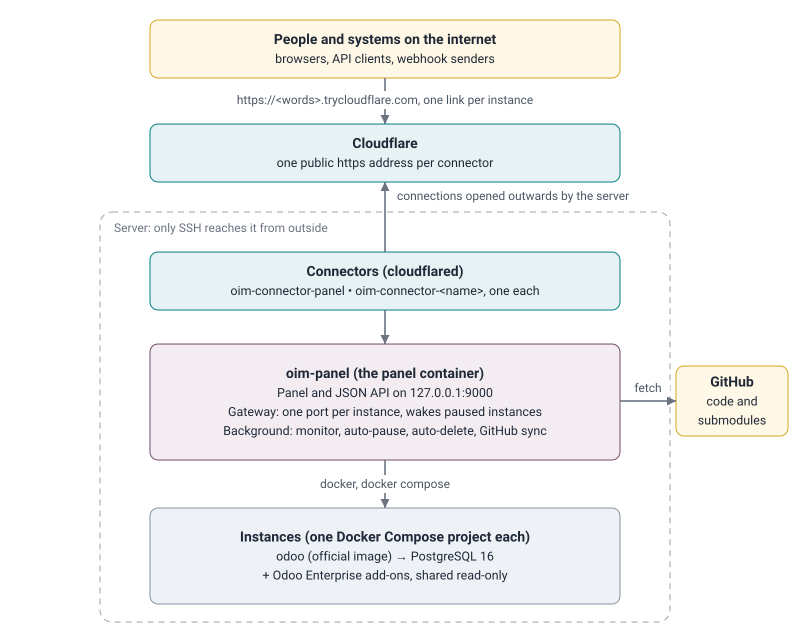

<div align="center">

# Odoo Instance Manager

**Turn any GitHub repository into a running Odoo instance, with its own HTTPS link, in about two minutes.**

[](https://github.com/Yosef-AlSabbah/odoo-instance-manager/actions/workflows/ci.yml)
[](LICENSE.md)
[](CONTRIBUTING.md)
<br>


Community and Enterprise · GitHub sync · No open ports · Auto-pause · Lifetime and backups · Roles and audit

[What it does](#what-this-panel-does) ·
[Quick start](#quick-start) ·
[Architecture](#architectural-position) ·
[Documentation](#documentation) ·
[Security](#security-at-a-glance) ·
[Installation](#installation--configuration) ·
[Limitations](#known-limitations) ·
[Contributing](#contributing)

</div>

> [!IMPORTANT]
> **Instances are for showing Odoo, not for real data.**
> Every instance opens with the Odoo login `admin` / `admin`, and
> anyone who has an instance's link can sign in with it. The public links are free Cloudflare links: they **change when
> the server restarts**, and the panel always shows the current ones. Panel accounts are different: they have
> strong generated passwords, stored only as hashes.

## Quick start

```bash
git clone https://github.com/Yosef-AlSabbah/odoo-instance-manager.git
cd odoo-instance-manager
sudo ./check-server.sh   # read-only check: Docker, memory, disk, internet access
sudo ./install.sh        # installs the panel and prints its link and first passwords
```

Open the printed link, sign in, and create your first instance. Requirements and settings are in
[Installation & Configuration](#installation--configuration).

## What This Panel Does

Odoo Instance Manager runs on the server and is used from a browser. Nobody has to install anything or run any
command to use it: people receive a link.

1. **Create an instance in a few clicks**: choose a GitHub repository, a branch, the Odoo version (18, 19 or 20) and the
   edition (Community or Enterprise). The name, the database, the ports and the passwords are generated. Two minutes
   later the panel shows the instance's own https link and its login. See [Creating an instance](docs/USER_MANUAL.md#4-creating-an-instance).
2. **One https link per instance**: every instance is reachable from anywhere through its own link, even though the server
   accepts no incoming connections. Browsers, API clients and webhook senders use it like any Odoo address. See
   [Tunneling](docs/concepts/TUNNELING.md).
3. **Stays in sync with GitHub**: the panel checks GitHub every 2 minutes; when a developer pushes, the instance pulls
   the code, upgrades only the modules whose files changed and restarts. Submodules (for example OCA repositories)
   can be updated, added and removed from the panel.
4. **Private repositories without personal tokens**: each private repository gets its own read-only deploy key,
   created by the panel and stored encrypted. See [Deploy keys](docs/concepts/DEPLOY_KEYS.md).
5. **Saves memory by itself**: an instance nobody opened for 6 hours is paused, and starts again by itself on the next
   visit (a "Starting up" page is shown for a few seconds).
6. **Restart, pause, switch off, delete**: from the list (Restart) or from the instance's page.
7. **Lifetime and backups**: each instance can be deleted automatically a set number of days after its creation
   (30 by default), or kept. The choice is made when creating it and can be changed later. Before any deletion,
   automatic or by hand, the database and files are saved as a standard Odoo backup, listed under **Backups**.
8. **Two roles**: administrators can do everything; sync operators can update code, update and add submodules,
   restart and start instances. When a sync operator cannot do something, the panel tells them to contact the
   administrator named in the settings (`ADMIN_CONTACT_NAME`).
9. **Watches the server**: CPU, memory and disk of the server and of every instance, with the last 30 minutes as small
   graphs.
10. **Explains itself**: plain-language messages when something fails, the technical log next to it, and this
   documentation inside the panel under **Documentation**.

---

## Architectural Position



Everything on the server listens on `127.0.0.1` only. The only ways in are the Cloudflare connectors (which the
server itself opened) and SSH for administrators. The full picture is in [Architecture](docs/ARCHITECTURE.md).

---

## Technologies and What We Gain From Them

| Technology | What it does here | What we gain |
| :--- | :--- | :--- |
| **Docker Engine** | Runs every Odoo, every PostgreSQL, the panel and the connectors as containers. | Instances are isolated from each other and from the server: one can break or be deleted without touching the others. See [Docker](docs/concepts/DOCKER.md). |
| **Docker Compose** | Describes each instance (Odoo + PostgreSQL + volumes) as one project. | One command starts, stops or removes a whole instance, and deleting leaves nothing behind. |
| **Official Odoo images** (`odoo:18.0`, `19.0`, `20.0`) | The Odoo program itself. | Nothing to build or maintain; every version behaves exactly as Odoo publishes it; a new version is a new tag. |
| **PostgreSQL 16** | The database of each instance. | Odoo's own database; one per instance, so instances never share data. |
| **Cloudflare Tunnel** (`cloudflared`, quick tunnels) | Gives the panel and every instance a public https address. | Works without any open port, free, https included, no domain needed. See [Tunneling](docs/concepts/TUNNELING.md). |
| **Python 3** | The panel's language. | Same language as Odoo, so every Odoo developer can read and fix it. |
| **Flask** | The panel's pages and JSON API. | Small, well known, signed session cookies built in. |
| **Gunicorn** | Serves the Flask app. | Production web server; threads let long actions run without blocking the page. |
| **aiohttp** | The gateway in front of every instance. | Streams large files and keeps thousands of WebSocket connections (Odoo's live updates) open with little memory. See [Gateway](docs/concepts/GATEWAY.md). |
| **cryptography** (AES-256-GCM) | Encrypts the secrets the panel must read back (deploy keys, Odoo master passwords). | Audited library; encryption that also detects any change to the stored value. See [Passwords and encryption](docs/concepts/PASSWORDS_AND_ENCRYPTION.md). |
| **scrypt** (Python standard library) | Hashes panel passwords. | Slow and memory-hungry on purpose, so stolen hashes are very expensive to guess. |
| **Git and SSH deploy keys** | Fetch code; read-only access to one repository per key. | No personal account or token whose owner might leave; each key can be revoked on its own. See [Git submodules](docs/concepts/GIT_SUBMODULES.md). |
| **Plain JavaScript modules** | The panel in the browser. | No build step and no npm packages: nothing to update, no third-party code in the browser. |
| **Python-Markdown** | Shows this documentation inside the panel. | One set of Markdown files, read on GitHub and in the panel. |
| **Alpine Linux** (`docker:27-cli` base image) | The panel's container. | Small image with the Docker command line already included. |

Why each of these was chosen over the alternatives is explained in [Architecture: why we chose this](docs/ARCHITECTURE.md#6-why-we-chose-this).

---

## Documentation

All documents are in [`docs/`](docs/README.md) and are also shown inside the panel under **Documentation**.

| Document | For | What it covers |
| :--- | :--- | :--- |
| [Documentation index](docs/README.md) | everyone | Where to find what, by question ("how do I...?") |
| [User manual](docs/USER_MANUAL.md) | administrators and sync operators | Every page and button of the panel, step by step |
| [Administrator guide](docs/ADMIN_GUIDE.md) | the server's administrator | Installing, settings, files, backups, Enterprise add-ons, troubleshooting |
| [API and webhooks](docs/API.md) | developers | Calling an instance's Odoo from other systems |
| [Architecture](docs/ARCHITECTURE.md) | developers | How the parts work together, and why we chose each of them |
| [Security](docs/SECURITY.md) | administrators, reviewers | Passwords, encryption, sessions, input checks, what is and is not protected |
| [Concepts](docs/README.md#concepts-explained-with-examples) | anyone curious | Tunneling, Docker, the gateway, deploy keys, submodules, passwords and encryption, web attacks; each with examples |

---

## Security at a Glance

| Topic | How it is handled |
| :--- | :--- |
| Reachability | Nothing listens on a public address. The panel, the gateway and Odoo listen on `127.0.0.1`; the way in is the Cloudflare connectors. |
| Panel passwords | Never stored. Only a salted, peppered **scrypt hash** is kept; the pepper comes from a key outside the accounts file. Sign-in is locked after repeated failures. |
| Stored secrets | GitHub deploy keys and Odoo master passwords are **encrypted with AES-256-GCM**. Odoo itself only receives a hash of its master password. |
| Input | Every value from a browser or API client is checked against an allow-list (type, length, characters, pattern) before use, and never passed through a shell. |
| Sessions | Signed, `HttpOnly`, `Secure`, `SameSite=Strict` cookie; signed out after 60 minutes without activity and after 12 hours. |
| Browser | CSRF token and same-origin check on every change; strict Content-Security-Policy; no inline scripts or styles; HSTS. |
| Roles and audit | Administrator and sync operator roles checked on the server; every sign-in, refusal and action is in the audit log. |

Details, and what is deliberately *not* protected, are in [Security](docs/SECURITY.md).

---

## Components

```
odoo-instance-manager/
├── README.md                      # this file
├── install.sh                     # installs or updates the panel on the server (run as root)
├── check-server.sh                # read-only check of the server: Docker, memory, disk, internet access
├── docs/                          # documentation, also shown in the panel
│   ├── README.md                  #   index
│   ├── USER_MANUAL.md, ADMIN_GUIDE.md, API.md, ARCHITECTURE.md, SECURITY.md
│   └── concepts/                  #   TUNNELING, DOCKER, GATEWAY, DEPLOY_KEYS, GIT_SUBMODULES,
│                                  #   PASSWORDS_AND_ENCRYPTION, WEB_ATTACKS
└── manager/                       # the panel container
    ├── Dockerfile                 # Alpine + Docker CLI + Python packages
    ├── docker-compose.yml         # the panel service (host network, Docker socket, /opt/odoo)
    ├── .env.example               # every setting, documented
    ├── wsgi.py                    # web server entry point (gunicorn wsgi:app)
    ├── manage.py                  # command line: accounts, current links
    └── instance_manager/
        ├── settings.py            # every setting and path, read once
        ├── shell.py               # runs commands without a shell
        ├── instances.py           # instance folders, .env files, names, ports
        ├── state.py               # last visit, paused, switched off
        ├── jobs.py                # background actions, one at a time per instance
        ├── odoo.py                # compose file, odoo.conf, database parameters, versions, editions
        ├── gitrepo.py             # git operations, finding modules
        ├── github.py              # deploy keys, git configuration, repository access checks
        ├── git_ssh.py             # gives git the right deploy key, decrypted only for one connection
        ├── vault.py               # AES-256-GCM encryption of stored secrets
        ├── tunnels.py             # Cloudflare connectors
        ├── gateway.py             # forwards visits to Odoo, wakes paused instances
        ├── status_pages.py        # "Starting up" and similar pages
        ├── monitor.py             # resource usage, status, public address follow-up
        ├── operations.py          # create, delete, back up, restart, start, pause, switch off, updates, submodules
        ├── backups.py             # Odoo-format backups (dump.sql + filestore + manifest.json)
        ├── background.py          # starts the monitor, auto-pause, auto-delete, GitHub polling, gateway, connectors
        ├── accounts.py            # accounts, password hashing, sign-in throttling
        ├── audit.py               # audit log
        ├── hints.py               # plain-language explanations of errors
        └── web/
            ├── __init__.py        # the Flask app
            ├── security.py        # sessions, CSRF, security headers, roles
            ├── validation.py      # checks every value received from outside
            ├── views.py           # pages
            ├── docs.py            # documentation pages
            ├── api_session.py     # sign-in, own account
            ├── api_accounts.py    # accounts, audit log
            ├── api_instances.py   # instances, actions, jobs, logs
            ├── api_github.py      # deploy keys, repository checks
            ├── api_backups.py     # backups: list, download, delete
            └── static/            # index.html, login.html, app.css, favicon.ico, js/ (one module per area)
```

### Rules of the layout

| Rule | Why |
| :--- | :--- |
| One module per responsibility, each with a docstring that says what it owns. | Anyone can find where a behaviour lives from the file name. |
| `web/` only receives requests, checks them and calls the other modules. | The work (operations, git, Docker) can be tested and reused without HTTP. |
| Every external command is a list of arguments, run without a shell (`shell.py`, `jobs.py`). | User input can never be interpreted as a command. |
| Every value from outside goes through `web/validation.py`. | One place to read and review all input rules. |
| One way to do each thing, no fallbacks. | When something fails, there is one path to look at. |
| No inline styles or scripts in the browser code. | Allows the strict Content-Security-Policy. |

---

## Installation & Configuration

Requirements: a Linux server with Docker and the Docker Compose plugin, at least 2 GB of memory (about 1 to 1.5 GB
per running instance) and outgoing internet access to GitHub, Docker Hub and Cloudflare. No incoming port is needed.

```bash
scp -r odoo-instance-manager user@SERVER:~
ssh user@SERVER
cd ~/odoo-instance-manager
sudo ./check-server.sh      # checks Docker, memory, disk and internet access; changes nothing
sudo ./install.sh           # installs or updates the panel
```

The installer prints the panel's link and, the first time, the passwords of the `admin` and `sync` accounts (shown
only once). Running `install.sh` again updates the panel; instances, accounts, keys and settings are kept.

Settings are in `/opt/odoo/manager/.env`:

| Setting | Default | Meaning |
| :--- | :--- | :--- |
| `ADMIN_CONTACT_NAME`, `ADMIN_CONTACT_PHONE`, `ADMIN_CONTACT_EMAIL` | Yousef M. Y. Al Sabbah | Who users are told to contact |
| `ODOO_VERSIONS` | `18.0,19.0,20.0` | Versions offered |
| `ODOO_ADMIN_PASSWORD` | `admin` | Odoo password of user `admin` in new instances |
| `IDLE_HOURS` | `6` | Pause after this many hours without visits |
| `DELETE_AFTER_DAYS` | `30` | Lifetime offered for new instances (each instance can be set to "keep") |
| `POLL_MINUTES` | `2` | Check GitHub this often |
| `SESSION_IDLE_MINUTES` | `60` | Sign-out after inactivity |
| `SESSION_MAX_HOURS` | `12` | Longest possible session |

Everything about running the server (files, backups, Enterprise add-ons, troubleshooting) is in the
[Administrator guide](docs/ADMIN_GUIDE.md).

---

## Testing

The panel is tested end to end on the real server, through the public links, the way users reach it:

| Area | Checked |
| :--- | :--- |
| Instances | Odoo 20 Enterprise created in under 2 minutes; backup before deletion restorable by Odoo, `web_enterprise` installed, 800+ Enterprise apps available; restart; pause; a visit wakes a paused instance in a few seconds; delete removes everything. |
| Odoo through its link | Sign-in `admin` / `admin`, JSON-RPC, XML-RPC, JSON-2 API with an API key, incoming webhook, 5 MB upload and download, 30 parallel calls, WebSocket, two instances signed in at the same time. |
| Security | Sign-in throttling, roles, CSRF and same-origin checks, session expiry, refused input (wrong types, too long, control characters, option-like branch names), encrypted deploy keys, Odoo accepting its hashed master password. |

How to repeat these checks is described in the [Administrator guide](docs/ADMIN_GUIDE.md#9-checking-that-everything-works).

---

## Known Limitations

* **Links change after a restart** of the server or of a connector. Permanent links need a Cloudflare account and a
  domain (about 10 USD a year); only the way connectors are started would change.
* **Cloudflare quick tunnels** carry at most 100 MB per request, end requests that take longer than about 100
  seconds, and have no uptime guarantee.
* **Memory**: about 1 to 1.5 GB per running instance. On a 3 GB server, keep one or two instances running; the
  others pause by themselves.
* **Python libraries** listed in a module's `requirements.txt` are not in the official Odoo image.
* **An instance's major version cannot be changed**; create a new instance for another version.
* **Updates start up to 2 minutes after a push** (GitHub is polled, not called back).
* **The vault key is on the same server** as the secrets it protects: it protects copies and backups of the data,
  not a person who already has full control of the server. See [Security](docs/SECURITY.md#7-what-is-not-protected).

---

## Odoo Enterprise Add-ons (Not Included)

This repository contains **no Odoo Enterprise code**. Enterprise add-ons are Odoo's proprietary modules, available
to Odoo partners and subscribers; each server needs its own copy. Community instances work without them.

To offer Enterprise for a version, put that version's add-ons on the server in this layout:

```
/opt/odoo/enterprise/
├── 18.0/                       one folder per Odoo version, named exactly like the version tag
│   ├── web_enterprise/         required: the panel offers Enterprise only when
│   │   └── __manifest__.py     <version>/web_enterprise/__manifest__.py exists
│   ├── account_accountant/
│   ├── ...                     every Enterprise module directly inside the version folder
├── 19.0/
└── 20.0/
```

Rules:

| Rule | Right | Wrong |
| :--- | :--- | :--- |
| The folder is named like the Odoo version in `ODOO_VERSIONS` | `19.0` | `19`, `v19`, `odoo-19`, `enterprise-19.0` |
| Modules sit directly inside the version folder | `19.0/web_enterprise/` | `19.0/enterprise/web_enterprise/` |
| The add-ons match the version of the folder | Odoo 19 add-ons in `19.0/` | Odoo 18 add-ons in `19.0/` |
| Readable by the Odoo containers | `chmod -R a+rX /opt/odoo/enterprise/19.0` | files readable by root only |

The **Edition** field in the panel then offers Enterprise for that version immediately. Upload commands are in the
[Administrator guide](docs/ADMIN_GUIDE.md#6-odoo-enterprise-add-ons). Enterprise databases must be registered with
your own Odoo subscription or partner code.

---

## Licensing & Terms

Licensed under the **[PolyForm Noncommercial License 1.0.0](LICENSE.md)**: the source is open to read, use, change
and share, for any **noncommercial** purpose.

| Allowed | Not allowed |
| :--- | :--- |
| Personal use, study, research, testing | Selling it, or selling a service built on it |
| Use by charities, schools, public bodies | Using it to make money for a company without permission |
| Changing it and sharing your changes under the same licence | Removing the licence or the copyright notice |

For commercial use, ask the author for a separate licence. Odoo is a trademark of Odoo S.A.; this project is not
affiliated with or endorsed by Odoo S.A.

---

## Contributing

Contributions are welcome: bug reports, documentation fixes and code.

* Read [CONTRIBUTING.md](CONTRIBUTING.md) for the setup, the rules of the code and the pull request flow.
* Use the [issue forms](../../issues/new/choose) for bugs and feature ideas.
* Report security problems privately, as described in [SECURITY.md](SECURITY.md).
* Everyone taking part follows the [Code of Conduct](CODE_OF_CONDUCT.md).

## Support

* **Documentation**: the [documentation index](docs/README.md), also inside the panel under **Documentation**.
* **Questions and help**: see [SUPPORT.md](SUPPORT.md).

## Maintainer

Built and maintained by [Yousef Al Sabbah](https://github.com/Yosef-AlSabbah), with help from
[every contributor](../../graphs/contributors).
