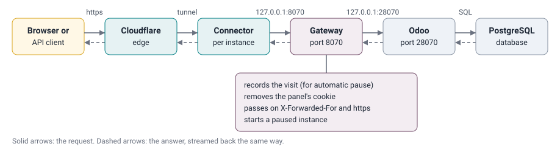
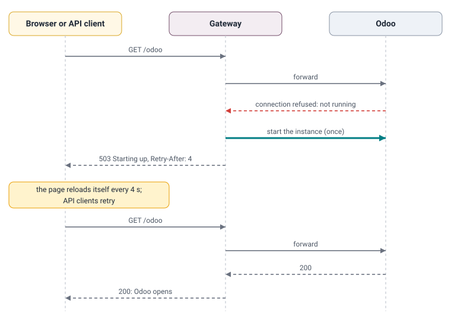
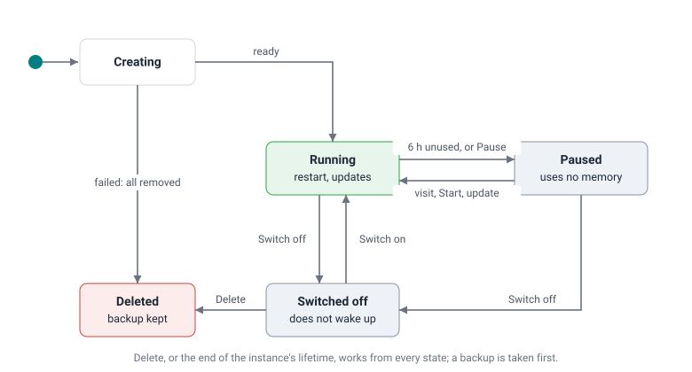
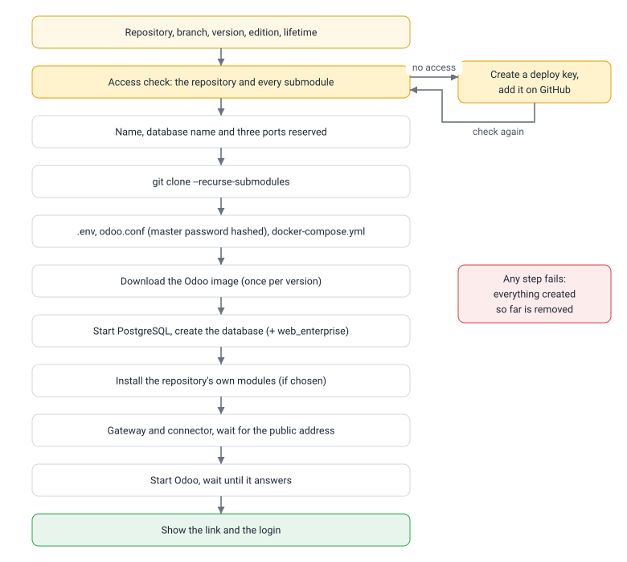
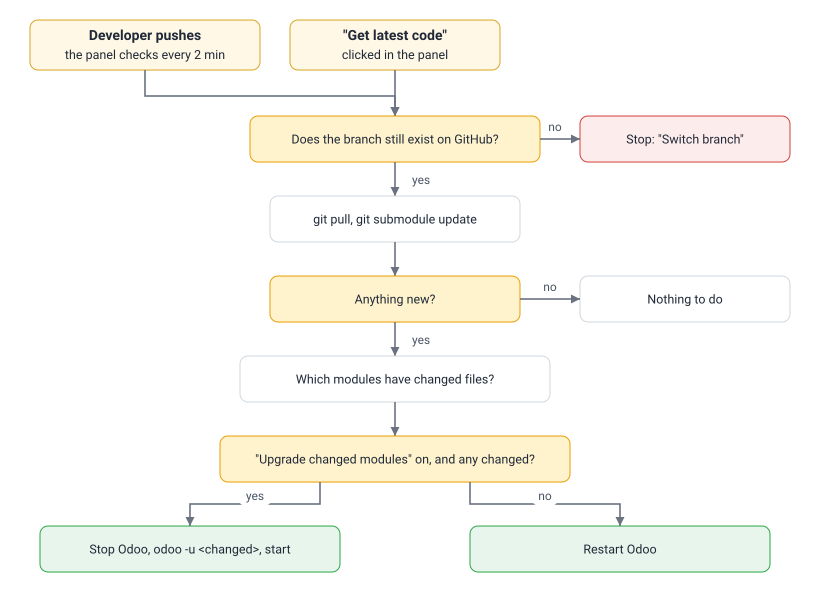

# Architecture

**Audience:** developers who change the panel, and anyone who wants to know how it works.
**Covers:** the parts, how a visit reaches Odoo, the life of an instance, how code arrives from GitHub, and why
each part was chosen.

---

## Contents

1. [The parts](#1-the-parts)
2. [How a visit reaches Odoo](#2-how-a-visit-reaches-odoo)
3. [Life of an instance](#3-life-of-an-instance)
4. [Creating an instance](#4-creating-an-instance)
5. [Code from GitHub](#5-code-from-github)
6. [Why we chose this](#6-why-we-chose-this)
7. [Conventions in the code](#7-conventions-in-the-code)

---

## 1. The parts

| Part | What it is | Where |
| :--- | :--- | :--- |
| **Panel** | Web pages and a JSON API (Flask, served by Gunicorn) on `127.0.0.1:9000`. | `instance_manager/web/` |
| **Gateway** | One small web server per instance (aiohttp) on `127.0.0.1:<gateway port>`. Forwards every request to that instance's Odoo. | `instance_manager/instances/gateway.py` |
| **Background work** | Threads in the panel's process: resource monitor (every 15 s), automatic pause (every 2 min), GitHub polling (every `POLL_MINUTES`). | `instance_manager/background.py`, `instances/monitor.py` |
| **Jobs** | Every action (create, update, restart...) runs as a job in its own thread, with steps, notes and a log. One job at a time per instance; others wait. | `instance_manager/core/jobs.py`, `instances/operations.py` |
| **Exposure plugin** | Makes the panel and each gateway reachable from outside. Default `cloudflare-quick`: one `cloudflared` container per target, opening an outgoing connection to Cloudflare. Alternative `host-ports`: the ports are opened on the server. | `instance_manager/exposure/` |
| **Add-on source plugin** | Provides the Enterprise add-ons of a version: an existing folder (`folder`) or a branch of a git repository (`git`). | `instance_manager/addons/` |
| **Settings** | Every setting, typed and checked at start-up (pydantic-settings). | `instance_manager/config.py` |
| **Instances** | One Docker Compose project per instance: an `odoo` container (official image) and a `db` container (PostgreSQL 16), two volumes. | `/opt/odoo/instances/<name>/` |

All of the panel (pages, gateway, background work, jobs) runs in **one container** and **one process**
(`oim-panel`), so they share their state in memory without a database or a message queue. The container uses
the server's network (`network_mode: host`), so `127.0.0.1` means the same inside and outside it, and the server's
Docker through `/var/run/docker.sock`.

Each instance uses three ports on `127.0.0.1`, chosen when it is created and stored in its `.env`:

| Port | Starts at | Used by |
| :--- | :--- | :--- |
| `GATEWAY_PORT` | 8069 | The gateway listens here; the instance's connector points here. |
| `ODOO_PORT` | 28069 | Odoo itself; only the gateway connects to it. |
| `CONNECTOR_METRICS_PORT` | 20300 | The connector reports its public address here. |

---

## 2. How a visit reaches Odoo

Odoo runs with `proxy_mode = True`, so it trusts the forwarded headers: it sees the visitor's real address and
knows the visit came over https. WebSocket connections (Odoo's live updates, `/websocket`) take the same path.

When the instance is **paused**, the gateway notices that Odoo does not answer, starts the instance once, and
answers in the meantime:

Browsers get a small page that reloads itself; API clients get plain text. Both get HTTP `503` with
`Retry-After`, which API clients and webhook senders understand as "try again shortly".

Each Odoo database also receives its public address, so links that Odoo writes (in e-mails, the portal, payment
and webhook pages) are right:

| Odoo system parameter | Value | Why |
| :--- | :--- | :--- |
| `web.base.url` | the instance's current link | links in e-mails, portal, payments, webhooks |
| `web.base.url.freeze` | `True` | otherwise Odoo replaces it with the address an administrator signs in from |
| `report.url` | `http://localhost:8069` | PDF reports load their styles from Odoo itself, not through the tunnel |

When a link changes (after a restart), the monitor sees it within 15 seconds and updates `web.base.url`.

---

## 3. Life of an instance

| State | What runs |
| :--- | :--- |
| Running | Odoo, PostgreSQL, connector |
| Paused | connector only (so a visit still reaches the gateway, which starts the rest) |
| Switched off | connector only; the gateway answers "Switched off" and does not start anything |

---

## 4. Creating an instance

If any step fails, everything created so far (containers, volumes, connector, folder) is removed, so the same name
can be used again. `addons_path` lists every folder of the repository that contains modules (including submodules
such as `oca/web`), then the Enterprise add-ons; it is recalculated on every start, restart and update.

---

## 5. Code from GitHub

How git reaches GitHub is configured once for every git command the panel runs (`github.configure_git`):

| Repository | Way |
| :--- | :--- |
| has a deploy key on the server | SSH with that repository's key (`git_ssh.py` decrypts it for the length of the connection) |
| any other | anonymous HTTPS (public repositories) |

Both `https://github.com/owner/repo` and `git@github.com:owner/repo` addresses, including those written in
`.gitmodules`, are mapped to that one way. See [Deploy keys](concepts/DEPLOY_KEYS.md) and
[Git submodules](concepts/GIT_SUBMODULES.md).

---

## 6. Why we chose this

Each decision lists what we chose, why, what it costs, and the alternatives we considered.

### Docker with the official Odoo image
- **Chosen:** the official `odoo:<version>` and `postgres:16` images, unchanged.
- **Why:** nothing to build or maintain; every version behaves exactly as Odoo publishes it; a new Odoo version is a
  new tag; instances cannot affect the server's own software.
- **Cost:** Python libraries that custom modules need (`requirements.txt`) are not included.
- **Considered:** our own image per project (more to maintain, slower to start an instance); installing Odoo directly on
  the server (versions would conflict with each other).

### One Docker Compose project per instance
- **Chosen:** every instance has its own Odoo container, its own PostgreSQL container and its own volumes.
- **Why:** instances are fully independent: one can be restarted, paused, broken or deleted without touching the
  others, and deleting removes everything it had.
- **Cost:** each PostgreSQL uses some memory (about 50 to 100 MB), more than one shared database server would.
- **Considered:** one PostgreSQL for all instances (less memory, but one instance's problem or restore could affect
  the others, and deleting would need careful clean-up).

### A gateway in front of every Odoo
- **Chosen:** visitors reach a small gateway in the panel, which forwards to Odoo. See [Gateway](concepts/GATEWAY.md).
- **Why:** a stopped Odoo cannot start itself, and Odoo does not know when it was last used. The gateway sees every
  request, so it records the last visit, starts a paused instance on the first request and shows clear pages
  ("Starting up", "Update in progress", "Switched off").
- **Cost:** the panel container must run for instances to be reachable; it restarts automatically with the server.
- **Considered:** nginx (cannot start a stopped container by itself); keeping every instance running (not enough memory).

### Cloudflare quick tunnels for public access
- **Chosen:** each destination (panel, every instance) has a `cloudflared` connector that connects out to Cloudflare
  and receives a free https address. See [Tunneling](concepts/TUNNELING.md).
- **Why:** the server is a container behind its provider's machine; only SSH is forwarded to it and the provider will
  not forward more. Outgoing connections are allowed, and a tunnel only needs outgoing connections. Quick tunnels
  need no account and no domain, cost nothing and include https.
- **Cost:** links change when the server or a connector restarts. The panel always shows the current links and
  updates each Odoo's own address automatically.
- **Considered:** opening ports (not available); SSH tunnels (every user, client and webhook sender would need SSH
  access); Tailscale Funnel (free and permanent, but account, expiring keys and one device per address); a Cloudflare
  named tunnel with our own domain (permanent links, needs a domain: the natural next step).

### One link per instance
- **Chosen:** every instance has its own link and Odoo runs at its normal paths.
- **Why:** Odoo cannot run under a sub-path such as `/instance/sales/`. A shared address would need a cookie to remember
  the instance, which breaks API calls, webhooks, links in e-mails and having two instances open at the same time.
- **Cost:** one small connector per instance (about 30 MB of memory).

### Read-only deploy keys for private repositories
- **Chosen:** one SSH deploy key per repository, created by the panel, added on GitHub by someone with admin rights on
  that repository. Repositories without a key are fetched anonymously over https. See [Deploy keys](concepts/DEPLOY_KEYS.md).
- **Why:** a deploy key gives read-only access to exactly one repository and belongs to no person: no personal
  account or token whose owner might leave, and each key can be revoked on its own.
- **Cost:** one key per private repository, including each private submodule.
- **Considered:** a personal access token (gives access to everything that person can see, expires, belongs to a
  person); a GitHub App (more setup than a server needs). Only one way is kept, so there is one path to debug.

### Update triggers as plugins: polling by default, webhooks where possible
- **Chosen:** what starts a code update is a list of trigger plugins (`UPDATE_TRIGGERS`). `polling` checks each
  branch every 2 minutes; `github-webhook` receives GitHub's push events, checked with GitHub's HMAC signature.
- **Why:** a webhook is immediate but needs a panel address that never changes; polling needs nothing from GitHub
  and nothing reachable from outside, so it works behind quick tunnels. Each server enables what fits it, or both.
- **Cost:** with polling only, an update starts up to 2 minutes after a push.

### An API for other systems: token and signature
- **Chosen:** `/api/v1`, authenticated by an API token (who calls; stored as a hash) and an HMAC-SHA256 signature
  over timestamp, nonce, method, path and body (the request is genuine, unchanged and new; the signing secret is
  stored encrypted). Read and write scopes. The endpoints reuse the panel's own views.
- **Why:** a token alone can leak through logs and proxies; the signature means a leaked token is not enough, and
  the timestamp and nonce stop replays. Reusing the panel's views keeps one set of input checks, roles and audit.
- **Considered:** the panel's session cookie (made for browsers, protected against exactly this kind of use);
  OAuth (an authorization server is more than a self-hosted panel needs); mutual TLS (hard to set up behind tunnels).

### A lifetime per instance, and a backup before every deletion
- **Chosen:** each instance is deleted a set number of days after its creation (30 by default) unless it is set to
  "keep"; the setting is chosen when creating it and can be changed later. Every deletion first writes a backup in
  Odoo's own format; if the backup fails, nothing is deleted.
- **Why:** instances are made for a purpose (a demo, a test, a review) and are easily forgotten; on a small server
  forgotten instances fill the disk. Counting from creation is predictable: the date is shown on the page. The backup
  means an automatic deletion can always be undone, with the tool every Odoo user already knows (Restore Database).
- **Cost:** backups are kept until someone deletes them, so they use disk space.
- **Considered:** deleting after a period without visits (an instance used once a month would disappear
  unexpectedly); pg_dump's custom format (smaller, but cannot be restored from Odoo's database manager).

### Upgrading only the modules that changed
- **Chosen:** after new code arrives, the panel compares the old and new commits (repository and submodules) and runs
  `odoo -u` only for modules whose files changed.
- **Why:** much faster and less risky than upgrading every module.

### Pausing after 6 hours without visits
- **Why:** the server has 3 GB of memory, enough for about two running instances. Paused instances use none and start
  again on the next visit in a few seconds.

### Hashing panel passwords, encrypting other secrets
- **Chosen:** panel passwords are hashed with scrypt and a pepper; deploy keys and Odoo master passwords are
  encrypted with AES-256-GCM; Odoo receives only a hash of its master password. See
  [Passwords and encryption](concepts/PASSWORDS_AND_ENCRYPTION.md).
- **Why:** a password only has to be checked, so it should never be readable, even by us; a deploy key has to be used,
  so it must be readable by the panel, but only by the panel. Keeping the key (`vault.key`) apart from the data means
  a copy of the data alone reveals nothing.
- **Cost:** `vault.key` must be backed up on its own. Losing it means recreating deploy keys and resetting panel
  passwords.
- **Not encrypted:** each instance's database password. The database is reachable only from that instance's Odoo
  container, on a private Docker network, and both must read it at every start; encrypting it would add moving parts
  without protecting anything an attacker could reach.

### One place that checks all input
- **Chosen:** every value received from a browser or API client goes through `web/validation.py`: type, length,
  allowed characters and pattern (allow-list), with a clear message when refused.
- **Why:** reviewing input rules is easy when there is one file to read, and nothing is "cleaned up" silently. See
  [Web attacks](concepts/WEB_ATTACKS.md).

### Plugins for everything that differs between servers
- **Chosen:** how instances are reached (`EXPOSURE`) and where Enterprise add-ons come from (`ENTERPRISE_SOURCE`)
  are plugins, found through Python entry points and created once with the settings. See [Plugins](PLUGINS.md).
- **Why:** servers differ: one accepts no incoming connection, another has a public address; one team keeps
  Enterprise in folders, another in git. Building one way in would force it on everyone. Entry points are the
  standard Python mechanism (pytest, Flask, Sphinx), so a plugin can live in its own package without changing the
  panel.
- **Cost:** two small interfaces to keep stable.
- **Considered:** if/else on a setting inside the core (every new option touches the core); a framework for
  dependency injection (more machinery than two interfaces need).

### Typed settings, locked dependencies, enforced checks
- **Chosen:** settings in one typed class (pydantic-settings); dependencies locked with uv (`uv.lock`); black, ruff,
  mypy and the tests run on every commit (pre-commit) and on every pull request (CI).
- **Why:** a wrong setting stops the panel at start-up with its name instead of failing later; every installation
  gets the same library versions; style and type mistakes are caught before review.
- **Considered:** the operating system's Python packages (versions differ between servers); pip with requirements
  files (no lock of indirect dependencies).

### Small, dependency-light software
- **Chosen:** Python with Flask (panel) and aiohttp (gateway, needed for streaming and WebSockets); plain JavaScript
  modules without a build step; panel data in small JSON files (accounts, state) instead of a database.
- **Why:** few moving parts, everything readable and fixable on the server, nothing extra to run or upgrade, no
  third-party JavaScript in the browser.

### An Odoo-like look
- **Chosen:** the panel uses Odoo's colours and patterns: control panel with breadcrumbs, list views, form sheets
  with a status bar and tabs, underlined fields, buttons on the left of dialogs.
- **Why:** the people who use the panel use Odoo every day; familiar patterns need no explanation.

### Documentation inside the panel
- **Chosen:** the Markdown files of this repository are shown under **Documentation**, and help links in the panel
  open the relevant page.
- **Why:** one set of documents, always the version that is running, readable without access to GitHub.

### Odoo login admin / admin
- **Why:** instances are shown to clients and colleagues; a predictable login avoids looking up passwords.
- **Cost:** anyone with an instance's link can sign in as administrator. Do not keep real customer data in instances. Change
  `ODOO_ADMIN_PASSWORD` to use another password for new instances.

### Enterprise add-ons shared read-only
- **Chosen:** the add-ons of each version are stored once on the server (where, is decided by the add-on source plugin)
  and mounted read-only.
- **Why:** one copy per version on disk, no instance can change them, updating them updates every instance.

---

## 7. Conventions in the code

| Convention | Example |
| :--- | :--- |
| Every module starts with a docstring saying what it owns. | `vault.py`: "Encryption of the secrets the panel must be able to read back." |
| Type hints everywhere; formatting by black; lint by ruff; mypy in strict-enough mode (`disallow_untyped_defs`). | `def address(self, target: Target) -> str \| None:` |
| Commands are lists of arguments, never shell strings. | `["git", "clone", "-b", branch, "--", url, path]` |
| One way to do each thing; no silent fallbacks. | A repository with a key is fetched over SSH, every other one over HTTPS, nothing else. |
| Errors shown to people are sentences that say what to do. | "This branch name is not valid." rather than a stack trace; the technical log is one click away. |
| Long actions are jobs with named steps. | "Downloading the code from GitHub", "Starting Odoo" |
| No inline styles or scripts in the browser code. | Every look is a class in `app.css`; every click goes through `data-act` in `main.js`. |

The full file list is in the [project overview](../README.md#components).
