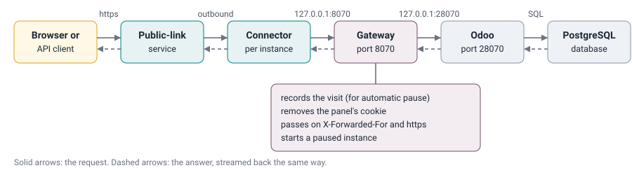
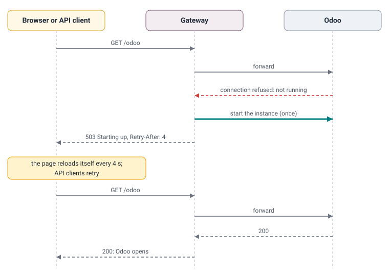
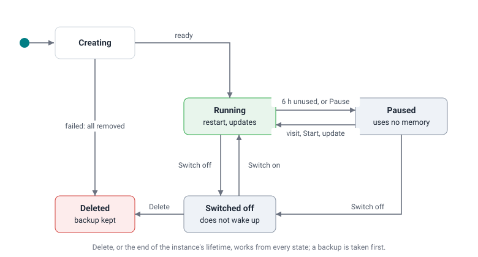
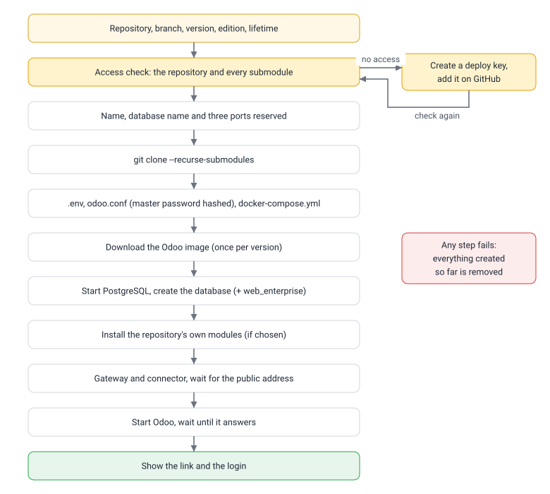
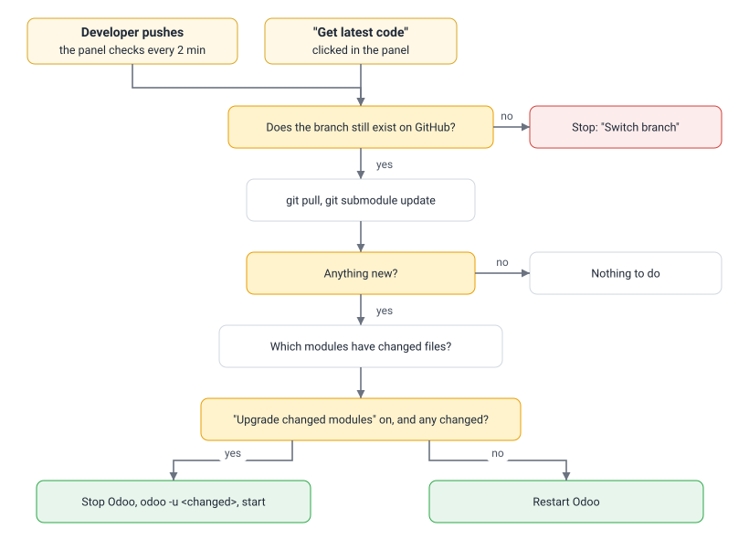

# Architecture

**Audience:** developers who change the panel, and anyone who wants to know how it works.
**Covers:** the parts, how a visit reaches Odoo, the life of an instance, how code arrives from GitHub, and why
each part was chosen.

---

## Contents

1. [The parts](#1-the-parts)
2. [How a visit reaches Odoo](#2-how-a-visit-reaches-odoo)
3. [Life of an instance](#3-life-of-an-instance)
4. [Creating an instance](#4-creating-an-instance)
5. [Code from GitHub](#5-code-from-github)
6. [Design decisions](#6-design-decisions)
7. [Conventions in the code](#7-conventions-in-the-code)

---

## 1. The parts

| Part | What it is | Where |
| :--- | :--- | :--- |
| **Web app** | The panel in the browser: React, TypeScript and SCSS design tokens, Chart.js for the live charts, built by Vite and served by Caddy (container `sudoo-web`) on `PANEL_PORT` (9000). Caddy forwards `/api`, `/hooks` and `/docs` to the backend and `/api/v1/events` to the live events. The design system is described in [Design](DESIGN.md). | `web/` |
| **Backend** | The API, `/api/v1` (Flask, served by Gunicorn, container `sudoo-panel`) on `127.0.0.1:API_PORT` (9002). | `sudoo/web/` |
| **Live events** | `/api/v1/events`: every change (jobs, instances, resource figures, settings) pushed to connected clients as Server-Sent Events, on the backend's asyncio loop (the one `gateway.py` runs), `127.0.0.1:9001`. Always in the backend. | `sudoo/core/events.py`, `web/v1/events.py` |
| **Gateway** | One small web server per instance (aiohttp) on its gateway port (`127.0.0.1` behind a tunnel or a proxy on the server; every address, over https, with `EXPOSURE=direct`), and, with direct, managed names or custom domains, ports 80 and 443 for every name, each with its certificate. Forwards every request to that instance's Odoo, and with direct the panel's own address to the web service. Runs in its own container, `sudoo-gateway` (`GATEWAY_MODE=service`, the default), or inside the backend (`embedded`). | `sudoo/instances/gateway.py`, `gateway_service.py`, `gateway_link.py` |
| **Mail catcher** | A small SMTP server in its own container, `sudoo-mail` (the panel's image, `sudoo.sh mailcatcher`), that staging and development instances send their e-mail to: nothing reaches real addresses. The backend connects it to those instances' networks, points their `odoo.conf` at it, switches off their own mail servers and reads the caught e-mails from `/opt/odoo/mail` for the Mail tab ([Admin guide](ADMIN_GUIDE.md#23-mail-catcher)). | `sudoo/mailcatcher/` |
| **Metrics** | Figures of the server and every instance (CPU, memory, requests, errors, response times, uptime, disk) with one hour of history, from the monitor and the gateway. | `sudoo/instances/metrics.py` |
| **Roles** | Five roles, each a set of named permissions; every endpoint and action checks a permission, never a role. | `sudoo/roles.py` |
| **Storage** | The panel's own data (accounts, tokens, audit log, instance state) in SQLite, behind a storage plugin. | `sudoo/storage/` |
| **Background work** | Threads in the panel's process: resource monitor (every `METRICS_INTERVAL_SECONDS`, 5 s, reading a continuous `docker stats` stream), automatic pause (every 2 min), automatic deletion (every 10 min), daily backups (checked every minute, run once `DAILY_BACKUP_TIME` has passed in `TIMEZONE`), GitHub polling (every `POLL_MINUTES`), alerts (the end of every job, and the server and instances every `METRICS_INTERVAL_SECONDS`; e-mail, webhooks, the bell). | `sudoo/background.py`, `instances/monitor.py`, `sudoo/alerts/` |
| **Backups** | Odoo-format zips (`dump.sql`, `filestore/`, `manifest.json`) in `BACKUPS_DIR`, named `<instance>__<database>__<YYYYMMDD-HHMMSS>__<kind>.zip`. Seven kinds: `manual`, `daily`, `deletion`, `before-restore`, `before-rollback`, `before-repair`, `before-update`; each instance keeps only its latest `daily`, `before-restore`, `before-rollback`, `before-repair` and `before-update` (taken before a code update, put back when it fails: `SAFE_UPDATES`), `before-restore` and `before-rollback` for `ROLLBACK_HOURS`. Restoring replaces an instance's database and filestore in place; a backup of another instance of the same Odoo series is loaded under the target's database name and neutralised. | `sudoo/instances/backups.py`, `instances/operations.py` |
| **Jobs** | Every action (create, update, restart...) runs as a job in its own thread, with steps (and a progress line on the running one), notes, a result and, when it fails, "Why it failed". Its technical log is a server log, never shown to users ([Jobs and their logs](#jobs-and-their-logs)). One job at a time per instance; others wait. | `sudoo/core/jobs.py`, `instances/operations.py` |
| **Exposure plugin** | Makes the panel and each gateway reachable from outside ([Public addresses](concepts/PUBLIC_ADDRESSES.md)). `direct` (the default of new installations): the gateway answers ports 80 and 443 itself with ACME certificates. `proxy`: the owner's reverse proxy in front, local ports and a trusted header with the visitor's address. `tunnel` (earlier name `cloudflare-quick`): one `cloudflared` connector container per target, opening an outgoing connection. `host-ports` (earlier option): the ports opened on the server. | `sudoo/exposure/`, `instances/panel_address.py` |
| **Add-on source plugin** | Provides the Enterprise add-ons of a version: an existing folder (`folder`) or a branch of a git repository (`git`). | `sudoo/addons/` |
| **Settings** | Every setting, typed and checked (pydantic-settings). Almost all can be changed on the Settings page while the panel runs, kept on top of `.env` with secrets encrypted. | `sudoo/config.py` |
| **Instances** | One Docker Compose project per instance: an `odoo` container (official image) and a `db` container (PostgreSQL 16), two volumes. | `/opt/odoo/instances/<name>/` |

The backend (API, live events, background work, jobs) runs in **one container** and **one process**
(`sudoo-panel`), so they share their state in memory without a message queue; the web app is a second, separate
container (`sudoo-web`) that holds no state. The gateways run in a third container, `sudoo-gateway`, so that
visitors keep reaching the instances while the backend restarts or is down (next section). All three use the
server's network (`network_mode: host`), so `127.0.0.1` means the same inside and outside them; only the backend
uses the server's Docker, through `/var/run/docker.sock`. A fourth, the mail catcher (`sudoo-mail`), is on no
network of the server: only on its own internal one and those of the staging and development instances.

Each instance uses three ports on `127.0.0.1`, chosen when it is created and stored in its `.env`:

| Port | Starts at | Used by |
| :--- | :--- | :--- |
| `GATEWAY_PORT` | 8069 | The gateway listens here; a proxy or the instance's connector points here. |
| `ODOO_PORT` | 28069 | Odoo itself; only the gateway connects to it. |
| `CONNECTOR_METRICS_PORT` | 20300 | With `tunnel` only: the connector reports its public address here. |

---

## 2. How a visit reaches Odoo

Odoo runs with `proxy_mode = True`, so it trusts the forwarded headers: it sees the visitor's real address and
knows the visit came over https. WebSocket connections (Odoo's live updates, `/websocket`) take the same path.

**The gateway service.** The gateway ports belong to the `sudoo-gateway` container (`sudoo.sh gateway`,
`instances/gateway_service.py`), not to the backend. It has no Docker socket, no `.env` and none of the panel's
data; it shares one folder with the backend, `<ODOO_ROOT>/gateway` (root only):

| File | Written by | What it is |
| :--- | :--- | :--- |
| `routes.json` | backend | Every instance's gateway and Odoo port and whether it is switched off, the address to listen on, the visitor-address header the exposure trusts, the gateway settings (also those changed in the panel), the names answered on ports 80 and 443 and, with `EXPOSURE=direct`, the panel's name, the server's own addresses and the web service's port; the production access rules (beta) and the key of the panel's passes. |
| `geo/` | backend | The country database of the access rules (`country.bin` and its manifest with a SHA-256, `country.json`), replaced atomically once a month (`instances/geoip.py`). |
| `visits.json` | gateway | The last visit of every instance; the backend takes newer ones into the instance state (automatic pause, daily backups). |
| `gateway.sock` | gateway | Control channel: `POST /sync` makes the gateway read `routes.json` and reconcile its listeners now, and answers with them, their errors and the requests counted since the last call (the backend adds them to the metrics); `GET /healthz` for the health check. |
| `panel.sock` | backend | `POST /wake/<name>`: the gateway asks the backend to start a paused instance. |

A Unix socket's path holds at most 107 bytes. When `<ODOO_ROOT>/gateway/gateway.sock` would be longer (a deep
ODOO_ROOT, as in a test run on one machine), both sockets go to `/tmp/sudoo-<hash of the gateway folder>/` (mode
`700`, refused when another user owns it), which the backend, the gateway service and its health check all derive the
same way. Containers each have their own `/tmp`, so keep ODOO_ROOT short where the two run in separate containers.

The backend (`instances/gateway_link.py`) runs one round every 2 seconds and at once when an instance is created or
deleted: write `routes.json` if it changed, `POST /sync`, read `visits.json`. While the backend is down, the gateway
keeps serving with the last `routes.json`, records visits and counts requests; a visitor of a **paused** instance
gets "Starting soon" (the page asks again every 4 seconds) until the backend is back and starts it. While the
gateway service does not answer, the backend serves the instances itself, exactly as in `embedded` mode: at once
when `gateway.sock` is missing (no service, or it stopped normally), after `GATEWAY_TAKEOVER_SECONDS` otherwise.
Both open the ports with `SO_REUSEPORT`, so a port is handed over without a moment where nobody listens. With
`GATEWAY_MODE=embedded` the backend writes `routes.json` with mode `embedded` and keeps the ports; a gateway service
that still runs then holds none.

When the instance is **paused**, the gateway notices that Odoo does not answer, starts the instance once, and
answers in the meantime:

Browsers get a small page that reloads itself; API clients get plain text. Both get HTTP `503` with
`Retry-After`, which API clients and webhook senders understand as "try again shortly".

Each Odoo database also receives its public address, so links that Odoo writes (in e-mails, the portal, payment
and webhook pages) are right:

| Odoo system parameter | Value | Why |
| :--- | :--- | :--- |
| `web.base.url` | the instance's current link | links in e-mails, portal, payments, webhooks |
| `web.base.url.freeze` | `True` | otherwise Odoo replaces it with the address an administrator signs in from |
| `report.url` | `http://localhost:8069` | PDF reports load their styles from Odoo itself, not through the public link |

When a link changes (after a restart), the monitor sees it within 15 seconds and updates `web.base.url`.

---

## 3. Life of an instance

| State | What runs |
| :--- | :--- |
| Running | Odoo, PostgreSQL (and its connector with `tunnel`) |
| Paused | nothing of its own, besides a connector with `tunnel` (a visit still reaches the gateway, which starts the rest) |
| Switched off | the same; the gateway answers "Switched off" and does not start anything |

Besides its files, each instance has a small record in the panel's storage (`core/state.py`, collection
`instance_state`):

| Field | Meaning |
| :--- | :--- |
| `last_visit` | The latest request through the gateway, or start; the automatic pause counts from it. |
| `used_since` | The first visit or start after the instance's last daily backup. Set by the gateway and by every start or restart, cleared when the daily backup starts. The daily backup loop backs up an instance only when `used_since` is earlier than the latest backup time. |
| `paused`, `switched_off` | Why the instance is stopped. |
| `branch_missing` | The branch no longer exists on GitHub. |

Visits are kept in memory and written at most every 30 seconds; the other fields are written at once.

### Jobs and their logs

A job (`core/jobs.py`) records what people see: its **steps** (each with when it started and, while it runs, a
**progress** line in plain words and a percentage when known: "Downloading Odoo 19.0: 2 of 5 parts" from the image
download, "Setting up the module sale" from Odoo's log while it installs or upgrades modules), its **notes**, its
**result** and, when it fails, **Why it failed** (`core/failure.py`): the step that failed, a plain-language reason
(`core/hints.py`; "Something went wrong in this step. The server's log has the details; your administrator can read
it." when nothing more specific applies) and the **error details**: only the lines that explain the failure, picked
by kind (repository access, git, Python requirements, tests, Odoo's errors with the tail of their traceback), at most
60, with addresses' passwords, tokens, the server's paths, IP addresses and container names removed. These go
through the API and the live event `job`.

The **technical log** (every command and everything it prints) is a server log. No endpoint, event, e-mail, alert or
download sends it to anyone, whatever their role. Each line goes to the backend's own log, prefixed with the job id
and the instance (`docker logs sudoo-panel`, `job 1a2b3c4d5e6f acme-dev: ...`), with `redact()` and the job's
masked secrets applied. The job also keeps it in memory, for the panel itself: the hints, the error details, a
build's Odoo warnings and test results. The instance's **Logs** tab shows Odoo's own log only (`odoo.log`).

**Backups and restores.** Jobs of kind `backup` take a `manual` backup (**Back up now**), a `daily` one (the daily
loop) or a `deletion` one (first step of a deletion). A backup starts only the database container of a paused
instance and stops it again afterwards. The `restore` job (permission `instances.restore`) saves a `before-restore`
backup, stops Odoo, drops and creates the database, loads `dump.sql` through `psql`, replaces the filestore through
a one-off container of the instance's Odoo image, sets `web.base.url` to the current link and starts Odoo. A
backup of another instance (checked against the Odoo series in its `manifest.json`) goes into the target's database
name and is neutralised (`odoo neutralize` in a one-off container on Odoo 16+, SQL otherwise) before Odoo starts; a
new instance can be created from one the same way instead of an empty database. The `rollback` job restores the
newest `before-restore` backup while it is younger than `ROLLBACK_HOURS`, after saving a `before-rollback` one (so it
never replaces its own snapshot); a background loop removes expired snapshots every five minutes when no job runs.

---

## 4. Creating an instance

If any step fails, everything created so far (containers, volumes, connector with `tunnel`, folder) is removed, so the same name
can be used again. `addons_path` lists every folder of the repository that contains modules (including submodules
such as `oca/web`), then the Enterprise add-ons; it is recalculated on every start, restart and update.

---

## 5. Code from GitHub

How git reaches GitHub is configured once for every git command the panel runs (`github.configure_git`):

| Repository | Way |
| :--- | :--- |
| has a deploy key on the server | SSH with that repository's key (`git_ssh.py` decrypts it for the length of the connection) |
| any other | HTTPS; when GitHub asks for credentials, git's credential helper (`git_credential.py`) hands it a read-only installation token of the panel's GitHub App installed on the repository's owner (`github_app.py`); public repositories need none |

Both `https://github.com/owner/repo` and `git@github.com:owner/repo` addresses, including those written in
`.gitmodules`, are mapped to that one way. See [Deploy keys](concepts/DEPLOY_KEYS.md) and
[Git submodules](concepts/GIT_SUBMODULES.md).

---

## 6. Design decisions

Each decision lists what was chosen, why, what it costs, and the alternatives that were considered.

### Docker with the official Odoo image
- **Chosen:** the official `odoo:<version>` and `postgres:16` images, unchanged.
- **Why:** nothing to build or maintain; every version behaves exactly as Odoo publishes it; a new Odoo version is a
  new tag; instances cannot affect the server's own software.
- **Cost:** Python libraries that custom modules need (`requirements.txt`) are not included.
- **Considered:** a custom image per project (more to maintain, slower to start an instance); installing Odoo directly on
  the server (versions would conflict with each other).

### One Docker Compose project per instance
- **Chosen:** every instance has its own Odoo container, its own PostgreSQL container and its own volumes.
- **Why:** instances are fully independent: one can be restarted, paused, broken or deleted without touching the
  others, and deleting removes everything it had.
- **Cost:** each PostgreSQL uses some memory (about 50 to 100 MB), more than one shared database server would.
- **Engines:** the operations reach Docker through an engine (`src/sudoo/engines/`), the Docker engine being the
  default; a Kubernetes engine (beta) runs the same instance as one namespace instead
  ([Kubernetes engine](KUBERNETES_ENGINE.md)).
- **Considered:** one PostgreSQL for all instances (less memory, but one instance's problem or restore could affect
  the others, and deleting would need careful clean-up).

### A gateway in front of every Odoo
- **Chosen:** visitors reach a small gateway, which forwards to Odoo. See [Gateway](concepts/GATEWAY.md).
- **Why:** a stopped Odoo cannot start itself, and Odoo does not know when it was last used. The gateway sees every
  request, so it records the last visit, starts a paused instance on the first request and shows clear pages
  ("Starting up", "Update in progress", "Switched off").
- **Cost:** the gateway must run for instances to be reachable; it restarts automatically with the server.
- **Considered:** nginx (cannot start a stopped container by itself); keeping every instance running (not enough memory).

### The gateway in its own container, waking through the backend
- **Chosen:** the gateways run in `sudoo-gateway`, without Docker access; to start a paused instance it asks the
  backend over a Unix socket (`panel.sock`). While the backend is down it shows "Starting soon" and asks again.
- **Why:** updating or restarting the backend no longer takes every instance offline, and the process that faces
  the internet holds no key to the server: the Docker socket is root on the host, so a gateway with it would be as
  powerful as the backend, which is exactly what the separation avoids. Running instances, and production instances
  (which never pause), do not need the backend at all; only waking a paused one waits for it.
- **Cost:** a paused instance cannot start while the backend is down; one more container (about 40 MB).
- **Considered:** the gateway starting the instance's two containers itself (needs the Docker socket, or a proxy
  that only allows `start` of `odoo-*` containers: still a way to Docker from the internet-facing process, and
  starting is not enough, since the backend first applies the instance's current configuration); a TCP port with a
  shared secret (a Unix socket in a root-only folder is unreachable from the network and the instances' containers,
  with nothing to leak).

### Public addresses through exposure plugins, the server's own ports by default
- **Chosen:** how the panel and the instances are reached is an exposure plugin. The default of new installations,
  `direct`, has the gateway answer ports 80 and 443 of the server for every name (the panel's name, managed names,
  custom domains), each with a certificate the panel gets and renews from an ACME authority (Let's Encrypt). The
  panel's own address is forwarded by the gateway to the web service on `127.0.0.1`, with the visitor's address in
  `X-Sudoo-Client-IP`. `proxy` fits servers behind the owner's reverse proxy; `tunnel` gives each destination a
  connector that connects out, for servers that accept no incoming connections. See
  [Public addresses](concepts/PUBLIC_ADDRESSES.md).
- **Why:** a server with a public address needs nothing in front of it: fixed addresses, https that ends on the
  server, nothing between the visitor and the server. The certificate code already served custom domains and
  managed names, so the panel's own name is one more name. Servers that cannot open ports still have the tunnel.
- **Cost:** ports 80 and 443 must be open; until the panel has a name it is served with its own certificate, which
  browsers warn about once. With `tunnel`, addresses change when a connector restarts.
- **Existing installations:** a `.env` without `EXPOSURE` keeps `tunnel`, the earlier default, and updates keep the
  value in `.env`, so no update changes how a running panel is reached.
- **Considered:** a separate reverse proxy container (Caddy or Traefik) in front (a second place that holds
  certificates and routes, kept in step with the panel's instances); SSH tunnels (every user, client and webhook
  sender would need SSH access); private networks such as Tailscale (every visitor would need the software).

### One link per instance
- **Chosen:** every instance has its own link and Odoo runs at its normal paths.
- **Why:** Odoo cannot run under a sub-path such as `/instance/sales/`. A shared address would need a cookie to remember
  the instance, which breaks API calls, webhooks, links in e-mails and having two instances open at the same time.
- **Cost:** one name per instance (a managed name or a custom domain, each with its certificate); with `tunnel`, one small connector per instance (about 30 MB of memory).

### One GitHub App per panel, deploy keys as the fallback
- **Chosen:** each panel registers its own private, read-only GitHub App through GitHub's App Manifest flow, and a
  super admin installs it on a personal account or organisations (all or selected repositories). The panel signs a
  short JWT with the app's private key, exchanges it for one-hour installation tokens, and hands them to git through
  a credential helper. Deploy keys (one SSH key per repository) stay for servers without an app. See
  [Administrator guide](ADMIN_GUIDE.md#15-the-github-app) and [Deploy keys](concepts/DEPLOY_KEYS.md).
- **Why:** an app belongs to no person (no personal token whose owner might leave), is read-only, covers every
  repository and submodule of an account in a few clicks, and brings one webhook for all of them, whose address the
  panel can update itself when the panel's public link changes. The manifest flow means no key or secret is ever copied by hand.
- **Cost:** a few minutes of setup per panel; the app is shown on GitHub under the account that created it.
- **Considered:** a personal access token (gives access to everything that person can see, expires, belongs to a
  person); deploy keys only (one key per private repository and submodule, a webhook per repository).

### Projects: one repository each, membership in the instance's own files
- **Chosen:** a project is one GitHub repository (as on Odoo.sh), kept as a document in the panel's storage
  (collection `projects`) with the stage chosen for each branch and the project's own options; an instance belongs
  to it through `PROJECT=<id>` in its `.env`. Existing instances join their repository's project when the panel
  starts (only that line is added: nothing restarts); plain Odoo, which has no repository, stays standalone. Branch
  stages decide how instances of the branch are made: development from a fresh database, staging from a neutralised
  copy of production, production from a fresh database with the production rules. Access to a project goes through
  one function (`projects/access.py`), today the panel-wide roles.
- **Why:** the instance's files stay the truth about the instance (a panel database restored from an older backup
  cannot move instances between projects); the project only adds what concerns several instances. One access check
  is the place where teams and per-project access attach later without touching the callers.
- **Cost:** listing a project's branches asks GitHub (`git ls-remote`, cached 30 seconds); staging copies of large
  production databases take time and disk while they are made.
- **Considered:** a project per instance group chosen by hand (no link to the repository, so pushes could not be
  routed); a "Plain Odoo" project for instances without a repository (branches that do not exist).

### Database upgrades run third-party upgraders in temporary containers
- **Chosen:** an upgrade to a newer Odoo version (`upgrades/`) is tested on a new staging instance of the target
  version before production is upgraded in place, like Odoo.sh. Enterprise databases go through Odoo S.A.'s upgrade
  service with Odoo's own upgrade script, which a temporary PostgreSQL-image container downloads and runs when the
  upgrade starts; Community databases go through OCA OpenUpgrade, whose sources a temporary container of the
  instance's target Odoo image downloads at a pinned commit. Production keeps a `before-upgrade` backup and the
  previous image, add-ons and commit, so a failure or a cancel puts everything back.
- **Why:** neither upgrader is bundled, copied or imported (OpenUpgrade and openupgradelib are AGPL-3.0; Odoo's
  script and service are Odoo S.A.'s, used under the customer's subscription); the panel only starts them and reads
  their results. Testing on a separate instance keeps production serving while people check the result.
- **Cost:** an upgrade needs Internet access from the server (GitHub and PyPI, or Odoo's platform), and disk for a
  backup and the dumps; Odoo's service needs the subscription code each time, so a push to the upgrade branch only
  re-runs the test automatically with OpenUpgrade.
- **Considered:** vendoring OpenUpgrade or Odoo's script in the image (licences, and pinned copies going stale);
  upgrading production without a test instance (no chance to look before users do).

### Update triggers as plugins: polling by default, webhooks where possible
- **Chosen:** what starts a code update is a list of trigger plugins (`UPDATE_TRIGGERS`). `polling` checks each
  branch every 2 minutes; `github-app` receives the panel's GitHub App events, `github-webhook` per-repository push
  events, both checked with GitHub's HMAC signature.
- **Why:** a webhook is immediate but needs a panel address that never changes; polling needs nothing from GitHub
  and nothing reachable from outside, so it works with links that change. Each server enables what fits it, or both.
- **Cost:** with polling only, an update starts up to 2 minutes after a push.

### An API for other systems: token and signature
- **Chosen:** `/api/v1`, authenticated by an API token (who calls; stored as a hash) and an HMAC-SHA256 signature
  over timestamp, nonce, method, path and body (the request is genuine, unchanged and new; the signing secret is
  stored encrypted). Read, instances (connected apps, least privilege) and write scopes; an optional signed
  `X-Sudoo-Acting-For` names the person a call is made for. The endpoints reuse the panel's own views.
- **Why:** a token alone can leak through logs and proxies; the signature means a leaked token is not enough, and
  the timestamp and nonce stop replays. Reusing the panel's views keeps one set of input checks, roles and audit.
- **Considered:** OAuth (an authorization server is more than a self-hosted panel needs); mutual TLS (hard to set up
  behind public-link services and proxies).

### A separate web app on top of the API
- **Chosen:** the browser part is its own service (`web/`, container `sudoo-web`): React with TypeScript, data
  through TanStack Query kept current by the live events, styles as SCSS design tokens, served by Caddy on the
  panel's port. The backend only answers `/api/v1`.
- **Why:** the front end can change, be restyled or be replaced without touching the backend; every page uses the
  same API as other systems; a modern, animated interface without giving up the strict Content-Security-Policy.
  Taking over the panel's port keeps the panel's public address: what is in front of it is not touched.
- **Considered:** the previous plain JavaScript pages served by Flask (no build step, but every page hand-built
  and hard to extend); server-rendered pages (every update a full round trip); Next.js (a Node server to run for
  pages that need none).

### One API for the web app and for other systems
- **Chosen:** the panel's web app calls the same `/api/v1` as other systems, with its session cookie and a CSRF
  token instead of a token and signature.
- **Why:** one set of endpoints, shapes and checks; whatever the web app can do, a script can do the same way, and
  a separate front end can be built on it without a private API.
- **Considered:** a private API for the web app (two APIs drift apart); API tokens in the browser (a token stored
  in a page can be stolen by any script on it; the HttpOnly session cookie cannot be read by scripts).

### Live events with Server-Sent Events
- **Chosen:** `GET /api/v1/events` streams every change as Server-Sent Events; the data of each event is the same
  document a `GET` returns. Recent events are kept so a reconnecting client receives only what it missed.
- **Why:** pages update the moment something happens, without asking every few seconds; one connection per tab
  instead of many requests. SSE is plain HTTP: it passes through public-link services and proxies, browsers
  reconnect by themselves, and it needs no library. The stream runs on the asyncio loop, so open tabs cost almost
  nothing.
- **Considered:** polling (slow to show changes, constant load); WebSockets (two-way, which the panel does not
  need, and more to proxy and secure); webhooks to the browser (a browser cannot receive them).

### Metrics in memory, measured where the traffic passes
- **Chosen:** the monitor reads a continuous `docker stats` stream and samples every `METRICS_INTERVAL_SECONDS`
  (5 seconds); the gateway, which every visit already passes, counts
  requests, 5xx answers and the time to Odoo's first byte (in the gateway service, the backend collects the counts
  every 2 seconds). One hour of samples is kept in fixed-size rings and
  served in columns; each new sample is a live event.
- **Why:** no extra service, agent or database, and no work in Odoo; the figures that matter for a demo server (is it
  slow, is it failing, is it full) come from the two places that already see everything.
- **Considered:** Prometheus and Grafana (two more services and their memory on a small server; the panel's API
  can still be scraped); keeping history on disk (an hour is what the dashboard shows; a restart losing it is
  acceptable).

### SQLite for the panel's own data, behind a storage plugin
- **Chosen:** accounts, API tokens, the audit log, instance state and creation times in one SQLite file
  (`sudoo.db`), through the `sudoo.storage` plugin interface; JSON files of earlier versions are moved in once.
- **Why:** transactions (two changes to one account cannot overwrite each other), queries over the audit log, and
  still nothing to install or run: SQLite is part of Python and the data is a few megabytes.
- **Considered:** JSON files (no transactions, the whole file rewritten for every change); PostgreSQL for the
  panel (a server to run and back up for little data; possible later as a plugin).

### No Redis
- **Chosen:** caches, rate-limit counters and live events stay in the panel's memory.
- **Why:** the panel is one process on one server; memory is faster than any network cache and costs nothing to
  run. Redis earns its place only when several panel processes must share counters and events; the rate limiter
  and event bus are small interfaces, so a Redis plugin can be added then.

### Second factors as plugins, required for administrators
- **Chosen:** authenticator apps (TOTP) and e-mail codes from the operator's own mailbox, behind
  `sudoo.second_factors`; `REQUIRE_SECOND_FACTOR=admins` by default; the authenticator (`sudoo.auth`) is a plugin
  too, so a company directory can replace local passwords.
- **Why:** an administrator can delete every instance; a leaked password must not be enough. TOTP costs nothing and
  works offline; e-mail needs nothing on the phone. SMS costs money per message and is the weakest of the three,
  so it is left to a plugin. Recovery codes (`auth/recovery.py`) come with the app, so a lost phone does not need
  an administrator; they are kept as keyed hashes only, like the other secrets that never need to be read back.

### E-mail texts as data, not templates
- **Chosen:** every e-mail is listed in `mail/catalog.py` with its built-in subject, title and text in a small plain
  format (placeholders, bold, lists, notes, buttons; `mail/textformat.py`); changes made on the E-mail templates page
  are stored in the panel's storage and checked against the e-mail's placeholders. Only the frame
  (`templates/layout.html`) is a Jinja template, and it is code, not something edited in the browser.
- **Why:** a template language run on text typed in a browser is a way to run code on the server (template
  injection). A fixed list of placeholders, escaped values and no logic keep every e-mail safe to edit, and an update
  can still change the built-in texts without overwriting someone's changes.

### Limits on requests and creations
- **Chosen:** requests per minute per user, token or address (sliding window, IETF `RateLimit` headers); instance
  limits per server and per user and a waiting time between creations, all changeable on the Settings page.
- **Why:** a script in a loop, a stolen token or a careless user must not be able to fill the server's memory with
  instances or keep the panel busy.

### Every setting in the website, `.env` as the base
- **Chosen:** `.env` gives the defaults; super admins change almost every setting on the **Settings** page,
  including the e-mail account; the changes are validated by the same model and kept in `settings.json` on top of
  `.env`, secrets encrypted with the vault key. Settings that choose a plugin apply after **Restart the panel**, which
  stops only the backend for a few seconds. Folders, ports, the exposure and the storage stay in `.env`, because the
  web container and Docker read them too.
- **Why:** running the panel should not need a shell on the server; `.env` stays the single description of how the
  server is set up, and **Use .env** always brings back its value.

### No default accounts: a first-run page with a setup code
- **Chosen:** the installer creates no account. It prints a one-time setup code; whoever opens the panel with it
  creates the first account (a super admin) with their own name, e-mail, phone and password.
- **Why:** default accounts with printed passwords are copied into chats and never changed. The code makes sure the
  person with access to the server, not whoever finds the new public link first, owns the panel.

### Roles as sets of permissions
- **Chosen:** five roles (super admin, administrator, maintainer, developer, viewer), each a set of fourteen named
  permissions; every endpoint and action checks a permission. The web app shows only what the role allows, and the
  backend checks again on every request.
- **Why:** teams differ: some let developers create instances, others only let them follow branches. A new role is
  a new set, without touching the checks.

### One command to install
- **Chosen:** one file per release, `sudoo-install.sh`, checks the server, installs what is missing after asking,
  and starts prebuilt, signed images pinned by digest; it prints the address and the setup code. The images are built
  by GitHub Actions for amd64 and arm64, so servers never build or download the source code.
- **Why:** the person installing a demo server is often not a system administrator. Everything else, including
  e-mail, happens in the website.

### A lifetime per instance, and a backup before every deletion
- **Chosen:** each instance is deleted a set number of days after its creation (30 by default) unless it is set to
  "keep"; the setting is chosen when creating it and can be changed later. Every deletion first writes a backup in
  Odoo's own format; if the backup fails, nothing is deleted.
- **Why:** instances are made for a purpose (a demo, a test, a review) and are easily forgotten; on a small server
  forgotten instances fill the disk. Counting from creation is predictable: the date is shown on the page. The backup
  means an automatic deletion can always be undone, with the tool every Odoo user already knows (Restore Database).
- **Cost:** backups are kept until someone deletes them, so they use disk space.
- **Considered:** deleting after a period without visits (an instance used once a month would disappear
  unexpectedly); pg_dump's custom format (smaller, but cannot be restored from Odoo's database manager).

### Daily backups of used instances, restored in place
- **Chosen:** once a day, at `DAILY_BACKUP_TIME` in `TIMEZONE`, each instance used since its last daily backup is
  backed up, and the new daily backup replaces the previous one. A restore puts a backup back into the same
  instance (or another instance of the same Odoo series, neutralised), after saving the current state as a
  `before-restore` backup that is offered as Rollback for `ROLLBACK_HOURS`.
- **Why:** people change data in an instance and want yesterday's state back with one click, without Odoo's database
  manager or the master password. Backing up only used instances keeps the nightly work and the disk use to what
  changed: an instance nobody opened still has its last daily backup. Keeping one daily and one before-restore
  backup per instance bounds the disk use; the before-restore backup makes a wrong restore undoable.
- **Cost:** only one day back: an older state is only available from a backup taken by hand. The backup runs while
  Odoo runs, so a change made during those seconds may or may not be in it.
- **Considered:** backing up every instance every night (much more disk and work for idle instances); keeping
  several days of daily backups (more disk on small servers; can be added as a setting later); restoring into a new
  instance next to the old one (two links and twice the memory for what is usually an undo).

### Upgrading only the modules that changed
- **Chosen:** after new code arrives, the panel compares the old and new commits (repository and submodules) and runs
  `odoo -u` only for modules whose files changed.
- **Why:** much faster and less risky than upgrading every module.

### Pausing after 6 hours without visits
- **Chosen:** on by default for new instances (`AUTO_PAUSE`), after `IDLE_HOURS`; both can be changed on the
  Settings page, and each instance has its own switch.
- **Why:** a server with 3 GB of memory runs about two instances at once. Paused instances use none and start
  again on the next visit in a few seconds.

### Hashing panel passwords, encrypting other secrets
- **Chosen:** panel passwords are hashed with scrypt and a pepper; deploy keys and Odoo master passwords are
  encrypted with AES-256-GCM; Odoo receives only a hash of its master password. See
  [Passwords and encryption](concepts/PASSWORDS_AND_ENCRYPTION.md).
- **Why:** a password only has to be checked, so it should never be readable, not even by the panel; a deploy key has to be used,
  so it must be readable by the panel, but only by the panel. Keeping the key (`vault.key`) apart from the data means
  a copy of the data alone reveals nothing.
- **Cost:** `vault.key` must be backed up on its own. Losing it means recreating deploy keys and resetting panel
  passwords.
- **Not encrypted:** each instance's database password. The database is reachable only from that instance's Odoo
  container, on a private Docker network, and both must read it at every start; encrypting it would add moving parts
  without protecting anything an attacker could reach.

### One place that checks all input
- **Chosen:** every value received from a browser or API client goes through `web/validation.py`: type, length,
  allowed characters and pattern (allow-list), with a clear message when refused.
- **Why:** reviewing input rules is easy when there is one file to read, and nothing is "cleaned up" silently. See
  [Web attacks](concepts/WEB_ATTACKS.md).

### Plugins for everything that differs between servers
- **Chosen:** how instances are reached (`EXPOSURE`) and where Enterprise add-ons come from (`ENTERPRISE_SOURCE`)
  are plugins, found through Python entry points and created once with the settings. See [Plugins](PLUGINS.md).
- **Why:** servers differ: one has a public address, another sits behind a proxy or accepts no incoming connection; one team keeps
  Enterprise in folders, another in git. Building one way in would force it on everyone. Entry points are the
  standard Python mechanism (pytest, Flask, Sphinx), so a plugin can live in its own package without changing the
  panel.
- **Cost:** two small interfaces to keep stable.
- **Considered:** if/else on a setting inside the core (every new option touches the core); a framework for
  dependency injection (more machinery than two interfaces need).

### Typed settings, locked dependencies, enforced checks
- **Chosen:** settings in one typed class (pydantic-settings); dependencies locked with uv (`uv.lock`); black, ruff,
  mypy and the tests run on every commit (pre-commit) and on every pull request (CI).
- **Why:** a wrong setting stops the panel at start-up with its name instead of failing later; every installation
  gets the same library versions; style and type mistakes are caught before review.
- **Considered:** the operating system's Python packages (versions differ between servers); pip with requirements
  files (no lock of indirect dependencies).

### Small, current dependencies
- **Chosen:** Python with Flask (API) and aiohttp (gateway and live events, for streaming); SQLite from Python's
  standard library; in the browser React, TanStack Query, Chart.js and lucide icons, all on their latest versions,
  pages loaded only when opened; Caddy as the only web server. Dependabot keeps them current.
- **Why:** few moving parts, nothing extra to run, and a first page that downloads about 130 KB of compressed code.

### A calm interface
- **Chosen:** graphite neutrals with Odoo's plum as the single accent; the platform's system font; translucent
  sidebar and top bar; motion only where it explains something (press feedback, origin-aware menus, sheets that
  leave the way they came, a quick fade out and in between pages); status shown only when it matters. Details in [Design](DESIGN.md).
- **Why:** people keep the panel open for hours; quiet chrome lets the instances and their figures read first, and
  motion that is fast and consistent makes the panel feel responsive rather than busy.

### Documentation inside the panel
- **Chosen:** the Markdown files of this repository are shown on the web app's **Help** pages, rendered by the
  backend with the same links and anchors as on GitHub.
- **Why:** one set of documents, always the version that is running, readable without access to GitHub.

### Odoo login admin / admin
- **Why:** instances are shown to clients and colleagues; a predictable login avoids looking up passwords.
- **Cost:** anyone with an instance's link can sign in as administrator. Do not keep real customer data in instances. Change
  `ODOO_ADMIN_PASSWORD` to use another password for new instances.

### Enterprise add-ons shared read-only
- **Chosen:** the add-ons of each version are stored once on the server (where, is decided by the add-on source plugin)
  and mounted read-only.
- **Why:** one copy per version on disk, no instance can change them, updating them updates every instance.

---

## 7. Conventions in the code

| Convention | Example |
| :--- | :--- |
| Every module starts with a docstring saying what it owns. | `vault.py`: "Encryption of the secrets the panel must be able to read back." |
| Type hints everywhere; formatting by black; lint by ruff; mypy in strict-enough mode (`disallow_untyped_defs`). | `def address(self, target: Target) -> str \| None:` |
| Commands are lists of arguments, never shell strings. | `["git", "clone", "-b", branch, "--", url, path]` |
| One way to do each thing; no silent fallbacks. | A repository with a key is fetched over SSH, every other one over HTTPS, nothing else. |
| Errors shown to people are sentences that say what to do. | "This branch name is not valid." rather than a stack trace; "Why it failed" shows the few lines that explain it, and the full technical log is in the server's log. |
| Long actions are jobs with named steps. | "Downloading the code from GitHub", "Starting Odoo" |
| The web app takes its look from tokens and talks to the backend only through `/api/v1`. | Colours, sizes and motion in `web/src/styles/_tokens.scss`; data through `web/src/api/queries.ts`. |
| Every permission check names a permission. | `@require("instances.create")`, `refuse_unless("instances.delete", ...)` |
| Where an instance runs goes through its engine, never straight to Docker. | `engines.of(name).up(job, name, "db")`, `engines.of(name).exec_cmd(name, "db", "psql", ...)` ([Kubernetes engine](KUBERNETES_ENGINE.md#2-the-engine-layer)) |

The full file list is in the [project overview](../README.md#components).
