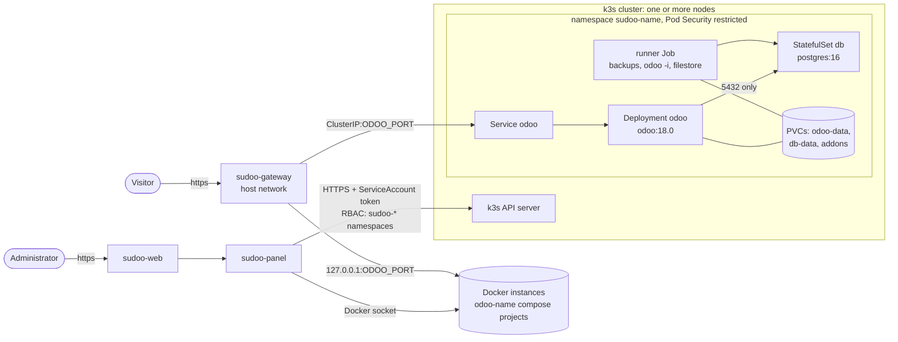

# Kubernetes engine (beta)

**Audience:** administrators who want to run instances on Kubernetes, and developers who change the engines.
**Covers:** the engine layer, how an instance runs on k3s, how each instance is kept apart from the others, the
panel's access to the cluster, how visitors reach Odoo, storage, backups, shells, logs, adding nodes, moving
instances between Docker and Kubernetes, the cost, and what is left for later phases.

> The Kubernetes engine is a **beta**. It is off until you set `KUBERNETES_ENGINE_BETA=true`
> ([Configuration](CONFIGURATION.md#kubernetes-engine-beta), installation in the
> [Admin guide](ADMIN_GUIDE.md#33-kubernetes-engine-beta)), and Docker stays the default engine of every new
> instance. Instances you already have keep running on Docker.

---

## Contents

1. [Why a second engine](#1-why-a-second-engine)
2. [The engine layer](#2-the-engine-layer)
3. [Architecture](#3-architecture)
4. [One namespace per instance](#4-one-namespace-per-instance)
5. [Isolation layers](#5-isolation-layers)
6. [The panel's access to the cluster](#6-the-panels-access-to-the-cluster)
7. [How visitors reach Odoo](#7-how-visitors-reach-odoo)
8. [Storage](#8-storage)
9. [Code and add-ons](#9-code-and-add-ons)
10. [Backups and restores](#10-backups-and-restores)
11. [Shell, logs, Connect as, mail catcher, names and certificates](#11-shell-logs-connect-as-mail-catcher-names-and-certificates)
12. [Nodes: adding servers to the cluster](#12-nodes-adding-servers-to-the-cluster)
13. [Moving instances between Docker and Kubernetes](#13-moving-instances-between-docker-and-kubernetes)
14. [Resources it costs](#14-resources-it-costs)
15. [Phases](#15-phases)
16. [Real high availability (later phase)](#16-real-high-availability-later-phase)

---

## 1. Why a second engine

Today the panel runs every instance as a Docker Compose project on the server it is installed on, through the Docker
socket. That is simple and fast, and it stays the default. It has two limits:

* **One server per panel** (or one agent per server with the premium package "servers"): an instance cannot use
  another server's free memory.
* **The Docker socket is root on the server.** The panel needs it to run containers, so anyone who takes over the
  panel's process owns the server.

What k3s (a small Kubernetes) gives today:

* **Easier growth.** A new server joins the cluster with one command from the panel, and new instances are placed on
  a node with room.
* **Stronger isolation.** The panel talks to the cluster's API with a ServiceAccount whose rights stop at its own
  namespaces (RBAC and an admission policy, not the Docker socket), every instance has default-deny network policies,
  and Pod Security `restricted` keeps containers from reaching the node.

What it does **not** give, yet: **high availability.** Spreading instances or branches over several nodes is not the
same as an instance surviving a failed server. With the `local-path` storage of this beta, a volume lives on one
node's disk: when that node is lost, the instances whose volumes were there are lost with it, and they come back only
from a backup. Two k3s servers are not highly available either: the cluster's embedded etcd needs an odd number of
server nodes, at least three. What real high availability needs is in [section 16](#16-real-high-availability-later-phase),
a later phase. k3s runs on a single VPS, so you can start with one server and add nodes later.

---

## 2. The engine layer

The panel's operations (create, start, stop, back up, restore, update, delete) are written once, as steps that do not
depend on the platform: start the database, run `odoo -i base` once, start Odoo, run `psql` in the database, stream
the filestore out, read Odoo's log. An **engine** turns each step into what its platform needs
(`src/sudoo/engines/base.py`):

| Group | Methods | Docker (`engines/docker.py`) | Kubernetes (`engines/kubernetes/`) |
| :--- | :--- | :--- | :--- |
| Definition | `prepare_images`, `apply`, `remove_leftovers` | download images; write the hardened compose file (`integrity.apply`); remove old containers and volumes | nothing to download (each node pulls); apply the instance's objects (server-side apply); delete an old namespace |
| Lifecycle | `up`, `stop`, `restart`, `remove` | `docker compose up / stop / restart / down -v` | scale the Deployment and StatefulSet to 1 or 0 and wait; delete the Odoo pod; delete the namespace |
| Commands | `exec_cmd`, `odoo_cmd`, `copy_out_cmd`, `filestore_cmd`, `logs_cmd` | `docker exec`, `docker compose run`, `docker cp`, `docker logs` | the same steps through the Kubernetes API (exec, a runner Job, pod logs) |
| Shell | `terminal()` | the Docker Engine API (`webshell/docker_exec.py`) | exec with a terminal over the API's WebSocket |
| Facts | `odoo_host`, `observe` | `127.0.0.1`; figures from the monitor's `docker stats` stream | the Service's cluster address; pod status and metrics-server figures |

Commands are argument lists, run like every other external command of the panel (`core/shell.py`, `Job.run`), never
through a shell. An instance's engine is the `ENGINE` key of its `.env`; no key means Docker, which is what every
instance created before engines existed has.

---

## 3. Architecture



The panel, the gateway and the web app stay Docker containers on the first server, which is also the k3s server
node. The panel keeps every instance's files in `<ODOO_ROOT>/instances/<name>/` (`.env`, `odoo.conf`, the git
checkout), whatever its engine: only where Odoo and PostgreSQL run changes. Its state, jobs, backups folder, audit log
and settings are the same for both engines.

---

## 4. One namespace per instance

Each Kubernetes instance gets its own namespace, `sudoo-<name>` (instance names are at most 31 lowercase letters,
digits and dashes, so every name fits).

**Why per instance and not per project.** An instance is the panel's unit everywhere: one job at a time, one gateway
port, one backup series, one deletion, one quota. With Docker it is one Compose project; with Kubernetes it is one
namespace. A per-project namespace would mix production with its staging and development copies inside one trust
boundary, make quotas per project only, and turn "delete this instance" into deleting a selection of objects instead
of a namespace. The project is still recorded, as the label `sudoo.sh/project` on the namespace, for reports.

| Object | Name | What it is |
| :--- | :--- | :--- |
| Namespace | `sudoo-<name>` | labels `app.kubernetes.io/managed-by=sudoo`, `sudoo.sh/instance`, `sudoo.sh/stage`, Pod Security `restricted` |
| Secret | `odoo-config` | `odoo.conf` (it holds the database password and the master password's hash), mounted read-only at `/etc/odoo` |
| Secret | `db` | the PostgreSQL password |
| PersistentVolumeClaims | `odoo-data`, `db-data`, `addons` | Odoo's filestore and sessions; PostgreSQL's data; the code |
| StatefulSet + Service | `db` | PostgreSQL 16, one replica, reached as `db:5432` (the name `odoo.conf` uses with Docker too) |
| Deployment + Service | `odoo` | the official Odoo image, one replica, `Recreate` strategy (its volumes are ReadWriteOnce) |
| Job | `odoo-run-<id>` | short-lived runner: `odoo -i base`, `odoo shell`, `odoo neutralize`, the filestore of a backup or a restore |
| NetworkPolicies | `default-deny`, `dns`, `odoo-to-db`, `db-from-odoo`, `odoo-from-gateway` | below |
| ResourceQuota, LimitRange | `sudoo` | below |
| RoleBinding | `sudoo-panel` | the panel's rights in this namespace (section 6) |

Pausing scales the Deployment and the StatefulSet to zero: no pod runs, the volumes stay. Deleting removes the
namespace, and with it every object and volume (a backup is taken first, as with Docker).

---

## 5. Isolation layers

Each layer stops something different; together they keep one instance from reaching another, or the node.

| Layer | What it does | What it stops |
| :--- | :--- | :--- |
| Namespace | Every object of an instance lives in its own namespace; the panel's rights are given per namespace | names, Secrets and volumes of one instance are invisible to another |
| NetworkPolicy, default deny | No pod may receive or send anything unless a policy below allows it, in both directions | a compromised Odoo reaching other instances, the node's services or the internet |
| NetworkPolicy, allowed paths | Odoo to its own PostgreSQL on 5432; every pod to the cluster DNS; Odoo from the gateway's node addresses on its ports only | another namespace's pods reaching this PostgreSQL or this Odoo |
| Pod Security `restricted` | Enforced on the namespace (and, with the installer, by default on every namespace): non-root users, no privilege escalation, every capability dropped, `RuntimeDefault` seccomp, no host paths, ports, network or processes | a container escaping to the node |
| ResourceQuota and LimitRange | Caps CPU, memory, pods, volumes and storage of the namespace; default requests and limits for every container | one instance starving the node or filling its disk |
| Separate volumes | Each instance has its own PersistentVolumeClaims; nothing is shared between namespaces | reading another instance's files |
| Secrets | `odoo.conf` and the database password are Secrets (encrypted at rest with the installer's `--secrets-encryption`), never environment variables of the panel | passwords in plain text on the node's disk |

The Odoo and PostgreSQL containers run as their images' own users (Odoo `100:101`, PostgreSQL `999:999`) with
`fsGroup` set so they can write their volumes. Nothing runs as root, and no shell can (section 11).

**The gateway's path through the policy.** The gateway runs on the server node's host network. Traffic from a node to
a pod on the same node is allowed by k3s's policy controller, which also lets the kubelet's probes in. Traffic that
crosses to another node arrives from that node's flannel address: the panel adds `ipBlock` rules for the network and
bridge addresses of every node's pod range (`10.42.N.0/32` and `10.42.N.1/32`), which pods themselves never have, and
refreshes them whenever it applies an instance. A pod in another namespace has an address from the same ranges, but
never one of these two, so it stays out.

---

## 6. The panel's access to the cluster

With Docker, the panel holds the Docker socket, which is root on the server. With Kubernetes, the panel holds a
ServiceAccount token (`sudoo-system/sudoo-panel`) whose rights are written by `scripts/k3s-prepare.sh`:

| Grant | Where | Rights |
| :--- | :--- | :--- |
| ClusterRole `sudoo-panel` | the whole cluster | namespaces: create, read, update, delete; nodes and node metrics: read; RoleBindings: create, read, update, delete; `bind` on the ClusterRole `sudoo-instance` only |
| ClusterRole `sudoo-instance` | bound by the panel, per namespace, through a RoleBinding it creates in each `sudoo-<name>` | Pods (with exec and logs), Deployments, StatefulSets, Jobs, Services, ConfigMaps, Secrets, PersistentVolumeClaims, NetworkPolicies, ResourceQuotas, LimitRanges, pod metrics |
| Role `sudoo-join` | `kube-system` | Secrets: create (nothing else: it cannot read any) |

Kubernetes' role-based access cannot limit "create" or "delete" by a name prefix, so a **ValidatingAdmissionPolicy**,
`sudoo-panel-scope` (also written by the installer), checks every change the panel's ServiceAccount asks for:

* namespaces: only names starting with `sudoo-` (never `sudoo-system`), with the label
  `app.kubernetes.io/managed-by=sudoo` and Pod Security `enforce=restricted` (so the panel can never relax it);
* RoleBindings: only in those namespaces, and only to the ClusterRole `sudoo-instance`;
* Secrets in `kube-system`: only k3s bootstrap tokens for joining nodes (type `bootstrap.kubernetes.io/token`, group
  `system:bootstrappers:k3s:default-node-token`, with an expiry).

The result: the panel can do anything inside its own namespaces and nothing outside them. It cannot read Secrets of
`kube-system` or of any other namespace, run privileged pods, mount the node's disk or change cluster settings. If
the panel is taken over, the attacker gets the instances (as with any panel), not the nodes. `SECURITY.md` and
[Security](SECURITY.md) say the same for reviewers.

The panel reads its access from a kubeconfig file (`KUBERNETES_KUBECONFIG`, written by the installer with the
ServiceAccount's token and the cluster's certificate authority) or, when the panel itself runs in the cluster, from
the in-cluster ServiceAccount (`KUBERNETES_MODE=in-cluster`). It speaks plain HTTPS to the API (no client library):
JSON for objects (server-side apply, field manager `sudoo`), and the `v5.channel.k8s.io` WebSocket protocol for exec,
which can close a command's input (needed to load a database dump).

---

## 7. How visitors reach Odoo

**Chosen: the panel's own gateway, to each instance's ClusterIP Service.** The Service `odoo` of an instance listens
on the instance's `ODOO_PORT` (and `ODOO_GEVENT_PORT` with workers) and forwards to Odoo's 8069 (8072). Its cluster
address is kept in the instance's `.env` (`ODOO_HOST`) and in the gateway's `routes.json`, so the gateway forwards
there instead of to `127.0.0.1`. The gateway runs on the server node's host network, where kube-proxy makes every
ClusterIP reachable, whatever node the pod runs on.

Why not the alternatives:

| Option | Why not (for now) |
| :--- | :--- |
| NodePort | Opens the port on every interface of every node, public ones included, unless each node's firewall is set; ports are limited to 30000-32767 |
| An ingress controller (Traefik, which k3s ships) | A second reverse proxy with its own certificates, while the gateway already does visits, waking paused instances, "switched off" pages, managed names, custom domains and ACME. The installer disables Traefik. An ingress becomes worthwhile when the panel runs outside the cluster or when nodes serve visitors directly (phase 4) |
| `hostPort` | Forbidden by Pod Security `restricted`, and only reaches pods on the panel's node |

So everything the gateway does today (visits, automatic pause and wake, status pages, managed names, custom domains,
certificates, the tunnel and proxy exposures) works unchanged for Kubernetes instances.

---

## 8. Storage

* **Now: `local-path`**, the storage class k3s ships. Each volume is a folder on the node the pod first runs on, and
  the pod is tied to that node. Fast and simple; a node that is lost takes its instances' data with it, so backups
  matter as with Docker. The storage class is a setting (`KUBERNETES_STORAGE_CLASS`).
* **Later: Longhorn** (phase 5, [section 16](#16-real-high-availability-later-phase)): replicated volumes across
  nodes, so an instance could restart on another node, and volume snapshots. It needs three nodes to be worth it and
  about 500 MB of memory per node.

Sizes: `KUBERNETES_DB_SIZE_GB`, `KUBERNETES_FILES_SIZE_GB` and `KUBERNETES_ADDONS_SIZE_GB` (local-path does not
enforce them; the ResourceQuota counts them).

---

## 9. Code and add-ons

The panel keeps cloning and updating each instance's repository in `<ODOO_ROOT>/instances/<name>/addons`, with its
GitHub App or deploy keys, exactly as for Docker: credentials never enter the cluster. After every change of the code,
and before every start, the panel copies the checkout (without `.git`) into the `addons` volume through a runner Job
(a `tar` stream over exec). Odoo mounts that volume read-only at the same path as with Docker
(`/mnt/extra-addons`), so `addons_path` in `odoo.conf` is the same.

An init container doing its own `git clone` was considered and set aside for now: it would need the repository's
credentials inside the cluster, and the panel's update, rollback and submodule logic would have to be repeated there.

Enterprise add-ons are not copied in the beta (an Enterprise instance cannot use the Kubernetes engine yet; phase 3).

---

## 10. Backups and restores

Backups keep the panel's Odoo-format zip (`dump.sql`, `filestore/`, `manifest.json`) in the same backups folder, with
the same names and kinds, so a backup made on one engine restores on the other.

1. The database: `pg_dump` runs in the PostgreSQL pod through exec; its output streams to the panel.
2. The filestore: a **runner Job** (`odoo-run-<id>`: the Odoo image, the instance's volumes, the same non-root user,
   a deadline) is started; `tar` of `/var/lib/odoo/filestore/<db>` runs in it through exec and streams to the panel.
   It works while Odoo is paused. The Job is deleted at the end.
3. The panel writes the zip, as for Docker. Daily backups use the same loop and `DAILY_BACKUP_TIME`.

A restore stops Odoo, recreates the database and loads `dump.sql` through `psql` in the PostgreSQL pod (exec, with
the input closed at the end), replaces the filestore through a runner Job, and starts Odoo. `odoo -i base`,
`odoo shell` and `odoo neutralize` run in runner Jobs the same way.

---

## 11. Shell, logs, Connect as, mail catcher, names and certificates

| Feature | Kubernetes engine |
| :--- | :--- |
| **Shell tab** | Exec with a terminal over the API's WebSocket, into the running Odoo or PostgreSQL pod, after checking it is that instance's pod (namespace, labels, not privileged, no host network or processes). The same tickets, limits, recordings and permissions as with Docker. Root shells are refused: Pod Security forbids root. |
| **Logs tab** | The Odoo pod's log through the API (`timestamps`, `tailLines`, `sinceTime`, `follow`), in the same format as `docker logs --timestamps`, so the same filters and live view work. |
| **Connect as** | Uses the gateway and a database query, both engine-independent; it works once phase 3 routes its query through `exec_cmd` (it uses `docker exec` today). |
| **Mail catcher** | Not in the beta. A Kubernetes instance's Odoo cannot send e-mail at all (its egress is denied except to its database and DNS), so no staging or development e-mail can leave. Phase 3: the mail catcher as a Service in `sudoo-system`, with an egress rule to it. |
| **Managed names, custom domains, certificates** | Unchanged: they live in the gateway, which reaches the instance's Service. |
| **Status and figures** | Each monitor cycle reads the instance's pods (running, ready, start time) and, when metrics-server runs (k3s ships it), their CPU and memory. |

---

## 12. Nodes: adding servers to the cluster

k3s nodes join a server with a token. The panel creates a **k3s bootstrap token** (a Secret in `kube-system` that
k3s accepts for joining, valid for `KUBERNETES_JOIN_TOKEN_MINUTES`), prefixes it with the hash of the cluster's
certificate authority (so the new node checks it talks to your cluster), and shows the exact command once:

```bash
curl -sfL https://get.k3s.io | INSTALL_K3S_VERSION='<the server version>' \
  K3S_URL='https://<server address>:6443' K3S_TOKEN='K10<ca hash>::<id>.<secret>' sh -s - agent
```

The token is never stored by the panel: it exists only in the cluster (until it expires) and in that one answer. The
nodes list shows each node's name, roles, status, version, CPU and memory, and what is used now (metrics-server).

Adding nodes means running instances on several servers, which is what the premium package **servers** sells
(Business plans): the "Add a node" action answers 402 with the plans that include it when that package does not run.
The list of nodes is always shown.

---

## 13. Moving instances between Docker and Kubernetes

A move between engines is the same backup and restore the panel uses for moves between servers:

1. the instance is switched off (the downtime starts);
2. a backup is taken on its current engine;
3. what runs on the old engine is removed (containers and volumes, or the namespace); the folder, the `.env`, the
   code and the state stay;
4. `ENGINE` is changed, the new engine's objects are written, the database starts and the backup is restored into
   it (not neutralised: it is the same instance);
5. Odoo starts on the new engine and must answer; the gateway follows the new address.

If a step fails, the new engine's objects are removed, `ENGINE` goes back, and the backup is restored on the old
engine. The core has this as the job `change-engine`
(`POST /api/v1/instances/<name>/actions/change-engine`, body `{"engine": "kubernetes"}`, permission
`instances.move`). The premium package **servers** shows it in its **Move** dialog as a target "this server,
Kubernetes" (its part: list the target, call the action, show the job); a move to another server's cluster is a move
to that server with the engine given in the plan (phase 4).

---

## 14. Resources it costs

**Measured (locally, not on a VPS).** One k3s server node (v1.36.6+k3s1) in a Docker container on a development
machine (Intel Core i7-11800H, 16 threads, 15 GB), with Traefik and servicelb off as the installer sets them, and
CoreDNS, metrics-server and local-path on. Each instance is Odoo 18.0 Community with only the `base` module and
PostgreSQL 16, made by this engine, idle (no visitors). Figures are the whole node (k3s, containerd and every pod),
averaged over `docker stats` samples every 5 seconds for 2 minutes, after 2 minutes of rest:

| State | Memory (average) | Memory (highest) | Processor (average) |
| :--- | :--- | :--- | :--- |
| k3s idle, no instance | 599 MiB | 605 MiB | 0.09 cores |
| 1 instance (Odoo + PostgreSQL) | 848 MiB | 855 MiB | 0.23 cores |
| 3 instances | 1231 MiB | 1238 MiB | 0.13 cores |

So k3s itself took about **600 MiB** here, and each idle instance about **210 MiB** more. (The processor figures are
small and noisy: the single instance was still finishing its first scheduled jobs.) The same figures are in
`docs/data/kubernetes-resources.json` for the installer and the website; they come from `perf/k3s_measure.py`
(with the engine, phase 2), which you can run again.

What this does not include: the server's own system, Docker and the panel's containers (`sudoo-panel`,
`sudoo-gateway`, `sudoo-web`), instances with real data, modules and visitors (an Odoo with workers and users takes
far more than 210 MiB), and a second node (a k3s agent takes less than a server). The official k3s minimum for a
server node is 2 CPU cores and 2 GB of memory before any application
([k3s: Requirements](https://docs.k3s.io/installation/requirements)).

**Recommendation:** a server with **at least 8 GB of memory** for the panel, k3s and a few working instances (4 GB is
enough to try it with one or two). Docker and k3s use separate container runtimes on the same server: images are
downloaded once per runtime.

---

## 15. Phases

| Phase | What | State |
| :--- | :--- | :--- |
| 1 | This design and the engine layer; existing behaviour behind the Docker engine | done |
| 2 | Kubernetes engine MVP (beta): create, pause, start, restart, delete, backups, restores, shell, logs, status, nodes, join command, change of engine, installer | done (beta) |
| 3 | The rest of the panel on Kubernetes: Enterprise add-ons, mail catcher, Connect as, code profiler, database upgrades, project builds and tests, imports, resource changes from the Resources card, drift checks, disk use per instance, an egress setting for production (outgoing e-mail, payment providers) | to do |
| 4 | Several nodes in earnest: an ingress (Traefik or Gateway API) for clusters where the panel is not on a node, moves to another server's cluster, a node's drain from the panel, storage classes besides `local-path` | to do |
| 5 | Real high availability ([section 16](#16-real-high-availability-later-phase)): three k3s server nodes with embedded etcd, replicated storage or the data kept outside the cluster, instances that restart on another node | planned, not available |

---

## 16. Real high availability (later phase)

> Planned, **not available**. Nothing in the panel or this beta keeps an instance running when its server fails.

An instance survives a lost server only when both the cluster's control plane and the instance's data survive it:

| What | What it needs | Reference |
| :--- | :--- | :--- |
| The cluster itself | **Three k3s server nodes** with embedded etcd (an odd number, so a majority remains when one is lost; two servers are no better than one) | [k3s: High availability with embedded DB](https://docs.k3s.io/datastore/ha-embedded) |
| The instances' data | **Replicated storage** such as Longhorn (each volume kept on several nodes), or PostgreSQL and the filestore kept **outside the cluster** (a managed database and object or network storage) | [k3s: Volumes and storage](https://docs.k3s.io/add-ons/storage) |
| The instances | Odoo restarting on another node when its node is lost, which needs the two lines above | |
| The way in | The gateway on more than one node, with the public address moving between them | |

Official minimum per k3s **server** node, before any application: **2 CPU cores and 2 GB of memory**
([k3s: Requirements](https://docs.k3s.io/installation/requirements)). Three such servers, plus replicated storage
(about 500 MB more per node for Longhorn), plus the instances themselves: plan the memory from the measured figures in
[section 14](#14-resources-it-costs).
