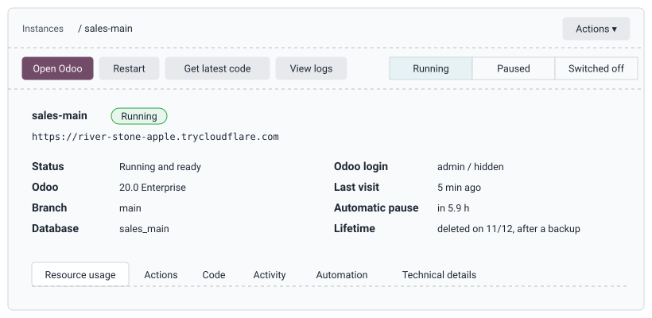

# User Manual

**Audience:** administrators and sync operators of Odoo Instance Manager.
**Covers:** every page and button of the panel, step by step.
**You need:** the panel's link and an account. Nothing has to be installed on your computer.

---

## Contents

1. [Signing in](#1-signing-in)
2. [The Instances page](#2-the-instances-page)
3. [An instance's page](#3-an-instances-page)
4. [Creating an instance](#4-creating-an-instance)
5. [Keeping the code up to date](#5-keeping-the-code-up-to-date)
6. [Submodules](#6-submodules)
7. [GitHub access (private repositories)](#7-github-access-private-repositories)
8. [Accounts and passwords](#8-accounts-and-passwords)
9. [Backups and audit log](#9-backups-and-audit-log)
10. [What each role can do](#10-what-each-role-can-do)
11. [When something goes wrong](#11-when-something-goes-wrong)
12. [Questions and answers](#12-questions-and-answers)

Words used in this manual:

| Word | Meaning |
| :--- | :--- |
| **Instance** or **instance** | One Odoo with its own database and its own link. |
| **Panel** | This website, where instances are managed. |
| **Repository** | The GitHub project that holds the custom modules of an instance. |
| **Branch** | A line of work inside a repository, for example `main` or `19.0`. |
| **Link** | The public https address of an instance, for example `https://river-stone-apple.trycloudflare.com`. |

---

## 1. Signing in

1. Open the panel's link that the administrator gave you.
2. Enter your **user name** and **password**, then click **Sign in**.

Good to know:

* After **5 wrong passwords** for the same account from the same place, or 20 from the same place, signing in is
  blocked for **15 minutes**. Wait, or ask the administrator to reset your password.
* You are signed out after **60 minutes without activity**, and after **12 hours** in any case.
* **Sign out** (top right) ends the session at once. Use it on shared computers.
* The panel's link changes when the server restarts. If the link you saved stops working, ask the administrator
  for the new one ([why links change](concepts/TUNNELING.md#5-why-the-link-changes)).

---

## 2. The Instances page

This is the first page after signing in. The top bar has **Instances**, **Accounts** and **Audit log**
(administrators), **Documentation**, your name, **Change password** and **Sign out**.

**Server usage** (the row of tiles):

| Tile | What it shows |
| :--- | :--- |
| Server CPU | How busy the processor is, with the last 15 minutes as a small graph. |
| Memory | Memory in use. Above 85% the panel suggests pausing instances that are not in use. |
| Disk | Disk space in use. Above 85% it suggests deleting instances that are no longer needed. |
| Instances | How many are running, paused and stopped, and after how many hours unused ones pause. |

Below the tiles is the **panel link** (the address of this panel right now).

**The list of instances**, one row per instance:

| Column | Meaning |
| :--- | :--- |
| Name | Click it (or anywhere on the row) to open the instance's page. A spinner below the name means an action is running. |
| Status | Running, Starting, Working, Paused, Switched off or Stopped (see [section 3](#3-an-instances-page)). |
| Odoo | Version and edition, for example `20.0 Enterprise`. |
| Branch | The branch of the repository the instance runs. |
| Link | The instance's public link. Opens Odoo in a new tab. |
| CPU, Memory | Current use, while it runs. |
| Last visit | When somebody last opened it. |
| **Restart** | Restarts Odoo (about 30 seconds). Useful when Odoo behaves strangely. |

**Recent activity** lists the latest actions on all instances. Click a line to see its steps and its technical log.

Administrators also see **New** (create an instance, [section 4](#4-creating-an-instance)) and **GitHub access**
([section 7](#7-github-access-private-repositories)).

---

## 3. An instance's page

The page is laid out like an Odoo form:

### Buttons at the top

| Button | What it does |
| :--- | :--- |
| **Open Odoo** | Opens the instance in a new tab. Sign in with the login shown on the page (normally `admin` / `admin`). |
| **Start** | Shown when the instance is paused or stopped. Starts it now instead of waiting for the first visitor. |
| **Restart** | Stops and starts Odoo. Takes about 30 seconds. |
| **Get latest code** | Downloads the newest code from GitHub, upgrades the modules that changed and restarts. |
| **View logs** | The latest 300 lines Odoo wrote. Lines with `ERROR` or `Traceback` usually explain a problem. |
| **Actions** menu (administrators) | **Switch branch** and **Delete instance**. |

### Statuses

| Status | Meaning | What to do |
| :--- | :--- | :--- |
| **Running** | Odoo answers. | Nothing. |
| **Starting** | The container runs but Odoo is not answering yet. | Wait up to a minute. If it stays, open **View logs**. |
| **Working** | An action (update, restart...) is running. Other actions wait their turn. | Wait; click **Show progress** to follow it. |
| **Paused** | Stopped to save memory because nobody used it for 6 hours. | Nothing: it starts by itself when someone opens its link. |
| **Switched off** | Stopped by an administrator. It does **not** start when someone opens it. | An administrator uses **Switch on** (Actions tab). |
| **Stopped** | Odoo stopped unexpectedly, often for lack of memory. | **Restart**. If it happens again, check the logs and pause other instances. |

The status bar at the top shows the three lasting states: Running, Paused and Switched off.

### Tabs

| Tab | Contents |
| :--- | :--- |
| **Resource usage** | CPU and memory of this instance (last 15 minutes), database size, size of attachments and images. |
| **Actions** | Every action with a short explanation (see below). |
| **Code** | Repository, branch, latest change, recent changes, submodules ([section 6](#6-submodules)). |
| **Activity** | Every action done on this instance. Click one to see its steps and log. |
| **Automation** (administrators) | Update automatically, upgrade changed modules, pause when not used ([section 5](#5-keeping-the-code-up-to-date)). |
| **Technical details** (administrators) | Folder on the server, internal ports, Odoo master password (copy only). |

**Actions tab**:

| Action | Who | What it does |
| :--- | :--- | :--- |
| Get latest code | everyone | Same as the button at the top. |
| Update submodules | everyone | Moves every submodule to its newest version and restarts. |
| Restart | everyone | Stops and starts Odoo. |
| Start now | everyone | Starts a paused instance immediately. |
| View logs | everyone | Odoo's latest log lines. |
| Pause | administrators | Frees memory now; starts again on the next visit. |
| Switch off / Switch on | administrators | Stops it completely; visitors see "Switched off" until it is switched on. |
| Upgrade modules | administrators | Like **Upgrade** in Odoo's Apps menu. Enter technical names separated by commas, or `all`. |
| Back up now | administrators | Saves the database and files as an Odoo backup, listed under **Backups**. A paused instance stays paused. |

---

## 4. Creating an instance

Administrators only. Click **New** on the Instances page.

1. **GitHub repository**: paste the repository's address. On GitHub, open the repository, click the green **Code**
   button and copy the address, for example `https://github.com/acme-co/sales`. Leave it empty for a plain Odoo
   without custom modules (then give a name under **More options**).
2. Wait a second: the panel checks the repository. Under the field you see "Repository found with N branches", or a
   message saying what is wrong.
3. **Branch**: the repository's default branch is selected first; pick the one you want. Your choice stays selected
   even when the repository is checked again (for example after adding a deploy key), and the preview shows it in
   bold. The instance only ever takes code from this branch. When the branch is named like a version (`19.0`), the
   Odoo version follows it.
4. **Odoo version**: 18, 19 or 20. Versions not yet published by Odoo are shown but cannot be chosen.
5. **Edition**: **Community** (free Odoo) or **Enterprise** (Enterprise apps and interface). Enterprise is offered
   for the versions whose Enterprise add-ons are on the server.
6. **Lifetime**: **Delete 30 days after creation** (the default) or **Keep until deleted by hand**. Before an
   instance is deleted, a backup of its database and files is always taken. You can change this later in the
   instance's **Automation** tab.
7. **More options** (optional):
   * **Name**: leave empty to use repository and branch (`sales-main`).
   * **Install the custom modules**: installs the repository's own modules (not those of submodules) after the
     database is created. On by default.
   * **Load demo data**: sample customers, products and orders, useful for presentations.
8. **Repository access** appears below: one line for the repository and one for every submodule.
   * "Access OK" everywhere: continue.
   * "No access" on a line: the repository is private and the server has no key for it yet. Click **Create deploy
     key** and follow [section 7](#7-github-access-private-repositories), then **Check again**.
9. The preview shows the **name**, the **database**, the **branch**, the **version**, the **Odoo login** and the
   **lifetime**. Check the branch before you continue.
9. Click **Create instance**.

The window now shows each step: preparing, downloading the code, downloading Odoo (the first time for a version
takes a few minutes), starting the database, creating the Odoo database, installing modules, creating the public
link, starting Odoo. A new instance usually takes **2 to 4 minutes**.

When it is ready, the window shows the **link**, the **user**, the **password** and the **database**, each with a
**Copy** button. You can close the window at any time: the work continues and is listed under Activity.

If a step fails, the window explains what went wrong in plain words, with the technical log below it. Everything
created so far is removed, so you can simply try again with **Try again**.

---

## 5. Keeping the code up to date

**Automatically.** Every 2 minutes the panel asks GitHub whether the instance's branch has new commits. If so, it
downloads them, upgrades the modules whose files changed and restarts Odoo. You see this in Activity as
"Get latest code" by "Automatic".

**By hand.** Click **Get latest code**. Use it right after a developer says "I pushed".

**Automation tab** (administrators):

| Switch | Effect |
| :--- | :--- |
| Update automatically from GitHub | Off: the instance only changes when someone clicks **Get latest code**. Use it for an instance that must not change before a presentation. |
| Upgrade changed modules | On: after an update, the modules whose files changed are upgraded in Odoo (needed for new fields, views and data). Off: Odoo only restarts. |
| Pause when not used | Off: the instance never pauses by itself (it keeps using memory). |
| Delete automatically, days after creation | On: the instance is deleted that many days after it was created, after a backup. The page shows the date under **Lifetime**. Off: it is kept until someone deletes it. |

Click **Save** after changing a switch. **Switch branch** moves the instance to another branch and restarts it.

---

## 6. Submodules

A submodule is another repository included inside the instance's repository, for example OCA's `web` modules in a
folder `oca/web`. See [Git submodules](concepts/GIT_SUBMODULES.md) for how they work.

The **Code** tab lists the submodules with their folder, address and current version.

| Action | Who | What it does |
| :--- | :--- | :--- |
| **Update submodules** (Actions tab) | everyone | Moves every submodule to the newest commit of its branch and restarts. |
| **Add submodule** (Code tab) | everyone | Adds a repository as a submodule and saves the change to GitHub. |
| **Remove** (next to a submodule) | administrators | Removes it from the instance and from GitHub. Uninstall its modules in Odoo first. |

Adding a submodule:

1. Click **Add submodule**.
2. **Repository address**, for example `https://github.com/OCA/web`.
3. **Folder** (optional, for example `oca/web`) and **Branch** (optional). For OCA repositories use the branch that
   matches the Odoo version, for example `19.0`.
4. Click **Add submodule**. The panel first checks it can read the repository.

Adding and removing change the repository on GitHub, so the server's key for the main repository must be allowed
to write ("Allow write access" ticked on GitHub). If it is not, GitHub refuses, the panel undoes the change on the
server and tells you so: the server and GitHub never disagree.

---

## 7. GitHub access (private repositories)

Public repositories need nothing. Every **private** repository, including every private submodule, needs a
**deploy key**: a key that lets the server read that one repository and nothing else. See
[Deploy keys](concepts/DEPLOY_KEYS.md) for how they work.

You need **admin rights on the repository on GitHub** to add a key. If you do not have them, send the key to
someone who does.

1. In the panel, click **Create deploy key** (in Repository access while creating an instance, or under
   **GitHub access** on the Instances page).
2. The panel shows the key and a link. Click **Copy key**, then open the link (the repository's **Settings,
   Deploy keys, Add deploy key** page on GitHub).
3. On GitHub:
   * **Title**: `Odoo Instance Manager`
   * **Key**: paste.
   * **Allow write access**: leave unticked, unless submodules of this repository will be added or removed from
     the panel.
   * Click **Add key**.
4. Back in the panel, click **I added it, check again**. The line now says "Access OK, with deploy key".

**GitHub access** lists all keys. **Delete** removes the server's key; also remove it on GitHub (repository
Settings, Deploy keys). One key per repository is shared by every instance that uses that repository.

---

## 8. Accounts and passwords

**Your own password.** Click **Change password** in the top bar. Enter your current password and the new one twice.
The new password must:

* be 12 to 128 characters long,
* use at least 6 different characters,
* not contain your user name,
* not contain a common word such as `password`, `admin`, `odoo` or `123456`.

A short sentence is the easiest kind of password to remember and the hardest to guess, for example
`green tea at 7 on the balcony`. Changing your password signs out your other sessions.

**Accounts** (administrators, top bar):

| Action | What happens |
| :--- | :--- |
| **Create an account** | Enter a user name (lower-case letters, digits, dots, dashes, underscores; 3 to 32 characters) and a role. A strong password is generated and shown **once**: copy it and give it to the person. They can change it after signing in. |
| **Reset password** | A new password is generated and shown once. The account is signed out everywhere. |
| **Delete** | The account is removed and signed out at once. Your own account and the last administrator cannot be deleted. |

Passwords are never stored by the panel, only checked: see [Passwords and encryption](concepts/PASSWORDS_AND_ENCRYPTION.md).

---

## 9. Backups and audit log

**Backups** (administrators, top bar) lists every backup: instance, database, when it was taken and its size.

* A backup is taken **before every deletion**, automatic or by hand. If the backup fails, the instance is not
  deleted.
* **Back up now** (Actions tab of an instance) takes one at any time.
* **Download** gives a zip file in Odoo's own backup format (database and files). To bring it back, open any Odoo's
  database manager (`/web/database/manager`), choose **Restore Database** and select the file.
* **Delete** removes a backup you no longer need. Backups are kept until someone deletes them, so look at the list
  from time to time; the disk usage is on the Instances page.

**Audit log** (administrators, top bar). The last 200 events, newest first: sign-ins (also failed ones), refused actions, every
action on an instance, account and key changes. Each line shows the time, the account, the event, the instance,
the address it came from and whether it was allowed.

---

## 10. What each role can do

| Action | Administrator | Sync operator |
| :--- | :---: | :---: |
| See instances, usage, activity, logs | yes | yes |
| Get latest code, update submodules, add a submodule | yes | yes |
| Restart, start a paused instance | yes | yes |
| Read the documentation, change own password | yes | yes |
| Create and delete instances | yes | no |
| Pause, switch off and on, upgrade modules, remove a submodule, switch branch | yes | no |
| Automation switches | yes | no |
| GitHub access (deploy keys) | yes | no |
| Accounts, audit log | yes | no |
| See the Odoo admin and master passwords, ports | yes | no |

When a sync operator tries something reserved for administrators, or an action fails, the panel tells them to
contact the administrator, Yousef M. Y. Al Sabbah.

---

## 11. When something goes wrong

1. Read the message: the panel explains failures in plain words.
2. Open the action in **Activity** to see which step failed and the technical log.
3. Try **Restart** if Odoo behaves strangely, and **View logs** if it does not start.
4. If it is still not solved, contact the administrator, Yousef M. Y. Al Sabbah, and say which instance, what you
   did and what the message said.

Common messages are listed in the [Administrator guide's troubleshooting table](ADMIN_GUIDE.md#10-troubleshooting).

---

## 12. Questions and answers

**Do the people I show an instance to need an account?**
No. They only need the instance's link and the Odoo login. Panel accounts are only for people who manage instances.

**Can two instances be open in the same browser at the same time?**
Yes. Each instance has its own link, so each has its own Odoo sign-in.

**The instance shows "Starting up". Is it broken?**
No. It was paused because nobody used it for 6 hours. The page opens Odoo by itself after 20 to 60 seconds.

**I pushed to GitHub but the instance does not show my change.**
Wait 2 minutes or click **Get latest code**. If the change is a new field or view, the module must be upgraded:
check that "Upgrade changed modules" is on, or ask an administrator to use **Upgrade modules**.

**The page says "The branch ... no longer exists on GitHub".**
The branch was deleted on GitHub, usually after its pull request was merged, so there is nothing left to update
from. An administrator uses **Actions, Switch branch** and picks the branch the instance should follow now, usually
`main`. The database and its data stay as they are.

**Can another system send webhooks to an instance, or call its API?**
Yes, through the instance's link. See [API and webhooks](API.md). Remember the link changes after a server restart.

**Is my data safe in an instance?**
Instances are for showing Odoo. Anyone with the link can sign in as `admin`. Do not put real customer data in them.
