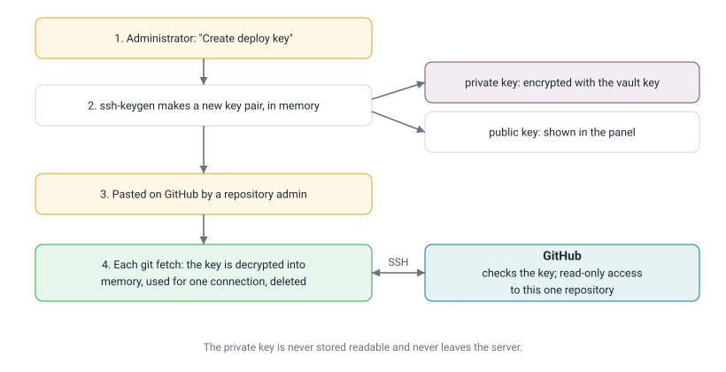

# Deploy Keys

**In one sentence:** a deploy key is a key pair that lets the server read one private GitHub repository and nothing
else, without using anyone's password or personal token.

Since the panel can connect its own **GitHub App**, which reads every repository you allow on an account or an
organisation (submodules included), deploy keys are the fallback: for servers without the app, or for a repository
whose submodules are added and removed from the panel (that needs write access, which the app does not have). See
[The GitHub App](../ADMIN_GUIDE.md#15-the-github-app).

---

## Contents

1. [An everyday comparison](#1-an-everyday-comparison)
2. [Key pairs in two minutes](#2-key-pairs-in-two-minutes)
3. [Why deploy keys and not a personal token](#3-why-deploy-keys-and-not-a-personal-token)
4. [What happens on our server](#4-what-happens-on-our-server)
5. [Example: an instance with a private submodule](#5-example-an-instance-with-a-private-submodule)
6. [Read-only or write access?](#6-read-only-or-write-access)

---

## 1. An everyday comparison

Instead of lending your house keys to a cleaner, you have one key made that opens only the storeroom. If the cleaner
leaves, you disable that one key; your own keys, and every other door, are unaffected.

A deploy key is that storeroom key: it opens one repository, and can be removed from it at any time.

---

## 2. Key pairs in two minutes

An SSH key is a **pair**:

| Part | Kept where | Like |
| :--- | :--- | :--- |
| **Private key** | Only on our server, encrypted | The key in your pocket. Never shared. |
| **Public key** | Pasted into the repository's settings on GitHub | The lock fitted to the storeroom door. Safe to show anyone. |

When the server connects, GitHub sends a challenge that only the matching private key can answer. The private key
itself never travels. A public key looks like this:

```
ssh-ed25519 AAAAC3NzaC1lZDI1NTE5AAAAIJ8n0m3... sudoo-panel acme-co/sales
```

---

## 3. Why deploy keys and not a personal token

| | Deploy key | Personal access token |
| :--- | :--- | :--- |
| Gives access to | **one repository** | everything the person can see |
| Belongs to | the repository | a person (who may leave the company) |
| Can write? | only if "Allow write access" is ticked | usually yes |
| Expires | no | usually yes, and breaks the server when it does |
| Revoking it affects | that repository only | everything that used the token |

A server needs to read a few repositories. A deploy key gives exactly that, and nothing more.

---

## 4. What happens on our server



Rules the panel follows for every git command:

| Repository | How it is reached |
| :--- | :--- |
| has a deploy key on the server | over SSH, with that repository's key |
| any other | over HTTPS: with a read-only token of the GitHub App when it is installed on the repository's owner, otherwise anonymously (public repositories only) |

This applies however the address is written (`https://github.com/acme-co/sales` or `git@github.com:acme-co/sales`),
including addresses inside `.gitmodules`.

---

## 5. Example: an instance with a private submodule

The repository `acme-co/sales` is private and includes two submodules:

```
acme-co/sales              private   → needs a deploy key
├── oca/web                public    → nothing needed
└── acme-co/shared-modules private   → needs its own deploy key
```

When creating the instance, **Repository access** shows:

| Repository | Status | Action |
| :--- | :--- | :--- |
| acme-co/sales (main) | No access | Create deploy key |
| OCA/web (submodule) | Access OK | |
| acme-co/shared-modules (submodule) | No access | Create deploy key |

Create both keys, add each one on its own repository on GitHub, click **Check again**: all three show "Access OK"
and the instance can be created. Every later instance of these repositories reuses the same keys.

GitHub allows one deploy key to be added to only one repository. That is why each private repository has its own.

---

## 6. Read-only or write access?

Leave **Allow write access** unticked. Tick it only on a main repository whose submodules will be added or removed
from the panel: those actions save a change (a commit) to GitHub. Without write access, GitHub refuses, and the
panel undoes the change on the server so the two never disagree.
