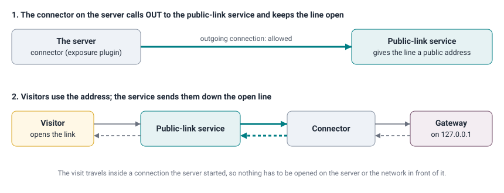

# Public addresses

**In one sentence:** the panel and every instance get a public https address, and the **exposure** setting
(`EXPOSURE`) decides how: normally the server answers on ports 80 and 443 itself (**direct**), behind your own reverse
proxy (**proxy**), or, for a server that cannot open ports, through an outgoing tunnel (**tunnel**).

---

## Contents

1. [The three ways](#1-the-three-ways)
2. [Choosing](#2-choosing)
3. [Direct](#3-direct)
4. [Proxy](#4-proxy)
5. [Tunnel](#5-tunnel)
6. [When an address changes](#6-when-an-address-changes)
7. [Is it safe?](#7-is-it-safe)
8. [Changing the mode later](#8-changing-the-mode-later)
9. [Existing installations](#9-existing-installations)

---

## 1. The three ways

| Mode | `EXPOSURE` | Who handles https | Addresses | Needs |
| :--- | :--- | :--- | :--- | :--- |
| **Direct** (default of new installations) | `direct` | the server itself, with certificates from an ACME authority (Let's Encrypt by default) | the panel's name, each instance's managed name or custom domain; they never change | ports 80 and 443 open to the internet |
| **Proxy** | `proxy` | your own reverse proxy or load balancer | the names your proxy serves | a proxy that forwards to the local ports and sends the visitor's address |
| **Tunnel** | `tunnel` | the tunnel service, at its edge | a random https address per instance, which changes when its connector restarts | outgoing connections only (TCP and UDP 7844) |

The mode is an exposure plugin ([Plugins](../PLUGINS.md#3-exposure-how-instances-are-reached)). The earlier names
still work in `.env`: `cloudflare-quick` is the tunnel, and `host-ports` (each instance on a port of the server,
`<PUBLIC_SCHEME>://<PUBLIC_HOST>:<port>`) remains for the panels that use it.

---

## 2. Choosing

* **A server with a public address** (a VPS, a cloud machine, a server in a data centre): **direct**. Nothing else
  runs, addresses are fixed, and https ends on the server itself.
* **A server that already sits behind a reverse proxy or load balancer** (an existing nginx, Traefik, HAProxy, a
  cloud load balancer): **proxy**.
* **A server that cannot accept incoming connections** (behind a NAT you do not control, an office network, a laptop
  for trying things out): **tunnel**.

The installer asks once, "How should people reach this server?", with Direct pre-selected; it checks that ports 80
and 443 are free, that the server has a public address of its own and that a host firewall (ufw, firewalld) lets
them in, and suggests Proxy or Tunnel when something is not right
([Administrator Guide](../ADMIN_GUIDE.md)).

---

## 3. Direct

The gateway (`sudoo-gateway`, [Gateway](GATEWAY.md)) listens on ports 80 and 443 of the server
(`DOMAIN_HTTP_PORT`, `DOMAIN_HTTPS_PORT`) and answers every name with its own certificate, which the panel gets and
renews from the ACME authority (HTTP-01 check on port 80).

**The panel's address**, in this order:

1. `PANEL_DOMAIN`, a name whose A (and AAAA) record points at the server, such as `panel.example.com`.
2. `PUBLIC_HOST`, when it is a name.
3. The server's own address (`PUBLIC_HOST` when it is an address, else `PUBLIC_IPV4` / `PUBLIC_IPV6`, else the
   address the server sends from), served with the **panel's own certificate**, which the panel makes itself.
   Browsers warn about it once; it is meant for the first sign-in, until a name is set.

While the name's certificate is being issued, the panel stays at the server's address. The gateway forwards the
panel's visits to the web service, which listens on `127.0.0.1` only.

**An instance's address**, in this order:

1. Its primary custom domain (`CUSTOM_DOMAINS=acme`, on by default in direct mode).
2. Its managed name, `<branch>.<stage>.<company>.<base>`, when the linked Sudoo.sh account offers them
   ([Administrator Guide, Managed subdomains](../ADMIN_GUIDE.md#managed-subdomains)).
3. `https://<server address>:<gateway port>`, served by the instance's gateway port with the panel's own
   certificate, until it has a name.

**Firewall:** open TCP 80 and 443 to the internet. Open the gateway ports (from `GATEWAY_PORT_START`, one per
instance) only if instances without a name must be reachable.

**The visitor's address:** visitors connect straight to the gateway, so the address of the connection is the
visitor's; no header from outside is trusted. For the panel, the gateway passes it on in `X-Sudoo-Client-IP` and
removes any copy a visitor sent; only processes on the server can reach the web service, so nobody else can set it.

---

## 4. Proxy

The web service and every gateway listen on `PROXY_LISTEN` (`127.0.0.1` by default, for a proxy on the same server)
on their own ports, and your proxy forwards to them:

| Address | Forwarded to |
| :--- | :--- |
| `https://<PANEL_DOMAIN or PUBLIC_HOST>` | `PROXY_LISTEN:PANEL_PORT` (9000) |
| an instance's custom domain (`CUSTOM_DOMAINS=external`, the default in proxy mode) or `https://<PUBLIC_HOST>:<gateway port>` | `PROXY_LISTEN:<gateway port>` |

* The proxy must send the visitor's address in `PROXY_CLIENT_IP_HEADER` (`X-Real-IP` by default) on **every**
  request, replacing any the visitor sent. The panel and the gateways trust that header, so nothing but the proxy
  may reach their ports: keep `PROXY_LISTEN=127.0.0.1`, or firewall the ports when the proxy runs elsewhere. For
  `X-Forwarded-For` the last address is taken.
* `PUBLIC_SCHEME` is `https` unless set otherwise.
* Managed names are answered by the gateway on `DOMAIN_HTTP_PORT` / `DOMAIN_HTTPS_PORT`, which defaults to 80 and
  443, where the proxy listens. Either move them to free ports and pass those names through the proxy (TLS
  passthrough, plus plain http for the ACME check), or turn `MANAGED_SUBDOMAINS` off.

An nginx example for the panel (one `server` block per instance name, or one per gateway port, follows the same
pattern; WebSockets are used by the panel's live updates, its terminal and Odoo):

```nginx
server {
    listen 443 ssl;
    server_name panel.example.com;
    # ssl_certificate ... (your proxy's certificate)
    client_max_body_size 64m;
    location / {
        proxy_pass http://127.0.0.1:9000;
        proxy_http_version 1.1;
        proxy_set_header Host $host;
        proxy_set_header X-Real-IP $remote_addr;
        proxy_set_header Upgrade $http_upgrade;
        proxy_set_header Connection $http_connection;
        proxy_buffering off;
        proxy_read_timeout 1h;
    }
}
```

---

## 5. Tunnel

For a server that does not accept incoming connections. Every destination gets a free quick tunnel through an
extension: no open port, no account, no domain.

**An everyday comparison.** You are in a building whose reception does not put outside calls through to the rooms.
Nobody can call you, but you can call out. So you call a switchboard and leave the line open; it gives you a public
number and passes every call to that number down your line. The switchboard is the tunnel service, the open line a
connection the server started, the number the instance's address, and the small program that keeps the line open
the **connector**.



| Connector (container) | Points to | Address |
| :--- | :--- | :--- |
| `sudoo-connector-panel` | the panel, `127.0.0.1:9000` | the panel's address |
| `sudoo-connector-<name>` | the gateway of each instance, `127.0.0.1:<gateway port>` | one per instance |

The panel starts and watches the connectors. Each one reports its address on a local status port; the panel shows
it and tells the instance's Odoo its new address (`web.base.url`). The connector image is `CLOUDFLARED_IMAGE`
([Configuration](../CONFIGURATION.md)). The server needs outgoing TCP and UDP port 7844.

---

## 6. When an address changes

**Direct and proxy:** addresses are fixed. An instance's address changes only when it gets a name (a managed name,
or a primary custom domain) or loses one; the panel tells its Odoo at once.

**Tunnel:** the tunnel needs no account, so its addresses are not reserved for your server; a connector that starts
again gets a new address.

| Event | Panel address | Instance addresses |
| :--- | :--- | :--- |
| An instance is paused, restarted or updated | same | same (its connector keeps running) |
| The panel is updated | same, unless its connector restarts | same |
| The server restarts | **new** | **new** |

The panel always shows the current addresses, and each Odoo is told its new address within about 15 seconds.

---

## 7. Is it safe?

* **Direct:** https ends on the server itself; no third party sees the traffic. Only ports 80 (ACME checks and the
  redirect to https) and 443 need to be open. The panel's own certificate is a fallback until a name is set.
* **Proxy:** https ends at your proxy; the header with the visitor's address is trusted only because nothing else
  can reach the local ports.
* **Tunnel:** https is decrypted at the tunnel service's edge and encrypted again for the connection to the server,
  so the service can technically see the traffic, the same model as any site behind a content delivery network;
  acceptable for instances without real data. No port is opened, so the server cannot be scanned through one.

In every mode the panel requires signing in, and its session cookie is never passed to Odoo.

---

## 8. Changing the mode later

**Settings, Addresses and domains, How people reach this server** shows the current mode and the panel's address,
and explains what a change does before it is saved. The change applies when the panel restarts (**Restart the
panel**). The page offers direct, proxy and tunnel, and refuses a change that would move the web service to another
address (from or to `host-ports`, or proxy with `PROXY_LISTEN` other than `127.0.0.1`): then change `EXPOSURE` in
`/opt/odoo/manager/.env` and run `docker compose up -d` in `/opt/odoo/manager`.

* Keep the page open at the current address until the new one works. If the panel cannot be reached afterwards,
  set `EXPOSURE` back in `.env` and run `docker compose up -d`.
* Switching away from tunnel leaves the `sudoo-connector-*` containers running until they are removed
  (`docker rm -f $(docker ps -aq --filter name=sudoo-connector-)`).
* Switching to direct: `CUSTOM_DOMAINS` follows the mode (acme) unless it is set in `.env`. A `.env` written by an
  earlier release has `CUSTOM_DOMAINS=off`; set it to `acme` (or empty) to serve custom domains.

---

## 9. Existing installations

An update never changes how a running panel is reached. Every release's `.env` names `EXPOSURE`, and updates keep
every value in it; a `.env` without `EXPOSURE` keeps `tunnel`, the behaviour of earlier releases. The installer
asks the question only on a fresh installation, never on an update.
