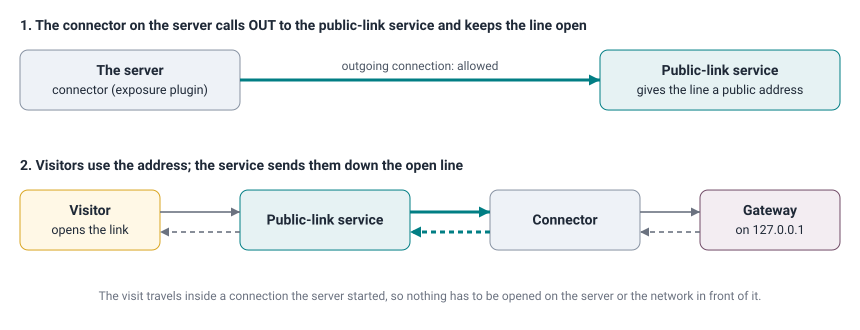

# Public links

**In one sentence:** every instance, and the panel itself, gets a public https link that anyone you share it with
can open, and that link is provided through an extension, so the server does not have to accept incoming
connections.

---

## Contents

1. [What a public link is](#1-what-a-public-link-is)
2. [An everyday comparison](#2-an-everyday-comparison)
3. [How a link reaches an instance](#3-how-a-link-reaches-an-instance)
4. [What it looks like on the server](#4-what-it-looks-like-on-the-server)
5. [When the link changes](#5-when-the-link-changes)
6. [Is it safe?](#6-is-it-safe)
7. [Fixed addresses and other options](#7-fixed-addresses-and-other-options)

---

## 1. What a public link is

Each instance has one address, such as `https://river-stone-apple.example.com`. Browsers, API clients and webhook
senders use it like the address of any Odoo. The panel has its own link too. You do not set anything up: the link
appears on the instance's card and page a few seconds after the instance starts.

How the links are provided is decided by the **exposure** plugin, an extension chosen per server
([Plugins](../PLUGINS.md#3-exposure-how-instances-are-reached)):

* The default, `cloudflare-quick`, needs **no open port, no account and no domain**. The server only makes outgoing
  connections, which almost every server, cloud machine or office network allows.
* `host-ports` serves each instance on a port of the server, for servers that accept incoming connections.
* Your own exposure plugin can serve every instance from a domain of yours.

The rest of this page describes the default.

---

## 2. An everyday comparison

You are in a building whose reception does not put outside calls through to the rooms. Nobody can call you. But you
can call out.

So you call a **switchboard** and leave the line open. The switchboard gives you a public phone number. When someone
dials that number, the switchboard passes the call down the line you opened. You can now receive calls, and the
reception never had to change anything.

* The switchboard is the **public-link service** the default extension uses.
* The open line is a connection the server started.
* The public phone number is the instance's **link**.
* The small program that dials out and keeps the line open is the **connector**.

---

## 3. How a link reaches an instance

The visitor's request never knocks on the server's door. It travels inside a connection the server started, so
nothing has to be opened on the server or on the network in front of it.

---

## 4. What it looks like on the server

Every destination has its own connector, so every destination has its own link:

| Connector (container) | Points to | Link |
| :--- | :--- | :--- |
| `sudoo-connector-panel` | the panel, `127.0.0.1:9000` | the panel's link |
| `sudoo-connector-sales-main` | the gateway of instance `sales-main`, `127.0.0.1:8070` | that instance's link |
| `sudoo-connector-<name>` | the gateway of each instance | one link per instance |

The panel starts and watches the connectors; nobody has to run them by hand. Each one reports its address on a
local status port, the panel shows it and tells the instance's Odoo its new address (`web.base.url`). The connector
image is the `CLOUDFLARED_IMAGE` setting ([Configuration](../CONFIGURATION.md)).

---

## 5. When the link changes

The default extension needs no account, so its addresses are not reserved for your server: a connector that starts
again gets a new address.

| Event | Panel link | Instance links |
| :--- | :--- | :--- |
| An instance is paused, restarted or updated | same | same (its connector keeps running) |
| The panel is updated (`sudoo-install update`) | same, unless its connector restarts | same |
| The server restarts | **new** | **new** |

The panel always shows the current links, and each Odoo is told its new address within about 15 seconds. Links you
sent to people earlier must be sent again. For addresses that never change, see
[section 7](#7-fixed-addresses-and-other-options).

---

## 6. Is it safe?

* **Visitor to the public-link service**: https, encrypted.
* **Service to the server**: inside the connector's own encrypted connection.
* **At the service**: https is decrypted at the service's edge and encrypted again for the connection to the
  server, so the service can technically see the traffic. That is the same model as every website behind a content
  delivery network, and acceptable for instances that hold no real data.
* **The server stays closed**: no port is opened, so the server cannot be scanned or attacked through an open port.
  Only what a connector points to is reachable, and the panel still requires signing in.

---

## 7. Fixed addresses and other options

| Option | Fixed address | Needs | Who can see the traffic |
| :--- | :--- | :--- | :--- |
| Default public-link extension (`cloudflare-quick`) | no, changes on restart | nothing | the service and the server |
| `host-ports` | yes | a server that accepts incoming connections; a TLS proxy in front for https | only the server |
| An exposure plugin for your own domain, for example through a reverse proxy you already run | **yes** | a domain | depends on the proxy |

* **No setup at all:** the default extension.
* **Fixed addresses with little work:** a domain of your own and a small exposure plugin
  ([Plugins](../PLUGINS.md#6-writing-a-plugin)); only the way connectors are started changes.
* **Custom domains for single instances** are a separate feature: the **Domains** tab of an instance
  ([User manual](../USER_MANUAL.md)).
