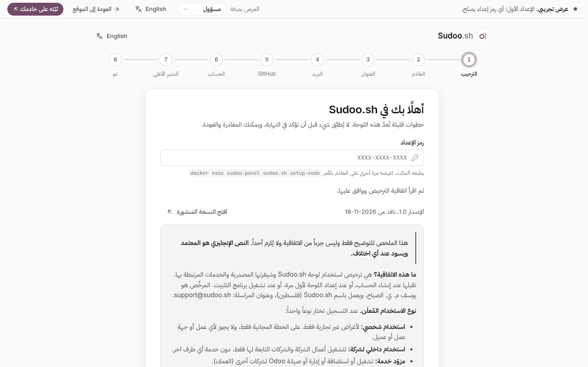

# سير العمل: تثبيت Sudoo.sh

[English](01-install-sudoo.md) · [كل سير العمل](README.md)

**الهدف:** تثبيت اللوحة على خادم جديد وإنشاء أول مسؤول أعلى.

**من يستطيع:** مسؤول الخادم (root على الخادم) يثبّت. ومن يُنهي الإعداد في المتصفح يصبح **المسؤول الأعلى**.

> **من يستخدم رمز الإعداد أولًا يصبح المسؤول الأعلى.** أبقِ الرمز سرًّا إلى أن يوجد أول حساب. اقرأ ملخص الترخيص قبل أن توافق: توافق لنفسك، أو لشركة نيابةً عنها.
> **تمرير سكربت إلى الصَّدفة يشغّله بصلاحية root.** يبيّن دليل المسؤول كيف تنزّل المثبِّت وتفحص بصمته وتقرأه قبل تشغيله. افعل ذلك إن استطعت.

## قبل أن تبدأ
خادم Ubuntu 22.04 أو أحدث، أو Debian 12 أو أحدث، مع systemd، ونواتان أو أكثر، وذاكرة 2 غيغابايت على الأقل (يُنصح بـ 4 أو أكثر)، ونحو 20 غيغابايت فارغة، واتصال HTTPS صادر إلى GitHub ومستودعات الصور. شغّل `sudo sudoo-install check` لترى كل الفحوص دون تغيير شيء. الفحص الفاشل (يُعلَّم بعلامة ×) يوقف المثبِّت قبل أن يغيّر شيئًا. *(المصدر: دليل المسؤول، فحوص المثبِّت؛ لم يُتحقق من مصدر المثبِّت.)*

## الخطوات
1. على الخادم شغّل أمر التثبيت من دليل المسؤول، القسم 2 (المثبِّت ذو الملف الواحد المرفق بكل إصدار)، أو نزّله وافحص بصمته واقرأه أولًا.
2. وافق على اتفاقية الترخيص حين تُطلب (اكتب `accept`). وبلا طرفية يتوقف المثبِّت ما لم يُعطَ `--accept-licence`.
3. اختر كيف يصل الناس إلى الخادم: **مباشر** (الموصى به) أو **وسيط** أو **نفق**. «مباشر» يحتاج إلى المنفذين 80 و443 فارغين ومفتوحين. ويشرح المثبِّت ما وجده. ثم اختر المحرّك؛ **Docker** محدد مسبقًا. يبقى Docker الافتراضي وKubernetes تجريبي.
4. يفحص المثبِّت الخادم، ويسأل قبل تثبيت الأدوات الناقصة (مثل Docker)، وينزّل الصور، ويكتب ملفاته ويشغّل الخدمات. وبلا طرفية يتوقف ويطبع الأمر الذي تعيد تشغيله مع `--yes`.
5. في النهاية يطبع عنوان اللوحة و**رابط الإعداد** و**رمز الإعداد** (مثل `ABCD-EFGH-JKLM`). إن ضاع الرمز يستطيع مسؤول على الخادم عرضه مرة أخرى بأمر رمز الإعداد المذكور في دليل المسؤول.
6. افتح رابط الإعداد. تحتوي صفحة الإعداد ثماني خطوات مع **رجوع** و**التالي**: الترحيب والترخيص، الخادم والمحرّك، العنوان، البريد (اختياري)، GitHub (اختياري)، الحساب (اختياري)، المدير الأعلى، تم. *(المصدر: setup_wizard.py وملف ترجمة الإعداد setup.ts.)* (الشكل 1)
7. في خطوة الترحيب أدخل رمز الإعداد، واقرأ ملخص الترخيص، واختر كيف ستستخدم Sudoo.sh (مشاريع شخصية، أو شركتي، أو مزوّد خدمة)، وضع العلامات في مربعات الموافقة، ثم تابع.
8. في خطوة المدير الأعلى أدخل الاسم الأول واسم العائلة والبريد (مطلوب) والهاتف (اختياري) وكلمة المرور مرتين (من 12 إلى 128 حرفًا). لا حقل لاسم مستخدم، فهو يُشتق من بريدك. ثم أكّد.
9. **لا يُطبَّق شيء قبل هذا التأكيد.** يُنشئ التأكيد الحساب ويطبّق اختياراتك معًا. وتدخل اللوحة بحسابك. أعدّ عاملًا ثانيًا حين يُطلب منك (يُطلب افتراضيًا من المسؤولين الأعلى والمسؤولين).
10. في خطوة «تم» أعد تشغيل اللوحة إن تغيّر العنوان، ثم **اربط GitHub** إن أردت ذلك الآن (سير العمل التالي)، أو **افتح اللوحة**.

## لقطات الشاشة
من العرض التجريبي ببيانات مخترعة. لا شيء مما يظهر حساب حقيقي.

*الشكل 1. الخطوة الأولى من صفحة الإعداد. يظهر في الخطوة 6.*

## ما تراه عند النجاح
تفتح اللوحة وأنت داخل بحساب المسؤول الأعلى الجديد، وتختفي صفحة الإعداد.

## مشكلات شائعة
- **ترفض صفحة الإعداد الرمز الصحيح:** خمسة رموز خاطئة خلال 15 دقيقة تحجب ذلك العنوان 15 دقيقة. انتظر.
- **رابط اللوحة لا يفتح أو تغيّر:** يستطيع مسؤول على الخادم طباعة الرابط الحالي (دليل المسؤول، استكشاف الأخطاء).
- **يفشل فحص:** اقرأ الحل المذكور بجانبه في دليل المسؤول (الذاكرة والمساحة والمنافذ وDocker). لا تستخدم `--force` ما لم تعرف السبب.
- **يحذّر المتصفح من الشهادة:** الوضع المباشر دون اسم للوحة يستخدم شهادته الخاصة. حدّد اسمًا للوحة.
- **تعذّر التحقق من توقيع تنزيل:** لا تثبّته، وأبلِغ عنه.

## حدود المراجعة
خطوات الإعداد وسلوك المسودة فُحصت في مصدر معالج الإعداد. أما فحوص المثبِّت وخياراته ورسائله فمن دليل المسؤول فقط، ولم يُثبَّت أو يُشغَّل شيء. أسماء الخطوات والأزرار من ملف الترجمة العربي setup.ts.
