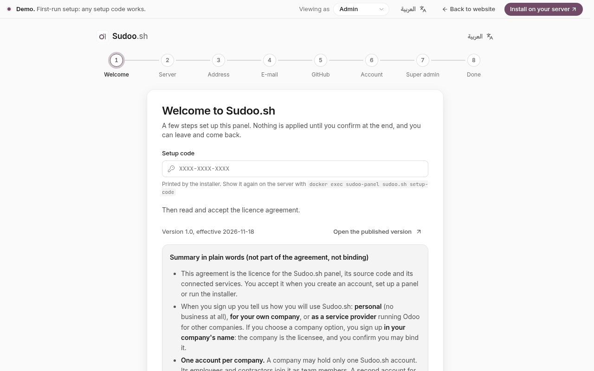

# Workflow: Install Sudoo.sh

[العربية](01-install-sudoo.ar.md) · [All workflows](README.md)

**Goal:** install the panel on a new server and create the first super admin.

**Who can do it:** the server administrator (root on the server) installs. The person who finishes the setup in the browser becomes the **super admin**.

> **Whoever uses the setup code first becomes the super admin.** Keep the code private until the first account exists. Read the licence summary before you accept it: you accept it for yourself, or, for a company, on its behalf.
> **Piping a script to a shell runs it as root.** The Admin guide shows how to download the installer, check its checksum and read it before you run it. Do that if you can.

## Before you start
A server with Ubuntu 22.04 or newer, or Debian 12 or newer, with systemd, 2 or more processor cores, at least 2 GB of memory (4 GB or more is advised), about 20 GB free disk, and outgoing HTTPS to GitHub and the image registries. Run `sudo sudoo-install check` to see every check without changing anything. A failed check (marked with a cross) stops the installer before it changes anything. *(Source: Admin guide, Installer checks; the installer source was not verified.)*

## Steps
1. On the server, run the install command from the Admin guide, section 2 (the one-file installer attached to each release), or download it, check its checksum and read it first.
2. Accept the licence agreement when asked (type `accept`). Without a terminal the installer stops unless `--accept-licence` is given.
3. Choose how people reach the server: **Direct** (recommended), **Proxy** or **Tunnel**. Direct needs ports 80 and 443 free and open. The installer explains what it found. Then choose the engine; **Docker** is pre-selected. Docker stays the default, Kubernetes is a beta.
4. The installer checks the server, asks before it installs missing tools (such as Docker), downloads the images, writes its files and starts the services. Without a terminal it stops and prints the command to run again with `--yes`.
5. At the end it prints the panel's address, the **setup link** and the **setup code** (like `ABCD-EFGH-JKLM`). If you lose the code, an administrator on the server can show it again with the setup-code command in the Admin guide.
6. Open the setup link. The setup page has eight steps with **Back** and **Next**: Welcome and licence, Server check and engine, Address, E-mail (optional), GitHub (optional), Account (optional), Super admin, Done. *(Source: setup_wizard.py and web/src/pages/Setup.tsx.)* (Figure 1)
7. In the Welcome step choose how you will use Sudoo.sh (Personal projects, My company or Service provider), tick the acceptance boxes and continue.
8. In the Super admin step enter first name, last name, e-mail (required), phone (optional) and a password twice (12 to 128 characters). There is no user name field, it is made from your e-mail. Confirm.
9. **Nothing is applied before this confirm.** The confirm creates the account and applies your choices together. You are signed in. Set up a second factor when asked (super admins and administrators are asked by default).
10. On the Done step, restart the panel if the address changed, then **Connect GitHub** if you want it now (the next workflow), or **Open the panel**.

## Screenshots
From the demo with invented sample data. Nothing shown is a real account.

*Figure 1. The first step of the setup page. Shown in step 6.*

## What you see when it worked
The panel opens, signed in as the new super admin, and the setup page is gone.

## Common problems
- **The setup page refuses the right code:** five wrong codes within 15 minutes block that address for 15 minutes. Wait.
- **The panel's link does not open or changed:** an administrator on the server can print the current link (Admin guide, troubleshooting).
- **A check fails:** read the fix next to it in the Admin guide (memory, disk, ports, Docker). Do not use `--force` unless you know why.
- **The browser warns about the certificate:** Direct without a name for the panel uses its own certificate. Set a name for the panel.
- **The signature of a download could not be verified:** do not install it, report it.

## Review limits
The setup steps and the draft behaviour are checked against the setup wizard source. The installer's checks, options and messages are from the Admin guide only, and nothing was installed or run.
