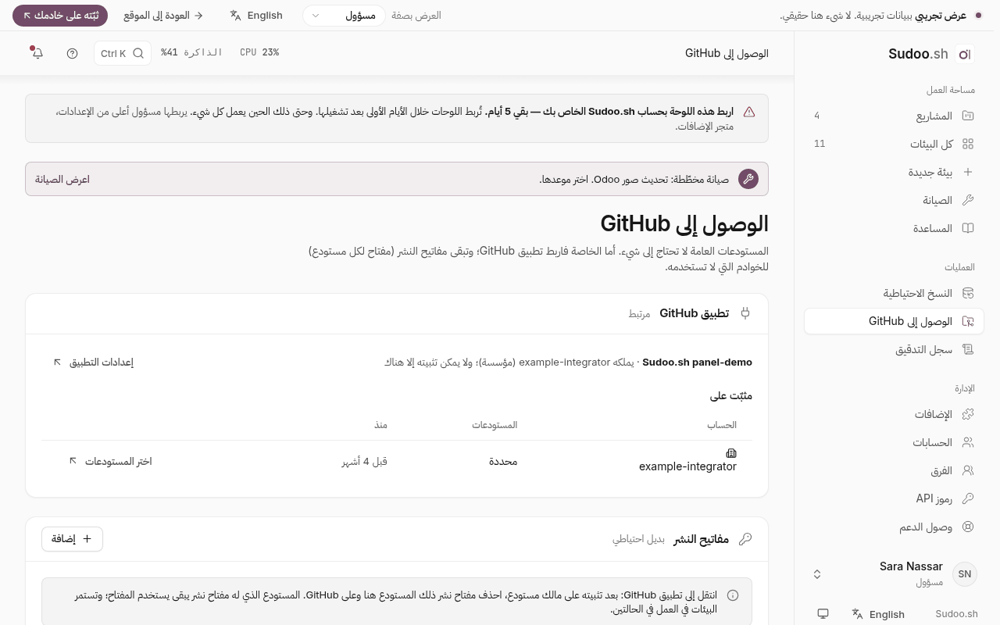
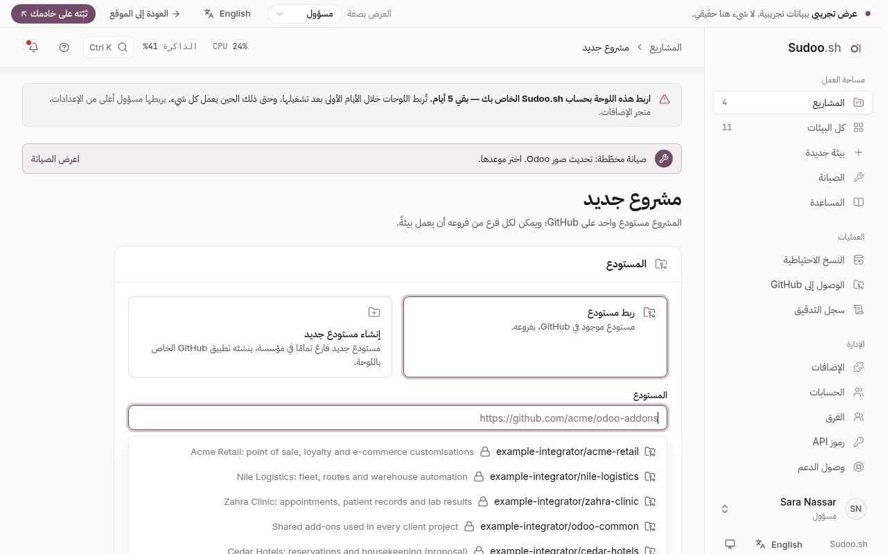

# سير العمل: ربط GitHub وإنشاء مشروعك الأول

[English](02-connect-github-first-project.md) · [كل سير العمل](README.md)

**الهدف:** السماح للوحة بقراءة شيفرتك على GitHub، ثم إنشاء مشروع من مستودع.

**من يستطيع:** **المسؤول الأعلى** يربط GitHub (مرة واحدة). المشرفون فما فوق ينشئون المشاريع.

## الخطوات
1. افتح **الوصول إلى GitHub** في الشريط الجانبي (العمليات) واضغط **اربط GitHub**. (الشكل 1)
2. أجب عن **مستودعات من ستستخدمها البيئات؟** لشيفرة شركة اختر **مؤسسة** واكتب اسمها (يجب أن تكون مالكًا للمؤسسة على GitHub). اختر **حسابي الشخصي** فقط إذا كانت الشيفرة في حسابك. اضغط **تابع على GitHub**.
3. يعرض GitHub التطبيق الجديد معبأً. اضغط **Create GitHub App**. يعيدك GitHub إلى اللوحة وتقول «أُنشئ تطبيق GitHub».
4. اضغط **ثبّت على GitHub**، واختر **كل المستودعات** أو **مستودعات محددة فقط**، ثم **Install**.
5. افتح **المشاريع** واضغط **مشروع جديد**.
6. تحت **المستودع** اختر **ربط مستودع** (ابحث في المستودعات التي يقرأها التطبيق أو الصق عنوانه) أو **إنشاء مستودع جديد** (تنشئ اللوحة مستودعًا جديدًا فارغًا وخاصًا في مؤسسة مثبّت عليها التطبيق). (الشكل 2)
7. راجع اسم المشروع وإصدار Odoo ونسخته اللذين ستحصل عليهما البيئات الجديدة. اضغط **إنشاء المشروع**.

## لقطات الشاشة
من العرض التجريبي ببيانات مخترعة. لا شيء مما يظهر حساب حقيقي.

*الشكل 1. الوصول إلى GitHub مع تطبيق GitHub المربوط. يظهر في الخطوة 1.*

*الشكل 2. مشروع جديد: ربط مستودع أو إنشاء مستودع. يظهر في الخطوة 6.*

## ما تراه عند النجاح
يعرض الوصول إلى GitHub الحساب تحت «مثبّت على». يظهر المشروع الجديد في **المشاريع**. تُعرض فروع المستودع المربوط فورًا، أما المستودع الجديد فلا فروع له حتى تدفع أول فرع.

## مشاكل شائعة
- **رفض إنشاء مستودع جديد:** ينقص التطبيق إذن **Administration: write**. تذكر الصفحة ما يجب فعله على GitHub (يقبل مالك المؤسسة التغيير)، ثم اضغط **التحقق من جديد**.
- **الحساب الشخصي لا يمكن للتطبيق إنشاء مستودعات فيه.** أنشئ مستودعًا فارغًا على GitHub واربطه.
- **لا يظهر التثبيت:** يظهر خلال دقيقة عند فتح الوصول إلى GitHub، ويقرؤه **تحديث** فورًا.
- **مستودعات حساب غير مالك التطبيق** تحتاج إلى مفاتيح نشر (انظر دليل المسؤول).
- لا يمكن إنشاء مشاريع بدور أدنى من مشرف.

## اعرف المزيد
`#workflow-connect-github-first-project`
