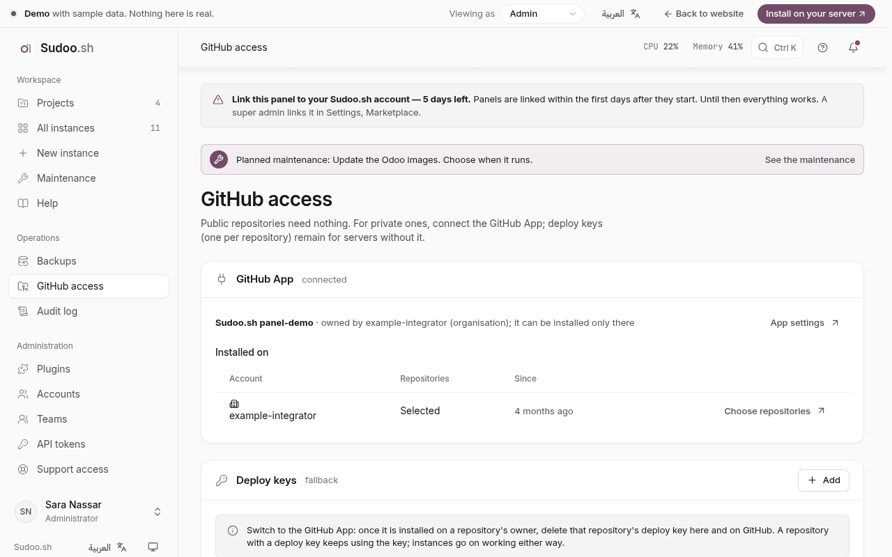
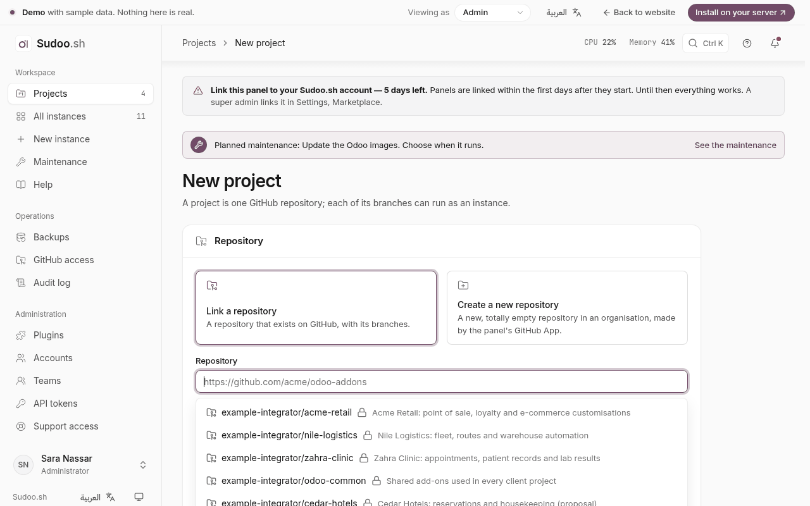

# Workflow: Connect GitHub and create your first project

[العربية](02-connect-github-first-project.ar.md) · [All workflows](README.md)

**Goal:** let the panel read your code on GitHub, then create a project from a repository.

**Who can do it:** a **super admin** connects GitHub (once). Maintainers and up create projects.

## Steps
1. Open **GitHub access** in the sidebar (Operations) and click **Connect GitHub**. (Figure 1)
2. Answer **Whose repositories will the instances use?** For a company's code choose **An organisation** and type its name (you must be an owner of that organisation on GitHub). Choose **My personal account** only when the code is in your own account. Click **Continue on GitHub**.
3. GitHub shows the new app already filled in. Press **Create GitHub App**. GitHub brings you back and the panel says "GitHub App created".
4. Click **Install on GitHub**, choose **All repositories** or **Only select repositories**, and press **Install**.
5. Open **Projects** and click **New project**.
6. Under **Repository** either **Link a repository** (search the repositories the app can read, or paste its address) or **Create a new repository** (the panel creates a new, empty, private repository in an organisation the app is installed on). (Figure 2)
7. Check the project's name and the Odoo version and edition new instances get. Click **Create project**.

## Screenshots
From the demo with invented sample data. Nothing shown is a real account.

*Figure 1. GitHub access, with the connected GitHub App. Shown in step 1.*

*Figure 2. New project: link or create a repository. Shown in step 6.*

## What you see when it worked
GitHub access lists the account under **Installed on**. The new project appears on **Projects**. A linked repository's branches are listed at once. A new repository has none until you push a first branch.

## Common problems
- **Create a new repository is refused:** the app lacks the **Administration: write** permission. The page says what to do on GitHub (an owner of the organisation accepts the change), then click **Check again**.
- **A personal account cannot get repositories created by an app.** Create an empty repository on GitHub and link it.
- **The installation does not show:** if you installed on GitHub directly or GitHub did not bring you back, it appears within a minute when you open GitHub access. **Refresh** reads it at once.
- **Repositories of another account than the app's owner** need deploy keys instead (see the Administrator guide, "Which account should own the app").
- You cannot create projects with a role below maintainer.
