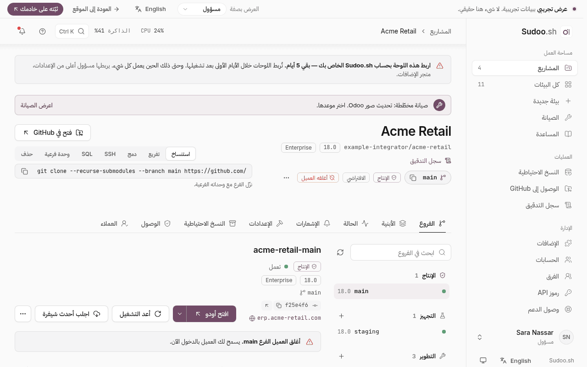

# سير العمل: الفروع والمراحل والترقية إلى الإنتاج

[English](03-branches-stages-promotion.md) · [كل سير العمل](README.md)

**الهدف:** تجربة الإصدار في التجهيز، وفحصه، ثم جعل الفرع فرع الإنتاج.

**من يستطيع:** يستطيع الجميع قراءة قائمة التحقق ومقارنة الفروع. ونقل الفرع إلى مرحلة أخرى يحتاج إلى مشرف فما فوق مع صلاحية `projects.manage` في ذلك الفرع. وإعادة بناء التجهيز من الإنتاج تحتاج إلى `instances.restore`.

> **الإنتاج بيانات حية.** اقرأ كل بند في قائمة التحقق قبل نقل الفرع. جعل الفرع إنتاجًا يغيّر ما تفعله اللوحة ببيئاته (انظر الجدول).

## المراحل الثلاث
| | التطوير | التجهيز | الإنتاج |
| :--- | :--- | :--- | :--- |
| الغرض | العمل اليومي | تجربة الإصدار | قاعدة البيانات الحية |
| يتوقف عند عدم الاستخدام | نعم، ما لم يُعطَّل | نعم، ما لم يُعطَّل | أبدًا |
| يُحذف بانتهاء المدة | نعم | نعم | أبدًا |
| نسخة يومية | بعد يوم استُخدم فيه | بعد يوم استُخدم فيه | كل يوم |
| الشيفرة الجديدة | حسب الاختيار | حسب الاختيار | معطّلة افتراضيًا: **احصل على أحدث شيفرة** عندما تكون جاهزًا |

أرقام مدة الحياة ووقت النسخ اليومي من إعدادات المشغّل، فراجع لوحتك لمعرفة القيم.

## الخطوات
1. تُنشأ الفروع على GitHub بالدفع. في صفحة المشروع اضغط **+** بجانب **التجهيز** أو **التطوير** لنسخ الأمر.
2. يظهر الفرع الجديد في **التطوير**. اسحبه إلى **التجهيز** أو استخدم **نقل إلى** من قائمته. (الشكل 1)
3. افتح قائمة الفرع واختر **إنشاء البيئة**. بيئة التجهيز نسخة محيّدة من بيانات الإنتاج. إذا اختلفت سلسلة Odoo عن الإنتاج فلا تُنسخ بياناته وتبدأ بقاعدة فارغة.
4. جرّب الإصدار في التجهيز. **إعادة البناء من الإنتاج** تستبدل قاعدة بيانات التجهيز وملفاته بنسخة محيّدة جديدة ويضيع كل ما أُنجز فيه منذ آخر إعادة بناء.
5. افتح **فحص الترقية** من قائمة فرع التجهيز (أو **مقارنة** لرؤية الإيداعات والملفات والوحدات).
6. اقرأ كل بند: ناجح أو يستحق القراءة أو يمنع الترقية، مع السبب. البنود: آخر بناء واختباراته، فحوصات CI في GitHub (إن استخدمها المشروع)، النسخة الاحتياطية للإنتاج، تغييرات الوحدات، الترحيلات المنتظرة، إصدار Odoo، أقفال الفروع، السعة والحدود.
7. إذا كانت أحدث نسخة احتياطية للإنتاج أقدم من حد المشغّل فاضغط **النسخ الاحتياطي الآن** ثم **الفحص من جديد**.
8. انقل الفرع: اسحبه إلى **الإنتاج** أو استخدم **نقل إلى**، وأكّد مربع الحوار الذي يشرح ما سيتغير.

## ماذا يفعل البند الأحمر
تمنع البنود الحمراء النقل **ما دام إعداد PROJECT_PROMOTION_BLOCKS في اللوحة مفعّلًا** (وهو مفعّل افتراضيًا). ويستطيع من يدير المشروع ويعرف سبب البند أن يختار **الترقية على أي حال**. يتم النقل ويُسجَّل التجاوز في سجل التدقيق مع البنود الحمراء. وإذا كان الإعداد معطّلًا تظهر البنود الحمراء لكنها لا تمنع النقل.
البنود التي «تستحق القراءة» لا تمنع النقل أبدًا. نسخة إنتاج قديمة أو حذف وحدة من هذا النوع.
الفحص السريع الذي يجريه النقل نفسه يترك البنود التي تحتاج إلى git (الوحدات والترحيلات)، لذا افتح **فحص الترقية** أولًا.

## لقطات الشاشة
من العرض التجريبي ببيانات مخترعة. لا شيء مما يظهر حساب حقيقي.

*الشكل 1. تبويب الفروع في مشروع: الإنتاج والتجهيز والتطوير. يظهر في الخطوة 2.*

## ما تراه عند النجاح
الفرع في **الإنتاج**. لا تتوقف بيئاته ولا تنتهي، وتُنسخ احتياطيًا كل يوم، ولا تأخذ شيفرة جديدة إلا عبر نسخة احتياطية وتراجع تلقائي.

## مشاكل شائعة
- **بند إصدار Odoo أحمر:** يعمل الفرع والإنتاج بسلسلتين مختلفتين. غيّر الشيفرة أو الإصدار أولًا، فلا يمكن نقل قاعدة بيانات إلى سلسلة أخرى بتغيير الشيفرة.
- **بند قفل أحمر:** الفرع أو فرع الإنتاج مقفل على غيرك. اسأل مسؤولًا.
- **بند سعة أحمر:** حدّ المشروع أو الخطة أو الإنتاج سيرفض النقل.
- **إخراج فرع من الإنتاج** يطلب تأكيدًا أيضًا، وقد تتوقف بيئاته وتنتهي.
- **فشل فحوصات CI** يمنع النقل فقط إذا كان حارس المستودع يمنع الترقية عند فشلها (معطّل افتراضيًا).

## اعرف المزيد
`#workflow-branches-stages-promotion`
