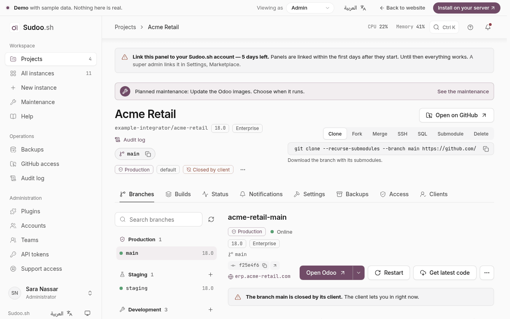

# Workflow: Branches, stages and promoting to production

[العربية](03-branches-stages-promotion.ar.md) · [All workflows](README.md)

**Goal:** rehearse a release in staging, check it, then make a branch the production one.

**Who can do it:** everyone can read the checklist and compare branches. Moving a branch to another stage needs maintainer or above with `projects.manage` in that branch. Rebuilding staging from production needs `instances.restore`.

> **Production is live data.** Read every line of the checklist before you move a branch. Making a branch production changes what the panel does with its instances (see the table below).

## The three stages
| | Development | Staging | Production |
| :--- | :--- | :--- | :--- |
| For | Day-to-day work | Rehearsing a release | The live database |
| Pauses when unused | Yes, unless switched off | Yes, unless switched off | Never |
| Deleted at end of lifetime | Yes | Yes | Never |
| Daily backup | After a day it was used | After a day it was used | Every day |
| New code | As chosen | As chosen | Off by default: **Get latest code** when ready |

The lifetime numbers and the daily backup time are the operator's settings (Settings), so look at your panel for the values. *(Source: USER_MANUAL Stages; config.py.)*

## Steps
1. Branches are created on GitHub by pushing. In the project's page click the **+** next to **Staging** or **Development** to copy the command.
2. The new branch appears in **Development**. Drag it to **Staging**, or use **Move to** in its menu. (Figure 1)
3. Open the branch's menu and choose **Create instance**. A staging instance is a neutralised copy of the production data. If the Odoo series differs from production, production's data cannot be copied and staging starts empty.
4. Rehearse the release in staging. **Rebuild from production** replaces staging's database and files with a new neutralised copy and loses everything done in staging since the last rebuild.
5. Open **Promotion check** in the staging branch's menu (or **Compare** to see commits, files and modules).
6. Read each line: green, amber or red with the reason. The lines are: latest build and tests, CI checks on GitHub (only when the project uses them), production's backup, module changes, migrations, Odoo version, locks, capacity.
7. If production's newest backup is older than the operator's limit, click **Back up now** and check again.
8. Move the branch: drag it to **Production** or **Move to**, and confirm the dialog that explains what changes.

## What a red line does
Red lines stop the move **while the panel's PROJECT_PROMOTION_BLOCKS setting is on** (it is on by default). A person who manages the project and knows why a line is red can tick **Promote anyway**. The move is then made and the override is written to the audit log with the red items. When the setting is off, red lines are shown but do not stop the move. *(Source: projects/promotion.py; web/v1/projects.py promotion_check, which logs "promotion checklist overridden".)*
Amber lines never stop the move. They are worth reading. An old production backup or a module removal is amber.
The quick check made by the move itself leaves out the lines that need git (modules, migrations), so open the **Promotion check** first.

## Screenshots
From the demo with invented sample data. Nothing shown is a real account.

*Figure 1. A project's Branches tab: Production, Staging and Development. Shown in step 2.*

## What you see when it worked
The branch is in **Production**. Its instances never pause, never expire, are backed up every day, and get new code only through a backup and an automatic rollback.

## Common problems
- **A red Odoo version line:** the branch and production run different Odoo series. Change the code or the version first, a database cannot be moved to another series by changing code.
- **A red lock line:** the branch or production's branch is locked to people other than you. Ask an administrator.
- **A red capacity line:** the project, the plan or the production limit would refuse the move.
- **Moving a branch out of production** also asks for confirmation. Its instances can then pause and expire.
- **Failing CI checks** stop the move only when the project's repository guard blocks promotion on failing checks (off by default).
