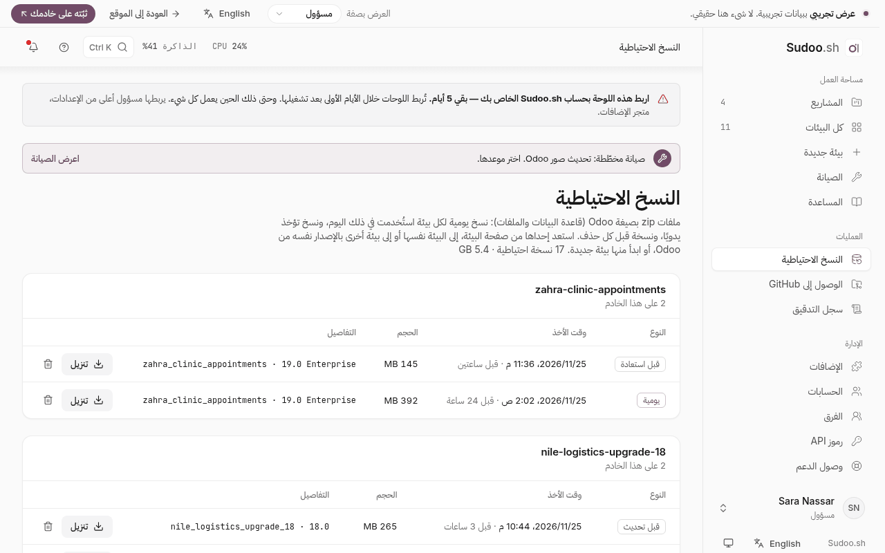

# سير العمل: النسخ الاحتياطية والاستعادة

[English](04-backups-and-restores.md) · [كل سير العمل](README.md)

**الهدف:** حفظ بيانات البيئة الآن، وإعادتها إلى حالة سابقة عند حدوث خطأ.

**من يستطيع:** يرى الجميع بطاقة النسخ الاحتياطية. تحتاج الاستعادة إلى صلاحية الاستعادة. ويحتاج تنزيل النسخة أو حذفها إلى صلاحية إدارة النسخ. واستعادة نسخة بيئة أخرى تحتاج إلى الصلاحيتين (المسؤولون والمسؤولون الأعلى).

> **الاستعادة تستبدل قاعدة بيانات البيئة وملفاتها الحالية.** يُستبدل كل ما جرى بعد تاريخ النسخة. تأكد من اسم البيئة وتاريخ النسخة قبل التأكيد. في بيئة الإنتاج يذكر مربع الحوار ذلك.

## الخطوات
1. افتح صفحة البيئة. بطاقة **النسخ الاحتياطية** في تبويب النظرة العامة، ولها أيضًا تبويب خاص.
2. للحفظ الآن اضغط **انسخ احتياطيًا الآن** وأضف تعليقًا يوضح السبب.
3. للرجوع، تأكد أولًا أنك في البيئة الصحيحة، وانظر إلى تاريخ النسخة ونوعها في القائمة. (الشكل 1)
4. اضغط **استعد الأحدث**، أو **استعد** على أحد أسطر القائمة.
5. اقرأ مربع الحوار. يعرض تاريخ النسخة ويذكر أن قاعدة البيانات والملفات تعود إلى تلك الحالة وأن التغييرات اللاحقة تُستبدل. اضغط **استعد** فقط إذا كان هذا ما تريده.
6. لا تقاطع المهمة. تابع خطواتها: تحفظ اللوحة الحالة الحالية أولًا، ثم توقف Odoo، وتعيد النسخة، ثم تشغّل Odoo. يعتمد الوقت على حجم قاعدة البيانات والملفات، فلا نَعِد بوقت محدد.
7. للتراجع استخدم **تراجع إلى ما قبل الاستعادة** في الشريط أعلى صفحة البيئة، ما دام متاحًا.

## ما تفعله اللوحة عند حدوث مشكلة
- **فشل النسخ الاحتياطي الأمان:** لا تمضي الاستعادة. النسخ الأمان هو الخطوة الأولى ويجري قبل إيقاف Odoo وقبل إعادة النسخة. عالج السبب الظاهر في المهمة ثم أعد المحاولة.
- **فشلت الاستعادة في منتصفها أو قوطعت:** قد تكون قاعدة البيانات في حالة غير معروفة. استخدم **تراجع إلى ما قبل الاستعادة** إن كان متاحًا واقرأ سجل المهمة. إن لم تعمل البيئة فاسأل مسؤولًا قبل المحاولة مجددًا. (يمضي التراجع حتى لو تعذر حفظ الحالة الحالية، ويعرض تحذيرًا بذلك.)
- **يُشغَّل Odoo بعد الاستعادة** حتى لو كانت البيئة متوقفة قبلها.

## مدة حفظ النسخة الاحتياطية الأمان
تُحفظ الحالة السابقة للاستعادة باسم «قبل استعادة» للعدد الذي يحدده المشغّل من الساعات (**الإعدادات ← النسخ الاحتياطية**، `ROLLBACK_HOURS`، والقيمة الافتراضية 24). تعرض ملاحظات المهمة والشريط الوقت الدقيق.

## استعادة نسخة من بيئة أخرى
اختر **استعد نسخة احتياطية أخرى…** ثم نسخة من إصدار Odoo نفسه وأكّد. تُحيَّد النسخة: تُعطَّل خوادم البريد الصادر والإجراءات المجدولة، وتأخذ قاعدة البيانات هوية جديدة، فلا ترسل بريدًا حقيقيًا ولا تشغّل مهام حقيقية.
**أبقِها معطّلة** حتى تراجع المستلمين وإعدادات خادم البريد والإجراءات المجدولة في Odoo. تفعيلها مبكرًا قد يرسل رسائل حقيقية أو يشغّل مهامًا على عملاء حقيقيين.
الوحدات التي لا يملكها مستودع هذه البيئة يتجاهلها Odoo حتى تضيفها.

## لقطات الشاشة
من العرض التجريبي ببيانات مخترعة. لا شيء مما يظهر حساب حقيقي.

*الشكل 1. صفحة النسخ الاحتياطية: كل نسخة بنوعها ووقتها وحجمها. يظهر في الخطوة 3.*

## ما تراه عند النجاح
تعمل البيئة ببيانات تلك النسخة. تعرض المهمة كل خطوة، ويعرض شريط خيار التراجع.

## مشاكل شائعة
- **زر استعد الأحدث معطّل:** لا توجد نسخة احتياطية للبيئة بعد.
- **نسخة معطّلة في قائمة النسخ الأخرى:** إصدار Odoo مختلف، أو نسخة Enterprise على بيئة Community. يظهر السبب.
- **لا توجد نسخة يومية:** البيئة التي لم يستخدمها أحد منذ آخر نسخة يومية لا تحصل على جديدة، والنسخة اليومية تحتفظ بالأحدث فقط.
- النسخ اليدوية والنسخ قبل الحذف تبقى حتى يحذفها أحد، فراجع القائمة من وقت لآخر.

## اعرف المزيد
`#workflow-backups-and-restores`
