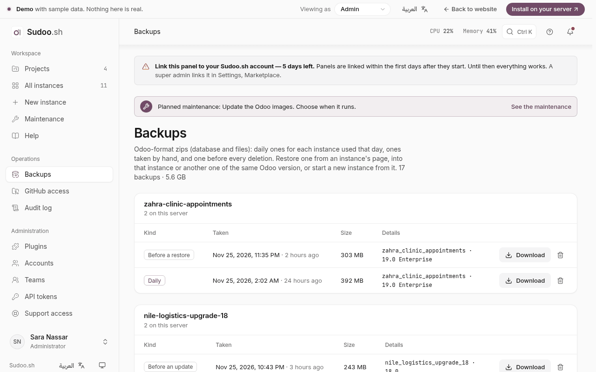

# Workflow: Backups and restores

[العربية](04-backups-and-restores.ar.md) · [All workflows](README.md)

**Goal:** save an instance's data now, and put it back to an earlier state if something goes wrong.

**Who can do it:** everyone sees the Backups card. Restoring needs the restore permission. Downloading or deleting a backup needs the backups permission. Restoring another instance's backup needs both (administrators and super admins).

> **A restore replaces the instance's current database and files.** Everything done since the backup is replaced. Check the instance name and the backup's date before you confirm. On a production instance the dialog says so.

## Steps
1. Open the instance's page. The **Backups** card is on the **Overview** tab and also has its own **Backups** tab.
2. To save now, click **Back up now** and add a comment that says why ("before the price import").
3. To go back, first check you are on the right instance and look at the backup's date, kind and revision in the list. (Figure 1)
4. Click **Restore the latest**, or **Restore** on one line of the list.
5. Read the dialog. It shows the backup's date and says the database and files go back to that state and later changes are replaced. Click **Restore** only if that is what you want.
6. Do not interrupt the job. Watch the steps in the job: the panel saves the current state first, stops Odoo, puts the backup back, then starts Odoo. The time it takes depends on the size of the database and files, so no fixed time is promised.
7. To undo, use **Rollback to before the restore** in the banner at the top of the instance page, while it is offered.

## What the panel does if something goes wrong
- **The safety backup fails:** the restore does not proceed. The safety backup is the first step and it runs before Odoo is stopped and before the backup is put back. Fix the cause shown in the job and try again.
- **The restore fails halfway or is interrupted:** the database may be in an unknown state. Use **Rollback to before the restore** if it is offered, and read the job's log. If the instance is not usable, ask an administrator before trying again. (A rollback goes ahead even when the current state cannot be saved, and says so in a warning.)
- **Odoo is started after a restore even if the instance was paused before.** *(Code: operations._finish_restore.)*

## How long the safety copy is kept
The state before a restore is kept as a "Before a restore" backup for the number of hours the operator set (**Settings, Backups**, `ROLLBACK_HOURS`; the shipped default is 24). The job's notes and the banner show the exact time.

## Restoring a backup of another instance
Pick **Restore another backup…**, choose a backup of the same Odoo version, and confirm. The copy is neutralised: outgoing mail servers and scheduled actions are switched off, and the copy gets its own database identity, so it cannot send real mail or run real jobs.
**Keep them switched off** until you have checked recipients, mail server settings and scheduled actions in Odoo. Switching them back on too early can send real e-mails or run real jobs against real customers.
Modules of the other instance that this instance's repository does not have are skipped by Odoo until you add them.

## Screenshots
From the demo with invented sample data. Nothing shown is a real account.

*Figure 1. The Backups page: each backup with its kind, time and size. Shown in step 3.*

## What you see when it worked
The instance is running with the data of that backup. The job lists every step. A banner offers the rollback.

## Common problems
- **Restore the latest is greyed out:** the instance has no backup yet.
- **A backup is greyed out in Restore another backup:** it is of another Odoo version, or an Enterprise backup on a Community instance. The reason is shown.
- **No daily backup:** an instance nobody used since its last daily backup gets no new one. Daily backups keep only the latest.
- Backups taken by hand and before deletions stay until someone deletes them. Check the list from time to time.
