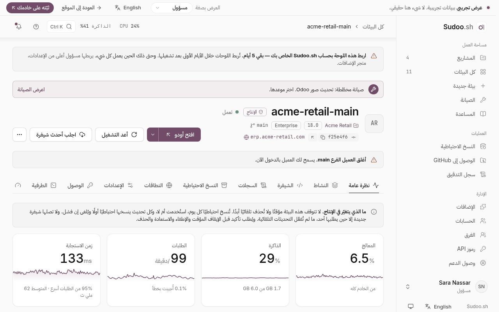

# سير العمل: تحديث Odoo وشيفرتك

[English](06-updating-odoo-and-code.md) · [كل سير العمل](README.md)

**الهدف:** إدخال شيفرة جديدة من GitHub إلى البيئة، ونقل قاعدة البيانات إلى إصدار Odoo التالي دون فقدان بيانات.

**من يستطيع:** جلب الشيفرة يحتاج إلى صلاحية على البيئة. الترقية إلى إصدار Odoo أحدث للمسؤولين والمسؤولين الأعلى. وتقصير مدة حياة البيئة يحتاج إلى حق حذف البيئات.

> **اعرف ما يحميك.** النسخة الاحتياطية الأمان والتراجع التلقائي قبل تحديث الشيفرة يحدثان فقط عندما ينطبق SAFE_UPDATES. وهو مفعّل افتراضيًا و**دائمًا في بيئة الإنتاج**، لكن للمسؤول تعطيله لمراحل أخرى. بدونه لا تعيد اللوحة التحديث الفاشل إلى حالته. راجع إعدادات لوحتك.

## الجزء الأول: شيفرة جديدة
1. ادفع إيداعاتك إلى فرع البيئة على GitHub.
2. افتح البيئة واضغط **اجلب أحدث شيفرة**. وعندما يكون **اجلب الشيفرة الجديدة تلقائيًا** مفعّلًا تفعل اللوحة ذلك بنفسها (تفحص GitHub بجدول يحدده المشغّل، وفورًا عندما يبلغها GitHub بدفعة). (الشكل 1)
3. تابع المهمة في **النشاط**. مع التحديث الآمن: تفحص GitHub، وتأخذ نسخة «قبل تحديث» إن تغيرت الشيفرة، وتنزّل الشيفرة، وترقّي الوحدات التي تغيرت ملفاتها (إذا كان **رقِّ الوحدات التي تغيّرت** مفعّلًا)، ثم تعيد تشغيل Odoo.
4. إذا لم يكن هناك جديد تقول المهمة إنه لا جديد على GitHub.
5. الحقل أو العرض أو ملف البيانات الجديد يحتاج إلى ترقية وحدته: تحدث بعد التحديث إذا كان **رقِّ الوحدات التي تغيّرت** مفعّلًا. وإلا استخدم **رقِّ الوحدات…** واكتب الأسماء التقنية مفصولة بفواصل، أو `all`.

**عند فشل التحديث (مع التحديث الآمن):** تعيد اللوحة الشيفرة السابقة، وقاعدة البيانات من النسخة الاحتياطية إن كانت الترقية قد غيّرتها، وتشغّل Odoo من جديد. تفشل المهمة بجملة تذكر الإيداع والخطوة، وتعرضها صفحة البيئة حتى ينجح تحديث. أصلح الشيفرة وادفع، أو اضغط **اجلب أحدث شيفرة** لتجربة الإيداع نفسه. التحديثات التلقائية لا تعيد محاولة إيداع جرى التراجع عنه. وإن فشلت الإعادة أيضًا تذكر الرسالة النسخة التي يجب استعادتها (تبويب النظرة العامة، **استعد**). تبقى البيئة المتوقفة متوقفة، ولا تُنسخ احتياطيًا إلا عند ترقية وحدات.

## الجزء الثاني: الترقية إلى إصدار Odoo أحدث
افتح البيئة، تبويب **الترقية**.
1. **تشغيل الفحص المسبق.** يقرأ الوحدات المثبّتة ويبحث عن وحدات مستودعك في فرع الترقية (المسمّى بالإصدار الجديد، مثل `19.0`). لا يتغير شيء. كل وحدة: جاهزة، أو لم تُنقل، أو بلا سلسلة إصدار، أو غير قابلة للتثبيت، أو مفقودة. بدون فرع ترقية يجري الاختبار على Odoo العادي، فتغيب وحداتك.
2. **اختبار الترقية.** تنسخ اللوحة البيئة احتياطيًا وترقّي النسخة وتضعها في بيئة تجهيز جديدة بالإصدار الجديد، محيّدة فلا يخرج بريد. افتحها واختبر عملياتك. إعادة الاختبار تبدأ من نسخة جديدة.
3. **ترقية الإنتاج.** أكّد. يرى الزوار صفحة «جارٍ الترقية»، وتؤخذ نسخة أخيرة، وتجري الترقية على أحدث البيانات، وتنتقل البيئة إلى الإصدار والفرع الجديدين، ويبدأ Odoo. يُوقَف Odoo (صيانة) قبل أخذ النسخة. وإذا فشلت أي خطوة أو لم يبدأ Odoo تعيد اللوحة البيئة إلى تلك النسخة بالشيفرة والفرع وإصدار Odoo السابقة. وإن فشلت الإعادة أيضًا تذكر المهمة ملف النسخة الذي تستعيده من بطاقة النسخ الاحتياطية. وإن كان ملف النسخة قد زال فلا يمكن تنفيذ الإعادة.
4. **بعد الترقية، إلغاء الترقية** يعيد البيئة إلى النسخة المأخوذة قبلها طوال المدة التي حددها المشغّل (UPGRADE_ROLLBACK_MINUTES، والقيمة الافتراضية 60 دقيقة، و0 تعطّله). وتفعل اللوحة ذلك بنفسها إن توقف Odoo عن الاستجابة خلال تلك المدة، وتعيد المحاولة على فترات. **كل ما تغيّر في Odoo بعد الترقية يضيع بالإلغاء.** تحفظ اللوحة أولًا الحالة المرقّاة كنسخة «قبل تراجع». وإن تعذّر الحفظ فلا تلغي الترقية وتترك البيئة كما هي، وتطلب الرسالة إصلاح مشكلة النسخ ثم الإلغاء من جديد، أو استعادة نسخة ما قبل الترقية يدويًا إن كان فقدان التغييرات مقبولًا. **إبقاء الترقية** ينهي المدة مبكرًا.

**كيف تُرقّى قاعدة البيانات:** قواعد Enterprise تستخدم خدمة الترقية الرسمية من Odoo S.A. ضمن اشتراكك وشروطها (تكتب رمز الاشتراك لتلك المهمة وتحتفظ به اللوحة طوال المهمة فقط). وقد تستغرق ساعة أو أكثر. وقواعد Community تستخدم OpenUpgrade إصدارًا بعد إصدار، والوحدة التي لا يغطيها توقف الترقية.
**ما لا تفعله أي طريقة عنك:** على المطورين نقل وحداتك إلى الإصدار الجديد في فرع الترقية.

## لقطات الشاشة
من العرض التجريبي ببيانات مخترعة. لا شيء مما يظهر حساب حقيقي.

*الشكل 1. صفحة بيئة مع إعادة التشغيل وجلب أحدث شيفرة. يظهر في الخطوة 2.*

## ما تراه عند النجاح
يعرض النشاط المهمة منتهية. وتعمل البيئة بالشيفرة الجديدة أو بإصدار Odoo الجديد.

## مشاكل شائعة
- «فشل عند ترقية الوحدات»: اقرأ سجل المهمة، أصلح الوحدة، ثم ادفع وأعد المحاولة.
- لا يفعل التحديث التلقائي شيئًا: الإيداع الذي فشل سابقًا لا يُعاد. استخدم **اجلب أحدث شيفرة**.
- **بدّل الفرع…** ينقل البيئة إلى فرع آخر (مثلًا بعد دمج الفرع وحذفه).

## اعرف المزيد
`#workflow-updating-odoo-and-code`
