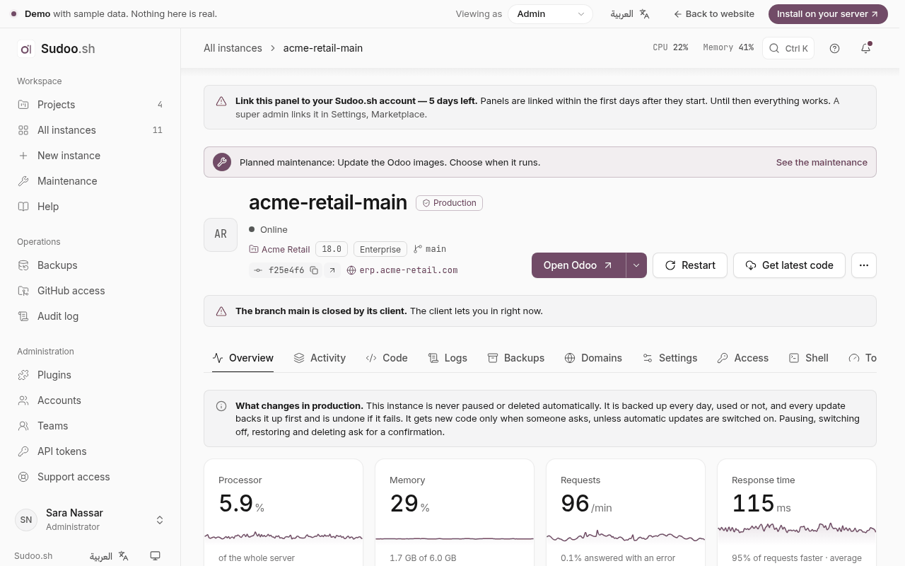

# Workflow: Updating Odoo and your code

[العربية](06-updating-odoo-and-code.ar.md) · [All workflows](README.md)

**Goal:** bring new code from GitHub into an instance, and move a database to the next Odoo version, without losing data.

**Who can do it:** getting code needs permission on the instance. Upgrading to a newer Odoo version is for administrators and super admins. Shortening an instance's lifetime needs the right to delete instances.

> **Know what protects you.** A safety backup and an automatic put-back happen before a code update only when SAFE_UPDATES applies. It is on by default and **always on for a production instance**, but an administrator can turn it off for other stages. Without it a failed update is not put back by the panel. Check your panel's Settings.

## Part 1: new code
1. Push your commits to the instance's branch on GitHub.
2. Open the instance and click **Get latest code**. When **Get new code automatically** is on, the panel does this by itself (it checks GitHub on a schedule set by the operator, and at once when GitHub reports a push). (Figure 1)
3. Watch the job in **Activity**. With safe updates: it checks GitHub, takes a "Before an update" backup if the code changes, downloads the code, upgrades the modules whose files changed (when **Upgrade changed modules** is on), runs checks and restarts Odoo.
4. If nothing is new the job says "Already up to date".
5. A new field, view or data file needs its module upgraded: it happens after the update when **Upgrade changed modules** is on. Otherwise use **Upgrade modules...** and type technical names separated by commas, or `all`.

**If an update fails (with safe updates on):** the panel puts back the previous code, the database from the backup when the upgrade may have changed it, and starts Odoo again. The job fails with a sentence naming the commit and the step, and the instance page shows it until an update works. Fix the code and push, or click **Get latest code** to try the same commit again. Automatic updates do not retry a commit that was rolled back. If putting back fails too, the message names the backup to restore (Overview tab, **Restore**). A paused instance stays paused, and is backed up only when modules are upgraded.

## Part 2: upgrading to a newer Odoo version
Open the instance, tab **Upgrade**.
1. **Run the pre-check.** It reads the installed modules and looks for those of your repository in the upgrade branch (named after the new version, for example `19.0`). Nothing changes. Each module is Ready, Not ported, No version series, Not installable or Missing. Without an upgrade branch the test runs on plain Odoo, so your own modules are missing.
2. **Test the upgrade.** The panel backs up the instance, upgrades that copy and puts it in a new staging instance on the new version, neutralised so no e-mail goes out. Open it and test your processes. **Run the test again** starts from a fresh backup.
3. **Upgrade production.** Confirm. Visitors see an **Upgrading** page, a final backup is taken, the upgrade runs on the latest data, the instance switches to the new version and branch, and Odoo starts. Odoo is stopped (maintenance) before the backup is taken. If any step fails or Odoo does not start, the panel puts the instance back on that backup, with the previous code, branch and Odoo version. If putting back fails too, the job names the backup file to restore from the Backups card. If that backup file is gone, the put-back cannot run.
4. **After the upgrade, Cancel the upgrade** puts the instance back on the backup taken just before it, for the time the operator set (UPGRADE_ROLLBACK_MINUTES; the shipped default is 60 minutes, and 0 turns it off). The panel also does it by itself if Odoo stops answering during that time, retrying at intervals. **Anything changed in Odoo after the upgrade is lost by cancelling.** The panel first saves the upgraded state as a "Before a rollback" backup. If it cannot save it, it does **not** cancel and leaves the instance as it is, and the message tells you to fix the backup problem and cancel again, or restore the pre-upgrade backup by hand if losing the changes is acceptable. **Keep the upgrade** ends the time early.

**How the database is upgraded:** Enterprise databases use Odoo S.A.'s upgrade service under your subscription and terms (you type the subscription code for that job, and the panel keeps it only for the job's duration). It often takes an hour or more. Community databases use OpenUpgrade, one version at a time. A module it does not cover stops the upgrade.
**What no method does for you:** your own modules must be ported to the new version by developers, in the upgrade branch.

## Screenshots
From the demo with invented sample data. Nothing shown is a real account.

*Figure 1. An instance's page, with Restart and Get latest code. Shown in step 2.*

## What you see when it worked
Activity shows the job as done. The instance runs the new code or the new Odoo version.

## Common problems
- "Failed at upgrading modules": read the job's log, fix the module, push, try again.
- An automatic update does nothing: a commit that failed before is not retried. Use **Get latest code**.
- **Switch branch...** moves the instance to another branch (for example after the branch was merged and deleted).

## Review limits (not for the final page)
Part 1 and the production upgrade and cancel steps are traced to operations.update_code and upgrades/run.py (promote, _put_back, cancel). The pre-check statuses, OpenUpgrade coverage, Odoo's upgrade-service behaviour and the Enterprise code handling beyond the job are from the manual only, and untested here. Nothing here is a guarantee that an upgrade succeeds. No upgrade was run.
