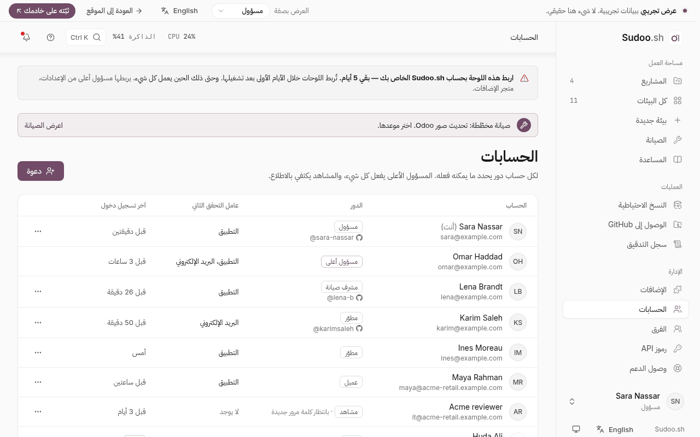

# سير العمل: أعضاء الفريق والأدوار

[English](07-team-members-and-roles.md) · [كل سير العمل](README.md)

**الهدف:** دعوة أشخاص إلى اللوحة بالدور المناسب، وتغيير وصولهم أو إزالته، ومعرفة ما يستطيعه كل دور.

**من يستطيع:** المسؤولون والمسؤولون الأعلى عبر **الحسابات**. وحده المسؤول الأعلى ينشئ مسؤولًا أعلى أو يغيّره أو يحذفه. أما الفرق والوصول لكل مشروع فميزتان مدفوعتان وتحتاجان إلى مسؤول.

> **الدور هو أقصى ما يستطيعه الشخص.** اختر أدنى دور يكفي. داخل المشروع يضيّق وصول المشروع الدور أكثر ولا يوسّعه أبدًا.

## الأدوار (ملخص)
مسؤول أعلى، ومسؤول، ومشرف صيانة، ومطوّر، ومشاهد. يرى الجميع البيئات والسجلات. يستطيع المطوّرون جلب الشيفرة وإعادة التشغيل. ويستطيع مشرفو الصيانة أيضًا إنشاء البيئات والنسخ الاحتياطي والاستعادة وتغيير إعدادات البيئة. ويستطيع المسؤولون أيضًا حذف البيئات وإدارة النطاقات والحسابات وسجل التدقيق والفرق والعملاء. ويستطيع المسؤولون الأعلى أيضًا تغيير الإعدادات وتطبيق GitHub وقوالب البريد والمسؤولين الأعلى. الجدول الكامل في دليل المستخدم، القسم 9.

## الخطوات: دعوة شخص
1. افتح **الحسابات** (الشريط الجانبي، قسم الإدارة) واضغط **دعوة**. (الشكل 1)
2. اكتب **بريد** الشخص (لا يجوز أن يستخدمه حساب آخر) واختر **الدور**. الاسم اختياري.
3. يصل الشخص بريدٌ فيه رابط يعمل **مرة واحدة** وحتى انتهاء مدته. مدة الدعوة هي إعداد المشغّل INVITATION_HOURS (الافتراضي المشحون 72 ساعة في الشيفرة). يختار كلمة مرور واسمًا، ويدخل، ويُعرض عليه عامل تحقق ثانٍ (ويُطلب منه إعداده أولًا إن كانت اللوحة تشترطه).
4. إلى ذلك الحين تعرض القائمة «مدعوّ» وموعد انتهاء الرابط. استخدم **أرسلها مجددًا** لرابط جديد (يتوقف القديم) أو **ألغِ الدعوة**.

## تغيير الوصول أو إزالته
- **تعديل:** الاسم أو البريد أو الهاتف أو الدور. إذا تغيّر دور حساب آخر خرج من اللوحة. وتغيير دورك أنت يطلب تأكيدًا ويُخرجك.
- **عيّن كلمة مرور جديدة:** تُنهي جلسات الحساب الحالية. اختر التوليد (تظهر مرة واحدة، فأعطها عبر قناة آمنة) أو اكتب كلمة مرور.
- **أزل عوامل التحقق الثانية:** لمن فقد هاتفه أو بريده. يدخل بعدها بكلمة المرور وحدها إلى أن يعدّ عاملًا جديدًا. افعل ذلك فقط بعد التأكد أنه الشخص نفسه.
- **حذف:** يُزال الحساب ويخرج فورًا.
- لا يمكن إعطاء آخر مسؤول أعلى دورًا آخر ولا حذفه *(الشيفرة: accounts.py)*. ولا يجوز أن يشترك حسابان في بريد واحد.
- **حساب جديد** (بدل الدعوة) يُعرض فقط ما دام البريد غير معدّ، أو حين يسمح به إعداد المشغّل INVITATION_PASSWORD_FALLBACK.

## لقطات الشاشة
من العرض التجريبي ببيانات مخترعة. لا شيء مما يظهر حساب حقيقي.

*الشكل 1. الحسابات: دور كل شخص وعامله الثاني وآخر دخول له. يظهر في الخطوة 1.*

## ما تراه عند النجاح
تعرض قائمة الحسابات الشخص بدوره، وهل له عامل تحقق ثانٍ، وآخر دخول له.

## مشكلات شائعة
- يقول الشخص إن الرابط لا يعمل: يعمل مرة واحدة وينتهي. استخدم **أرسلها مجددًا**.
- لا يستطيع شخص فعل أمر ما: تذكر اللوحة الصلاحية الناقصة. راجع دوره ووصول المشروع.

## حدود المراجعة
أسماء الأدوار والأزرار من ملفات الترجمة العربية للوحة. ما سوى ذلك كما في النسخة الإنجليزية.
