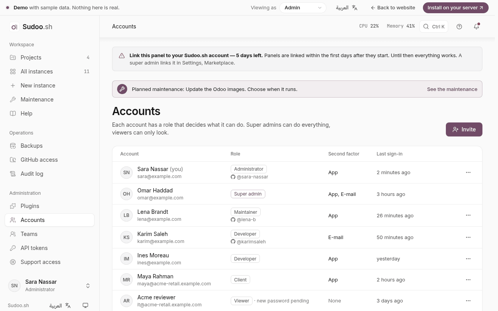

# Workflow: Team members and roles

[العربية](07-team-members-and-roles.ar.md) · [All workflows](README.md)

**Goal:** invite people to the panel with the right role, change or remove their access, and know what each role can do.

**Who can do it:** administrators and super admins use **Accounts**. Only a super admin can create, change or delete a super admin. Teams and per-project access are premium features and need an administrator.

> **A role is the most a person can do.** Choose the lowest role that works. Inside a project, project access can narrow a role further, never widen it.

## The roles (summary)
Super admin, Administrator, Maintainer, Developer, Viewer. Everyone sees instances and logs. Developers can get code and restart. Maintainers can also create instances, back up, restore and change instance settings. Administrators can also delete instances, manage domains, accounts, the audit log, teams and clients. Super admins can also change Settings, GitHub App, e-mail templates and super admins. The full table is in the User Manual, section 9.

## Steps: invite a person
1. Open **Accounts** (sidebar, Administration) and click **Invite**. (Figure 1)
2. Type the person's **e-mail** (no other account may use it) and choose the **role**. The name is optional.
3. The person gets an e-mail with a link that works **once** and until it expires. The expiry is the operator's INVITATION_HOURS setting (shipped default 72 hours, in code). They choose their password and name, are signed in, and are offered a second factor (asked to set one up first when the panel requires it).
4. Until then the list shows **Invited** and when the link expires. Use **Send again** for a new link (the old one stops working) or **Revoke invitation**.

## Change or remove access
- **Edit:** change name, e-mail, phone or role. When another account's role changes, that account is signed out. Changing your own role asks for confirmation and signs you out.
- **Set a new password:** ends the account's current sessions. Choose **Generate** (shown once, give it through a safe channel) or **Type a password**.
- **Remove second factors:** for a person who lost their phone or mailbox. They then sign in with the password only until they set up a new one. Do this only after you are sure it is that person.
- **Delete:** the account is removed and signed out at once.
- The last super admin cannot be given another role or deleted *(code: accounts.py)*. Two accounts cannot share an e-mail.
- **New account** (instead of invitation) is only offered while e-mail is not set up, or when the operator's INVITATION_PASSWORD_FALLBACK allows it.

## Screenshots
From the demo with invented sample data. Nothing shown is a real account.

*Figure 1. Accounts: role, second factor and last sign-in of each person. Shown in step 1.*

## What you see when it worked
The Accounts list shows the person with their role, whether they have a second factor and their last sign-in.

## Common problems
- The person says the link does not work: it works once and expires. Use **Send again**.
- A person cannot do something: the panel says which permission is missing. Check their role and the project's access.
