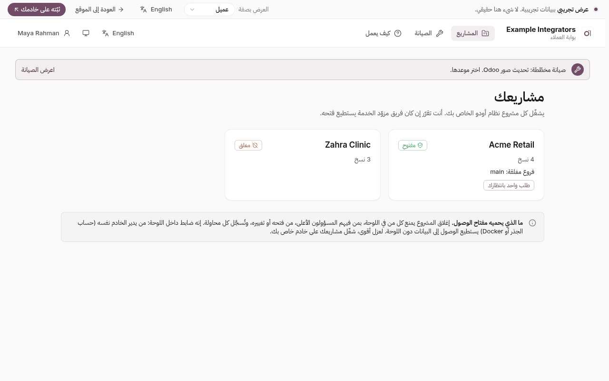

# سير العمل: بوابة العميل

[English](08-client-portal.md) · [كل سير العمل](README.md)

**الهدف:** إعطاء العميل مكانًا يرى فيه مشاريع Odoo الخاصة به ويقرر هل يجوز لفريقك فتحها.

**من يستطيع:** المسؤولون يضيفون العملاء ويزيلونهم في تبويب **العملاء** بالمشروع. والعميل يستخدم البوابة. إضافة عميل ميزة **خطة Business** (ترفضها اللوحة برسالة عن الخطة إن لم تشملها). وللمسؤولين الأعلى وصول طارئ فقط ما دام العميل يسمح به.

> **الإغلاق قرار العميل.** ما دام المشروع مغلقًا لا يستطيع أحد من فريقك فتحه أو تغييره أو نسخه أو استعادته أو قراءة سجلاته أو رؤية كلمات مروره، ولا حتى المسؤولون الأعلى، وكل محاولة تُسجَّل. هذا ضبط داخل اللوحة. ومن يدير الخادم نفسه (root أو Docker) يظل قادرًا على الوصول إلى البيانات. وللعزل الأقوى شغّل المشروع على خادم خاص به.

## خطوات فريقك: إضافة عميل
1. افتح المشروع وتبويب **العملاء**.
2. اضغط **أضف عميلًا**. أدخل حساب عميل موجودًا (يُضاف فورًا) أو بريدًا جديدًا (تُرسل دعوة). ويجوز منح العميل النسخ الاحتياطية وسطر أوامر.
3. أخبر العميل أين يدخل: عنوان البوابة الخاص إن حدده المشغّل (PORTAL_DOMAIN)، وإلا عنوان اللوحة. يرى حساب العميل البوابة ولا شيء غيرها من اللوحة.
4. لإزالة عميل استخدم **إزالة** في تبويب العملاء. لا يعود يرى المشروع، ويبقى المفتاح كما هو.
5. حين يكون شيء مغلقًا يظهر «مقفل». استخدم **اطلب وصولًا** على المشروع أو الفرع أو البيئة: اكتب السبب وعدد الساعات. يصل العميل بريد ويجيب في البوابة.

## ما يفعله العميل
1. يفتح المشروع في **مشاريعك**. المفتاح تحت «وصول فريق المزوّد» هو **مفتوح** أو **مغلق** أو **مفتوح حتى** وقت (ساعة أو 4 أو 24 افتراضيًا، أو عدد يكتبه حتى الحد الأقصى للمشغّل). (الشكل 1)
2. يتبع كل **فرع** المشروع ما لم يُعطَ إعداده الخاص (الإنتاج مغلق والتطوير مفتوح).
3. **طلبات الوصول:** **وافق** (مع اختيار الأشخاص ومدة أقصر إن شاء) أو **ارفض**. ويُغلق الوصول المعتمد من تلقاء نفسه.
4. **اقفل** المشروع أو الفرع: بقوة المغلق، ولا يُسمح لأحد، ولا حتى للمعتمدين. الوصول الطارئ فقط إن كان مسموحًا. العميل وحده يفتح القفل. ولا يُنشر عليه شيء تلقائيًا.
5. **الوصول الطارئ** مسموح افتراضيًا لمدة قصيرة (إعداد المشغّل، 60 دقيقة افتراضيًا) مع سبب، ويصل العميل بريد فورًا. ويستطيع العميل إيقافه لكل مشروع.
6. **سجل النشاط:** كل إجراء في المشروع بما في ذلك البيانات المفتوحة. **تصدير CSV** ينزّل حتى سنة.

## التأكيد بالبريد
كل تغيير كبير (الفتح والإغلاق والأقفال وتشغيل الوصول الطارئ وإيقافه والموافقة على طلب والأشخاص المسموح لهم) ينتظر تأكيد العميل برابط في البريد أو رمز من 6 أرقام، في المتصفح نفسه، ضمن مدة المشغّل (المشحونة 15 دقيقة). ويعمل كلٌّ منهما مرة واحدة. لا يتغير شيء إن لم يؤكد. أما رفض طلب وإنهاء وصول أحد فيحدثان فورًا. ويحتاج ذلك إلى إعداد البريد في اللوحة وإلى تشغيل CLIENT_CONFIRMATIONS (وهو الافتراضي).

## لقطات الشاشة
من العرض التجريبي ببيانات مخترعة. لا شيء مما يظهر حساب حقيقي.

*الشكل 1. بوابة العميل: مشاريعك، ومفتاح كل مشروع. يظهر في الخطوة 1.*

## ما تراه عند النجاح
يعرض تبويب العملاء العميل. وتعرض بوابته المشروع ومفتاحه. ويعرض سجل النشاط كل دخول.

## مشكلات شائعة
- **رُفضت إضافة العميل:** الخطة لا تشمل بوابة العميل.
- **لا يستطيع فريقك فتح مشروع مغلق:** هذا هو المقصود. أرسل طلبًا، أو استخدم الوصول الطارئ إن كنت مسؤولًا أعلى وكان العميل يسمح.
- **لا يصل تأكيد العميل:** راجع إعداد البريد. الرابط يعمل مرة واحدة، في المتصفح نفسه، وينتهي.
- **تتخطى الصيانة المشروع المغلق** ما لم يسمح العميل بتنفيذها.

## حدود المراجعة
فُحص في الشيفرة عند 3.5.0: رفض الإغلاق لمن لم يسمح لهم العميل (projects/access.py)، وشرط خطة Business (entitlements.py)، والقيم الافتراضية للطوارئ والتأكيد ومدة الفتح (config.py). لم يُتتبّع: نصوص البريد وسير التأكيد ومحتوى سجل النشاط والقول إن الإغلاق ينهي الموافقات السابقة. أسماء الأزرار من ملفات الترجمة العربية للوحة (clients.ts). عبارة «مقفل» هي ما تعرضه اللوحة على علامة الإغلاق.
