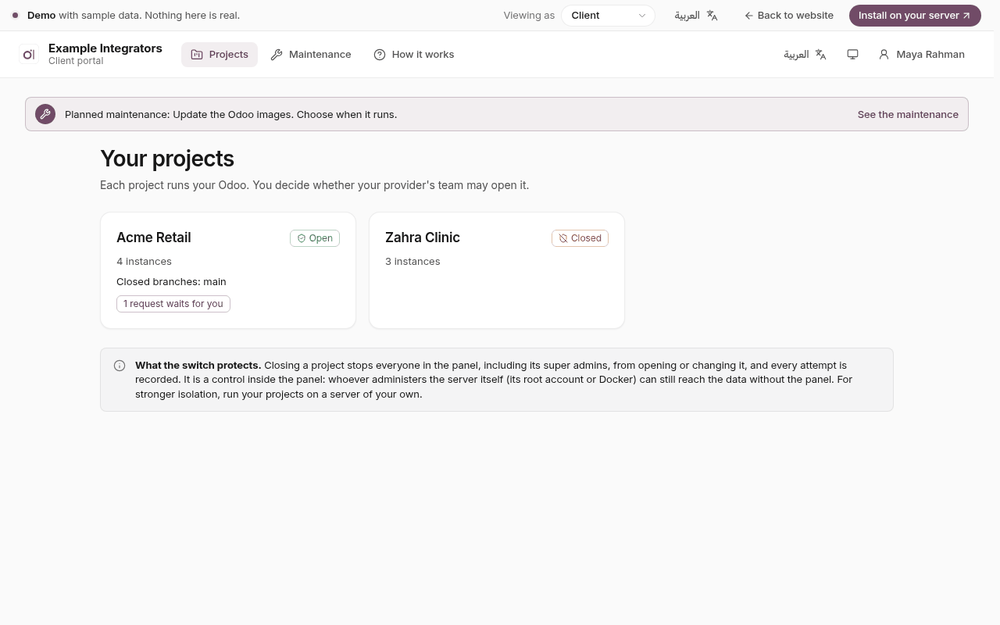

# Workflow: Client portal

[العربية](08-client-portal.ar.md) · [All workflows](README.md)

**Goal:** give a client a place to see their Odoo projects and decide whether your team may open them.

**Who can do it:** administrators add and remove clients on a project's **Clients** tab. The client uses the portal. Adding a client is a **Business plan** feature (the panel refuses it with a plan message otherwise). Super admins have emergency access only while the client allows it.

> **A closure is the client's decision.** While a project is closed nobody on your team can open, change, back up, restore, read logs or see passwords, super admins included, and every attempt is recorded. It is a control inside the panel. Whoever administers the server itself (root or Docker) can still reach the data. For stronger isolation, run the project on a server of its own.

## Steps for your team: add a client
1. Open the project and its **Clients** tab.
2. Click **Add a client**. Enter an existing client account (added at once) or a new e-mail address (an invitation is sent). You may give the client backups and a shell.
3. Tell the client where to sign in: the portal's own address when the operator set one (PORTAL_DOMAIN), otherwise the panel's address. A client account sees the portal and nothing else of the panel.
4. To remove a client use **Remove** in the Clients tab. They no longer see the project. The switch stays as it is.
5. When something is closed you see **Closed by client**. Use **Request access** on the project, branch or instance: write why and for how many hours. The client gets an e-mail and answers in the portal.

## What the client does
1. Open the project in **Your projects**. The switch under "Access by your provider's team" is **Open**, **Closed** or **Open until** a time (1, 4 or 24 hours by default, or a number they type up to the operator's maximum). (Figure 1)
2. Each **branch** follows the project unless given its own setting (production closed while development stays open).
3. **Access requests:** **Approve** (optionally choosing people and a shorter time) or **Refuse**. Approved access closes again by itself.
4. **Lock** the project or a branch: as strong as Closed, and nobody is let through, not even approved people. Only emergency access, if allowed. Only the client can unlock. Nothing is deployed to it automatically.
5. **Emergency access** is allowed by default for a short time (the operator's setting, 60 minutes by default) with a reason; the client is e-mailed at once. The client can turn it off per project.
6. **Activity log:** every action in the project, including data opened. **Export CSV** downloads up to a year.

## Confirming by e-mail
Every major change (opening, closing, locks, emergency access on or off, approving a request, the people let in) waits for the client's confirmation by an e-mailed link or 6-digit code, in the same browser, within the operator's time (shipped 15 minutes). Each works once. Nothing changes if they do not confirm. Refusing a request and ending someone's access happen at once. This needs e-mail to be set up on the panel and CLIENT_CONFIRMATIONS on (the default).

## Screenshots
From the demo with invented sample data. Nothing shown is a real account.

*Figure 1. The client portal: Your projects, with the switch of each. Shown in step 1.*

## What you see when it worked
The Clients tab lists the client. The client's portal shows the project and its switch. The activity log shows every access.

## Common problems
- **Adding a client is refused:** the plan does not include the client portal.
- **Your team cannot open a closed project:** that is the point. Send a request, or use emergency access if you are a super admin and the client allows it.
- **A client's confirmation does not arrive:** check the e-mail setup. The link works once, in the same browser, and expires.
- **A closed project is skipped by maintenance** unless the client lets it run.

## Review limits
Checked in code at 3.5.0: closure refuses people the client does not let through (projects/access.py closed_to), the Business-plan gate (entitlements.py), emergency, confirmation and open-hours defaults (config.py). Not traced: the e-mail texts, the confirmation flow, activity-log contents, and the statement that closing ends earlier approvals.
