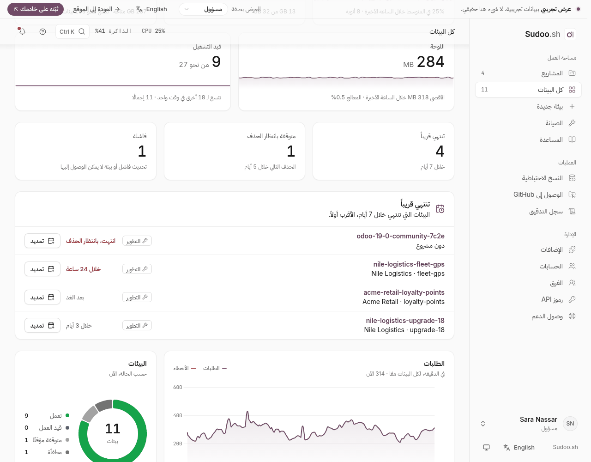

# سير العمل: انتهاء الصلاحية وتمديد البيئات

[English](09-expiry-and-extending.md) · [كل سير العمل](README.md)

**الهدف:** معرفة موعد انتهاء البيئة، وتمديدها في الوقت المناسب، وفهم ما يحدث إن لم تفعل.

**من يستطيع:** يظهر زر **تمديد** فقط لمن يحق له تغيير تلك البيئة. تقصير مدة البيئة يحتاج إلى حق حذف البيئات. والتمديد فوق الحدود أو تمديد بيئة متوقفة يحتاج إلى صلاحية `instances.extend_unlimited`.

> **البيئة التي تبلغ نهاية مدتها تُوقَف ثم تُحذف بعد مهلة.** تأخذ اللوحة نسخة احتياطية قبل الحذف. بيئات الإنتاج لا تنتهي أبدًا. مدّد قبل النهاية لا بعدها.

## كيف تنتهي البيئة
1. تُحسب المدة من الإنشاء. تحصل بيئات التطوير والتجهيز الجديدة على مدة افتراضية يحددها المشغّل (DELETE_AFTER_DAYS وSTAGING_DELETE_AFTER_DAYS، والقيمتان الافتراضيتان 30 و90 يومًا، و0 تعني الإبقاء). ويمكن لكل شخص اختيار مدة أخرى عند الإنشاء.
2. يُرسَل بريد إلى من يرعون البيئة قبل النهاية (EXPIRY_WARNING_DAYS، الافتراضي 3، و0 يعطّله).
3. عند النهاية **توقف** اللوحة البيئة وتبقي كل شيء. وتُحذف بعد EXPIRY_GRACE_DAYS (الافتراضي 7، و0 يعني فورًا). يُبلَّغ من يرعونها ويسجّل سجل التدقيق الإيقاف.
4. وهي متوقفة لا يستطيع تمديدها إلا من يملك `instances.extend_unlimited`، وبذلك تعمل من جديد.
5. الحذف يأخذ نسخة احتياطية أولًا. إذا فشلت لا تُحذف البيئة. وبعد 3 محاولات حذف تلقائية فاشلة متتالية تُطفئ اللوحة البيئة وتتوقف عن المحاولة حتى يحذفها أحد أو يعطيها مدة أخرى.

## خطوات تمديد بيئة
1. افتح صفحة **البيئات**. تعرض بطاقة **تنتهي قريباً** البيئات التي تنتهي خلال النافذة (EXPIRY_CARD_DAYS، الافتراضي 7)، الأقرب أولًا. أقل من 24 ساعة يتحول إلى كهرماني والمنتهية إلى أحمر. (الشكل 1)
2. اضغط **تمديد** على البيئة. اختر أحد التمديدات التي يتيحها المسؤول (EXPIRY_EXTEND_PRESETS، الافتراضي «1,7,30» يومًا) أو **عدد آخر من الأيام…** واكتب رقمًا.
3. تطبّق اللوحة حدود تبويب **الإعدادات** نفسها وتقول السبب إن رفضت. بدون صلاحية التمديد غير المحدود يُحدّ التمديد الواحد بـ EXPIRY_EXTEND_MAX_DAYS (الافتراضي 30) وبعدد مرات EXPIRY_EXTEND_MAX_COUNT (الافتراضي 1).
4. لرؤية كل بيئة لها تاريخ انتهاء اضغط **عرض الكل**.
5. للإبقاء الدائم افتح تبويب **الإعدادات** واختر **الإبقاء حتى الحذف يدويًا** (لم تُطابَق هذه التسمية مع ملف اللغة بعد). يستطيع المشرف إطالة المدة لا تقصيرها.

## لقطات الشاشة
من العرض التجريبي ببيانات مخترعة. لا شيء مما يظهر حساب حقيقي.

*الشكل 1. صفحة البيئات: تنتهي قريبًا، مع تمديد. يظهر في الخطوة 1.*

## ما تراه عند النجاح
تعرض البطاقة تاريخ الانتهاء الجديد أو تخرج البيئة من البطاقة. ويقول إشعار عدد الأيام المضافة.

## مشاكل شائعة
- **رُفض التمديد:** بلغتَ حد الأيام أو المرات. اطلب من يملك صلاحية التمديد غير المحدود.
- **البيئة متوقفة أصلًا:** تظهر «انتهت، بانتظار الحذف». لا يمدّدها إلا من يملك تلك الصلاحية. وبعد أيام المهلة تُحذف بعد نسخة احتياطية، وتبقى النسخة في النسخ الاحتياطية.

## اعرف المزيد
`#workflow-expiry-and-extending`
