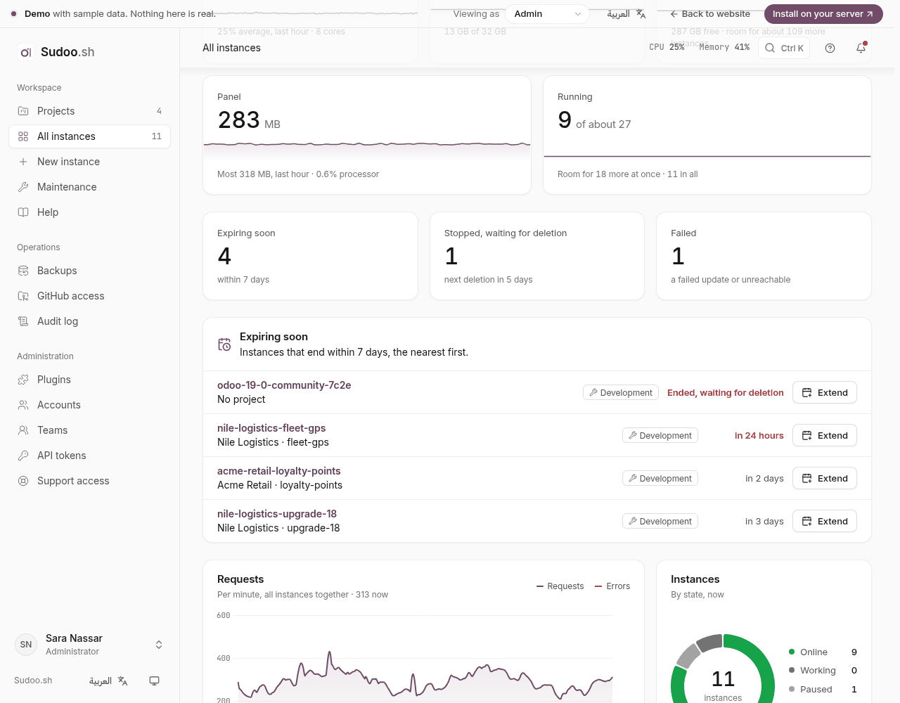

# Workflow: Expiry and extending instances

[العربية](09-expiry-and-extending.ar.md) · [All workflows](README.md)

**Goal:** know when an instance ends, extend it in time, and understand what happens if you do not.

**Who can do it:** the **Extend** button shows only to people who may change that instance. Giving an instance a shorter lifetime needs the right to delete instances. Extending beyond the limits, or extending a stopped instance, needs the `instances.extend_unlimited` permission.

> **An instance that reaches the end of its lifetime is stopped, and deleted after a grace period.** The panel takes a backup before deleting. Production instances never expire. Extend before the end, not after.

## How an instance ends
1. The lifetime counts from creation. New development and staging instances get a default lifetime set by the operator (settings DELETE_AFTER_DAYS and STAGING_DELETE_AFTER_DAYS; shipped defaults 30 and 90 days, 0 means keep). A person can choose another lifetime when creating.
2. The people who look after the instance are e-mailed before the end (EXPIRY_WARNING_DAYS, shipped default 3, 0 turns it off).
3. At the end the panel **stops** the instance and keeps everything. It is deleted EXPIRY_GRACE_DAYS later (shipped default 7, 0 means at once). The people who look after it are told, and the audit log records the stop. *(Source: operations.stop_expired, config.py.)*
4. While it is stopped only someone with `instances.extend_unlimited` can extend it, which starts it again.
5. The deletion first takes a backup. If the backup fails the instance is not deleted. After 3 failed automatic deletions in a row the panel switches the instance off instead and stops trying, until someone deletes it or gives it another lifetime. *(Source: operations.expire, DELETION_BACKUP_FAILED.)*

## Steps: extend an instance
1. Open the **Instances** page. The **Expiring soon** card lists instances ending within the window (EXPIRY_CARD_DAYS, shipped default 7), nearest first, at most EXPIRY_CARD_ROWS (shipped default 5). Under 24 hours turns amber, an ended one red. (Figure 1)
2. Click **Extend** on the instance. Choose one of the extensions the administrator offers (EXPIRY_EXTEND_PRESETS, shipped "1,7,30" days) or **Another number of days...** and type a number.
3. The panel applies the same limits as the instance's **Settings** tab and says why when it refuses. Without the extend-unlimited right, one extension is limited to EXPIRY_EXTEND_MAX_DAYS (shipped 30) and to EXPIRY_EXTEND_MAX_COUNT times (shipped 1).
4. To see every instance with an end date, click **See all**. It opens the list filtered by **With end date**.
5. To keep an instance for good, open its **Settings** tab and choose **Keep until deleted by hand** under Lifetime. A maintainer can make the lifetime longer, not shorter. Making an instance production also sets its lifetime to keep.

## Screenshots
From the demo with invented sample data. Nothing shown is a real account.

*Figure 1. The Instances page: Expiring soon, with Extend. Shown in step 1.*

## What you see when it worked
The card shows the new end date or the instance leaves the card. A toast says how many days were added.

## Common problems
- **Extend is refused:** the limit of days or times was reached. Ask someone with the extend-unlimited right.
- **The instance already stopped:** it shows as ended, waiting for deletion. Only someone with the extend-unlimited right can extend it. After the grace days it is deleted (after a backup). The backup stays in Backups.
- **Deleted tab:** shows recently deleted instances for DELETED_HISTORY_DAYS (shipped 90, 0 keeps nothing).
