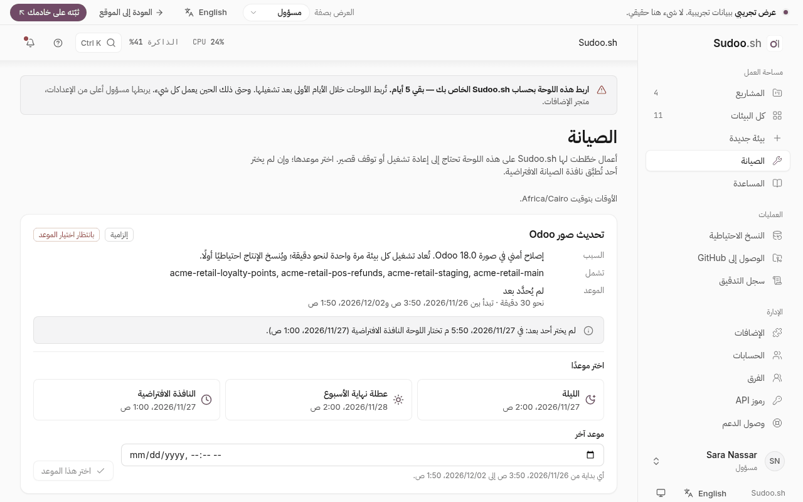

# سير العمل: نوافذ الصيانة

[English](10-maintenance-windows.md) · [كل سير العمل](README.md)

**الهدف:** اختيار موعد تنفيذ الأعمال المخططة على لوحتك، ومعرفة ما يراه الزوار والعملاء.

**من يستطيع:** المسؤولون الأعلى والمسؤولون (صلاحية `maintenance.manage`) يختارون الموعد. أما الآخرون والعملاء فيرونه. ويجب أن تكون اللوحة مرتبطة بـ Sudoo.sh حتى تصل الصيانة المخططة.

> **اختر وقتًا يقل فيه استخدام البيئات.** قد تُعاد تشغيل البيئة أثناء العمل ويرى الزوار صفحة «صيانة مجدولة». إذا لم يختر أحد تختار اللوحة النافذة الافتراضية بنفسها وتُعلمك بالبريد.

## الخطوات
1. يظهر شريط أعلى كل صفحة بموعد البدء وعدّ تنازلي بعد اختيار موعد. ويصل المسؤولين بريد أيضًا.
2. افتح **الصيانة** من القائمة. يعرض كل بند ما سيُنفَّذ ولماذا وعلى أي بيئات ومدته ومتى يجوز أن يبدأ (من أبكر بداية إلى الموعد النهائي).
3. اختر الموعد: **الليلة**، أو **عطلة نهاية الأسبوع**، أو **النافذة الافتراضية**، أو **موعد آخر** (أي بداية بين الحدين). الأوقات بتوقيت اللوحة. أوقات الإعداد الافتراضي هي إعدادات المشغّل، فاقرأ قيمها في الصفحة. (الشكل 1)
4. احفظ باختيار **اختر هذا الموعد**. ولمالك الحساب أن يختار على app.sudoo.sh أيضًا، ويسري آخر اختيار.
5. تصل تذكيرات إلى المسؤولين وعملاء المشاريع المتأثرة قبل البدء.
6. بعد التنفيذ افتح **الصيانة** لترى نتيجة كل خطوة، ويصل المسؤولين والعملاء بريد بالنتيجة.

## ما يُنفَّذ وبأي ترتيب
- تُعالَج البيئات واحدة بعد أخرى: التطوير أولًا ثم التجهيز ثم الإنتاج أخيرًا.
- عند صور Odoo الجديدة تُنسخ بيئات الإنتاج والتجهيز احتياطيًا أولًا (نسخة «قبل الصيانة»). ولا تأخذ هذه الخطوة نسخة لأنواع العمل الأخرى مثل إعادة التشغيل. ويجب أن يستجيب Odoo بعد ذلك وإلا تفشل الخطوة.
- بعد أي فشل لا تُمَسّ بيئة إنتاج في ذلك البند.
- تبقى البيئة المتوقفة متوقفة وتبدأ بالصور الجديدة عندما يفتحها أحد.
- تُتخطى البيئات على خوادم أخرى.

## إذا لم يختر أحد
إذا لم يختر أحد خلال المدة التي يحددها المشغّل، أو قبل الموعد النهائي بالمدة المحددة، تختار اللوحة أول نافذة افتراضية تناسب وتُبلغ بالبريد. وإذا فات الموعد النهائي يفشل البند الاختياري ويُنفَّذ الإلزامي في أقرب وقت.

## العملاء
يرى العملاء صيانة مشاريعهم في بوابة العميل ويصلهم بريدها. وإن سمح المزوّد يختارون الموعد بتأكيد بالبريد. المشروع الذي أغلقه العميل أو قفله يُتخطى ما لم يسمح العميل بالتنفيذ عليه («اسمح بتنفيذها على هذا المشروع»). ويُتخطى كذلك فرع قفله فريقك.

## لقطات الشاشة
من العرض التجريبي ببيانات مخترعة. لا شيء مما يظهر حساب حقيقي.

*الشكل 1. الصيانة: اختر موعد تنفيذ العمل المخطط. يظهر في الخطوة 3.*

## ما تراه عند النجاح
يعرض البند كل خطوة منتهية، وتستجيب البيئات من جديد، وفي سجل التدقيق مدخلات.

## اعرف المزيد
`#workflow-maintenance-windows`
