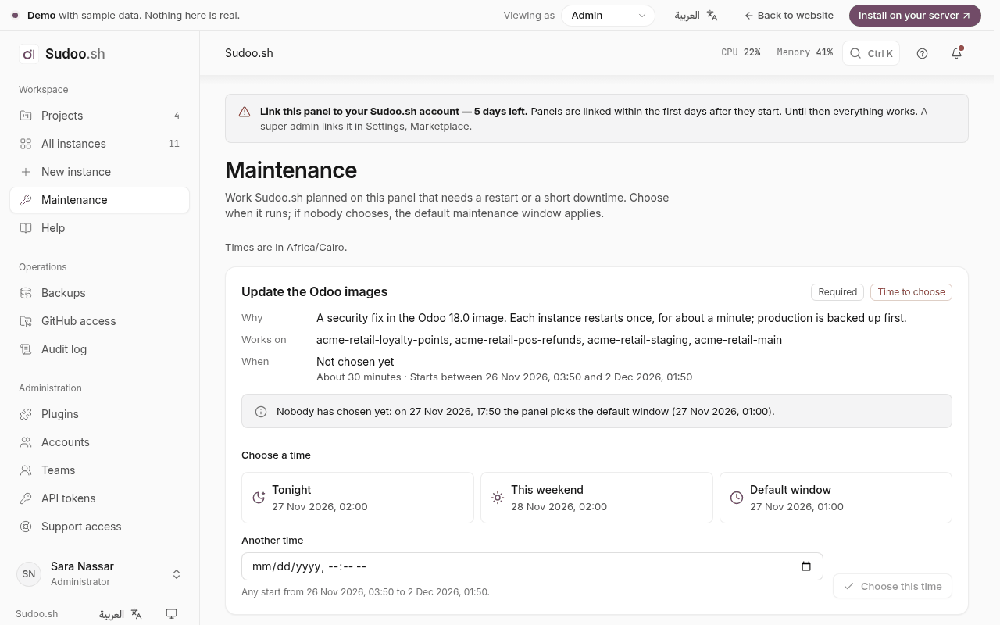

# Workflow: Maintenance windows

[العربية](10-maintenance-windows.ar.md) · [All workflows](README.md)

**Goal:** choose when planned work on your panel runs, and know what visitors and clients see.

**Who can do it:** super admins and administrators (permission `maintenance.manage`) choose the time. Everyone else, and clients, see it. The panel must be linked to Sudoo.sh for planned maintenance to arrive.

> **Choose a time when few people use the instances.** During the work an instance may restart and visitors see a **Scheduled maintenance** page. If nobody chooses, the panel picks the default window by itself and tells you by e-mail.

## Steps
1. A banner shows at the top of every page with the start time and a countdown once a time is chosen. Super admins and administrators also get an e-mail.
2. Open **Maintenance** in the menu. Each item shows what is done, why, which instances it works on, how long it takes, and when it may start (from its earliest start to its deadline).
3. Choose when: **Tonight**, **This weekend**, the **Default window**, or **Another time** (any start between the bounds). Times are in the panel's time zone. The default times (tonight 02:00, window 01:00-05:00 every day, the weekend day) are operator settings, so read yours on the page. Another time must be at least MAINTENANCE_LEAD_MINUTES from now. (Figure 1)
4. Save the choice. The account's owner may also choose on app.sudoo.sh, and the choice made last wins.
5. Reminders go to administrators and the clients of affected projects before it starts (MAINTENANCE_REMINDER_HOURS; shipped 24 and 1 hours).
6. After it ran, open **Maintenance** to see each step's result. Administrators and clients are e-mailed the result.

## What runs, and in what order
- Instances are handled one at a time: development first, then staging, production last. *(Source: maintenance.py, order.)*
- For new Odoo images, production and staging instances get a backup first (a "Before maintenance" backup; the setting MAINTENANCE_BACKUP_FIRST). For other kinds of work (such as a restart) that backup is not taken by this step. Odoo must answer afterwards or the step fails. *(Source: maintenance.work.)*
- After a failure, no production instance is touched in that item. *(Source: maintenance.py.)*
- A paused instance stays paused and starts with the new images when someone opens it.
- A panel restart waits until no job runs. A panel update asks for the new version and waits for it to be installed by the operator.
- Instances on other servers are skipped.

## If nobody chooses
If nobody chooses within MAINTENANCE_CHOOSE_HOURS of its arrival, or MAINTENANCE_CUTOFF_HOURS before its deadline, the panel picks the first default window that fits and says so by e-mail. If the deadline has passed, an optional item fails and a required one runs as soon as possible.

## Clients
Clients see the maintenance of their own projects in the client portal and get its e-mails. If the provider allows it (MAINTENANCE_CLIENT_CHOICE), they can choose the time too, confirmed by e-mail. A project the client closed or locked is skipped unless the client lets the maintenance run there (a button in the portal, confirmed by e-mail). A branch your own team locked is skipped too.

## Screenshots
From the demo with invented sample data. Nothing shown is a real account.

*Figure 1. Maintenance: choose when the planned work runs. Shown in step 3.*

## What you see when it worked
The item shows each step done. Instances answer again. The audit log has the entries.

## Common problems
- **No Maintenance page content:** the panel is not linked to Sudoo.sh, or nothing is planned.
- **An instance was skipped:** its branch is locked, its client closed it, or it is on another server. The step's detail says why.
- **A step failed on production's turn:** production was not touched after an earlier failure. Read the step's detail, fix the cause, and the operator can plan it again.
