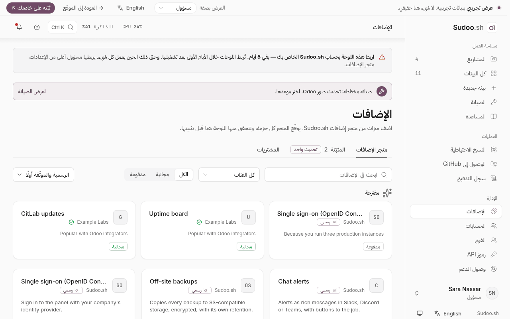

# سير العمل: الإضافات والسوق

[English](12-plugins-and-marketplace.md) · [كل سير العمل](README.md)

**الهدف:** العثور على إضافة وتثبيتها وتحديثها وإيقافها وإزالتها، وفهم ما يتضمنه شراء إضافة مدفوعة.

**من يستطيع:** **المسؤول الأعلى** فقط يثبّت ويشتري ويحدّث ويوقف ويزيل التثبيت ويربط اللوحة. المسؤولون يستطيعون النظر في صفحة الإضافات. أما المشرفون والمطورون والمشاهدون فلا.

> **المال:** اللوحة نفسها لا تخصم شيئًا أبدًا. يُدفع ثمن الإضافة المدفوعة في صفحة الدفع على app.sudoo.sh، ببطاقة محفوظة أو جديدة، من يفتح تلك الصفحة وهو مسجّل الدخول إلى الحساب المرتبط. اقرأ الخطة والسعر وسطر التجديد في تلك الصفحة قبل الدفع، فهي المرجع وليس هذا الدليل. إن كانت الخطة تتجدد فألغِها على app.sudoo.sh، فاللوحة لا تفعل ذلك، ولم يُتحقق في الكود من أن إزالة الإضافة تلغي الاشتراك. مغادرة الصفحة دون دفع لا تخصم شيئًا.

## خطوات تثبيت إضافة مجانية
1. افتح **الإضافات** في الشريط الجانبي (الإدارة). في تبويب **متجر الإضافات** صف **موصى بها** ثم الكتالوج. (الشكل 1)
2. افتح الإضافة واختر **ثبّت**. تتابع بطاقة العمل: سؤال المركز، التنزيل، فحص التوقيع، التحقق من ملاءمتها للوحة، التثبيت.
3. تعيد اللوحة تشغيل خلفيتها بنفسها خلال ثوانٍ. تستمر الواجهة والبيئات في العمل. تخبرك رسالة عند جاهزية الإضافة.
4. يُرفض التثبيت أثناء تشغيل مهام أخرى. انتظر انتهاءها. وإن فشلت خطوة تعرض **التفاصيل** السبب.

## خطوات شراء إضافة مدفوعة
1. اربط اللوحة مرة واحدة. على app.sudoo.sh افتح **الخوادم** ثم **ربط خادم** وانسخ الرمز لمرة واحدة (صالح 15 دقيقة). في اللوحة افتح **الإعدادات** ثم **السوق**، الصق الرمز واختر **ربط**. يربط الحساب خادمًا واحدًا.
2. افتح الإضافة واختر خطة. اقرأ السعر المعروض.
3. اختر **اشترِ على app.sudoo.sh**. يُفتح تبويب جديد على صفحة الدفع. يدفع هناك من يفتح الصفحة وهو مسجّل الدخول إلى الحساب المرتبط.
4. تعرض اللوحة «بانتظار الدفع في التبويب الآخر». عند نجاح الدفع تُثبَّت الإضافة بنفسها. وتُعاد محاولة البطاقة المرفوضة في الصفحة نفسها. الصفحة غير المدفوعة تنتهي بعد 30 دقيقة ولا يُخصم شيء.
5. لا يظهر زر الشراء إذا لم تكن اللوحة مرتبطة أو إذا عُطّل الدفع في السوق أو إذا كان الخادم موسومًا.

## التراخيص
للإضافة المدفوعة ترخيص لهذا الخادم. قبل انتهائه بسبعة أيام يظهر شريط ويصل المسؤولين الأعلى بريد. إذا انتهى دون تجديد تعمل الإضافة طوال مهلة، ثم تنسخ اللوحة بياناتها احتياطيًا و**توقف الإضافة مع إبقاء بياناتها وإعداداتها**. التجديد لاحقًا يعيد تشغيلها. لا يُحذف شيء عند انتهاء الترخيص. طول المهلة إعداد، فاقرأه في لوحتك.

## التحديث والإيقاف وإزالة التثبيت
- **التحديث** (تبويب المثبّتة): ينزّل الإصدار الجديد ويفحصه ويستبدل القديم ثم تُعاد تشغيل اللوحة.
- **إدارة ← أوقفها:** تبقى الملفات والبيانات وتُعاد تشغيل اللوحة. يُرفض إذا كانت إضافة مثبّتة أخرى تحتاج إليها.
- **إدارة ← أزل التثبيت** ثم اكتب معرّف الإضافة: تأخذ اللوحة نسخة احتياطية لبياناتها أولًا، ثم تزيل ملفات الإضافة وسجلها وتعيد التشغيل. **إزالة التثبيت قرار متعمّد للمسؤول الأعلى. تأكد أن لا شيء آخر يعتمد على الإضافة.**

## لقطات الشاشة
من العرض التجريبي ببيانات مخترعة. لا شيء مما يظهر حساب حقيقي.

*الشكل 1. الإضافات: تبويب المتجر. يظهر في الخطوة 1.*

## ما تراه عند النجاح
تظهر الإضافة في **المثبّتة** بإصدارها، ومع المدفوعة تواريخ ترخيصها.

## مشكلات شائعة
- **رُفض التثبيت:** هناك مهام أخرى تعمل. انتظر.
- **بانتظار الدفع:** يتم الدفع في التبويب الآخر، من يفتح صفحة الدفع على app.sudoo.sh.
- **أُوقفت إضافة:** انتهى ترخيصها ومضت مهلة السماح. جدّده.

## حدود المراجعة
تحققنا في الكود من أن إزالة التثبيت تأخذ نسخة احتياطية أولًا (plugin_manager.py). وفي كود صفحة الدفع على app.sudoo.sh: يمكن اختيار بطاقة محفوظة أو جديدة، وإلغاء الدفع لا يخصم شيئًا، وتبقى الصفحة مفتوحة 30 دقيقة، وتعرض سطر التجديد لكل خطة. لم نتحقق من أن مالك الحساب وحده يستطيع الدفع، ولا من إلغاء الاشتراك عند إزالة الإضافة. قواعد المال مصدرها صفحة الدفع نفسها. الأدوار والخطط والأسعار ومهلة السماح من MARKETPLACE.md فقط، ولم يُشترَ أو يُثبَّت أو يُتصل بشيء.

## اعرف المزيد
`#workflow-plugins-and-marketplace`
