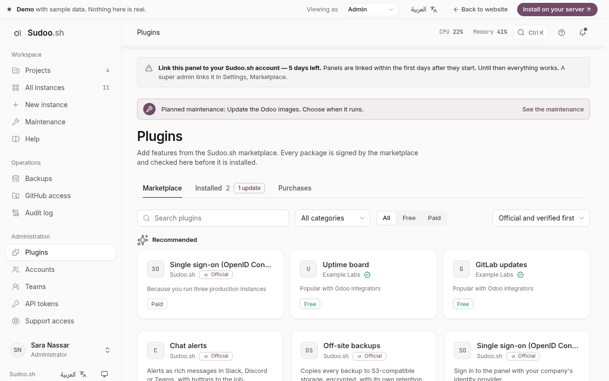

# Workflow: Plugins and the marketplace

[العربية](12-plugins-and-marketplace.ar.md) · [All workflows](README.md)

**Goal:** find, install, update, switch off or remove a plugin, and understand what buying a paid one involves.

**Who can do it:** only a **super admin** installs, buys, updates, switches off, uninstalls or links the panel. Administrators can look at the Plugins page. Maintainers, developers and viewers cannot.

> **Money:** the panel itself never charges anything. A paid plugin is paid for on the checkout page of app.sudoo.sh, with a saved card or a new card, by the person who opens that page signed in to the linked account. Read the plan, the price and the renewal line on that page before you pay: they are the authority, not this manual. If a plugin's plan says it renews, cancel it on app.sudoo.sh; the panel does not do that for you, and removing the plugin from the panel is not shown to cancel a subscription (not checked in code). Leaving the page without paying charges nothing.

## Steps: install a free plugin
1. Open **Plugins** in the sidebar (Administration). The **Marketplace** tab has a **Recommended** row, then the catalogue with search, categories, Free or Paid and ordering. (Figure 1)
2. Open the plugin and choose **Install**. A card follows the work: asking the hub, downloading, checking the signature, checking that it suits this panel, installing.
3. The panel restarts its backend by itself, which takes a few seconds. The web app and the instances keep running. A message says when the plugin is ready.
4. Installing is refused while other jobs run. Wait for them to finish. If a step fails, **Details** shows why.

## Steps: buy a paid plugin
1. Link the panel once. On app.sudoo.sh open **Servers**, **Link a server**, copy the one-time code (valid 15 minutes). In the panel open **Settings**, **Marketplace**, paste it and choose **Link**. An account links one server.
2. Open the plugin and choose a plan. Read the price shown: monthly, yearly, fixed term (paid once) or one time (a licence that does not expire).
3. Choose **Buy on app.sudoo.sh**. A new tab opens on the payment page signed in as the linked account. It shows the plugin, the plan, the server and who asked. Whoever opens that page signed in to the linked account pays there.
4. Back in the panel the plugin says **Waiting for payment in the other tab**. When the payment goes through the plugin installs by itself. A declined card can be retried on the same page. An unpaid page expires after 30 minutes and nothing is charged.
5. The Buy button is not offered when the panel is not linked, when payments are switched off on the marketplace, or when this server is flagged.

## Licences
A paid plugin has a licence for this server. Seven days before it ends a banner shows and super admins are e-mailed. If it ends without renewal the plugin keeps running for a grace period, then the panel backs up its own data (and instances when the plugin may change them) and **switches the plugin off, keeping its data and settings**. A later renewal switches it on again. Nothing is deleted when a licence ends. The grace length is a setting; read it on your panel.

## Update, switch off, uninstall
- **Update to vX** (Installed tab): downloads and checks the new version, replaces the old one and restarts the panel.
- **Manage, Switch off or Switch on:** the files and data stay and the panel restarts. Refused while another installed plugin needs it.
- **Manage, Uninstall**, then type the plugin's id: the panel takes a backup of its own data first, then removes the plugin's files and record and restarts. Refused while another installed plugin needs it. **Uninstalling is a super admin's deliberate action. Check that nothing else depends on the plugin.** *(Code: plugin_manager.uninstall makes a "before-uninstall" backup first.)*

## Screenshots
From the demo with invented sample data. Nothing shown is a real account.

*Figure 1. Plugins: the Marketplace tab. Shown in step 1.*

## What you see when it worked
The plugin appears on **Installed** with its version, and for a paid one its licence dates. Purchases lists receipts and purchases with **Export CSV**.

## Common problems
- **Install refused:** other jobs are running. Wait.
- **Waiting for payment:** the payment is made in the other tab, by whoever opens the checkout page on app.sudoo.sh.
- **A plugin was switched off:** its licence ended and the grace period passed. Renew it.
- **"Its files were changed":** switching it on is not possible, install it again.

## Review limits
Checked in code: uninstall backs up first (plugin_manager.py). On the account site (app.sudoo.sh checkout code): a saved or a new card can be chosen, cancelling a checkout charges nothing, a checkout stays open for 30 minutes, and the page shows each plan's renewal line. Not checked: that only the account owner can pay, whether a subscription cancels when a plugin is uninstalled, and what a card issuer does. Money rules come from the checkout page itself. The roles, the plans and prices, the grace period, the payment page, the licence timing and the hub signature checks are from MARKETPLACE.md only, and nothing was bought, installed or contacted. Plans and prices on the page are the hub's, so none are written here.
