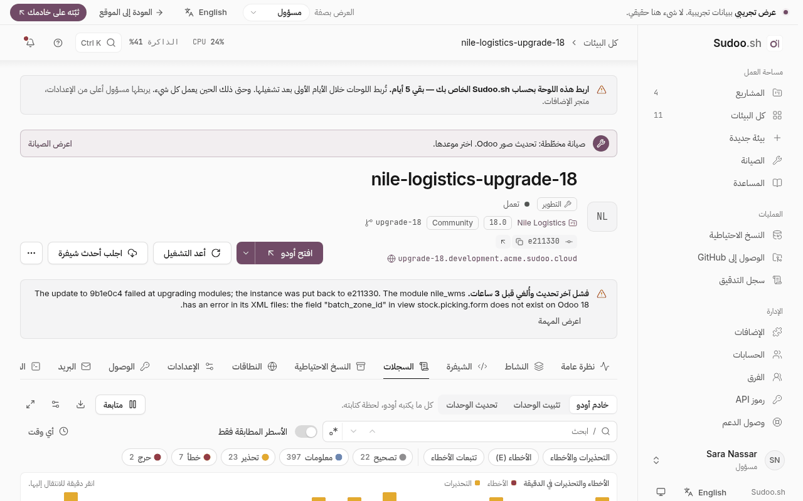

# سير العمل: استكشاف أخطاء الأبنية

[English](13-troubleshooting-builds.md) · [كل سير العمل](README.md)

**الهدف:** معرفة سبب فشل بناء أو تحديث أو مهمة، وماذا تفعل، دون أن تزيد الأمر سوءًا.

**من يستطيع:** كل من يستطيع فتح البيئة أو المشروع يرى تبويبي **النشاط** و**الأبنية**. بعض الحلول تحتاج إلى دور معيّن ([أعضاء الفريق والأدوار](07-team-members-and-roles.ar.md)). وأوامر الخادم (المعلَّمة أدناه) لمسؤول الخادم.

> **لا تُعد المحاولة عشوائيًا على الإنتاج.** التحديث الفاشل على بيئة ذات تحديثات آمنة تعيده اللوحة بنفسها (انظر «تحديث Odoo والشيفرة»). اقرأ الرسالة أولًا. والاستعادة والرجوع يستبدلان البيانات الحالية.

## الخطوات
1. اقرأ الرسالة. تشرح اللوحة الإخفاقات بكلمات واضحة. (الشكل 1)
2. افتح تبويب **الأبنية** في المشروع. يعرض كل فرع آخر أبنيته جنبًا إلى جنب: عنوان الإيداع والكاتب والعمر والمدة وشريطًا ملوّنًا (أخضر نجح، كهرماني تحذير، أحمر فشل، رمادي استُبدل، خطوط متحركة أثناء البناء). اضغط بناءً لفتح إيداعه على GitHub.
3. افتح المهمة في تبويب **النشاط** بالبيئة واقرأ **سبب الفشل**: الخطوة التي فشلت وسببها وتفاصيل الخطأ.
4. انظر تبويب **السجلات** إن لم يبدأ Odoo. وجرّب إعادة التشغيل إن بدا Odoo غريب السلوك. (الشكل 1)
5. إن غاب زر أو رُفض، فربما لا يشمله دورك. تذكر اللوحة الصلاحية الناقصة.
6. إن بقيت المشكلة، راسل المسؤول المذكور في صفحة الدخول. اذكر البيئة وما فعلته وما قالته الرسالة.

## إخفاقات شائعة
| ما تراه | السبب المرجّح | ما تفعله |
| :--- | :--- | :--- |
| فشل التحديث: الفرع لم يعد موجودًا على GitHub (أو لم يُجلب مرجع) | حُذف الفرع، غالبًا بعد دمج طلب السحب | من القائمة اختر **بدّل الفرع…** واختر الفرع الذي تتبعه الآن. |
| فشل التحديث: «تفرّق المساران» | غُيّر شيء مباشرة في مجلد الإضافات بالبيئة | يعيد مطوّر ضبط ذلك المجلد على فرع GitHub. |
| التغييرات لا تظهر في Odoo | لم تُرقَّ الوحدة | **الترقية**، أو شغّل ترقية الوحدات المتغيّرة. |
| البيئة «متوقفة» | تعطّل Odoo، غالبًا لنفاد الذاكرة | شغّلها، وأوقف بيئات أخرى مؤقتًا، وافحص ذاكرة الخادم (المسؤول). |
| فشلت استعادة | الملف تالف أو لم تبدأ قاعدة البيانات | يعرض تبويب النشاط الخطوة. استخدم الرجوع إلى ما قبل الاستعادة إن عُرض. |
| أُعيد تحديث ولا يُعاد المحاولة | الإيداع الذي فشل لا تعيده التحديثات التلقائية | ادفع إصلاحًا، أو اضغط **اجلب أحدث شيفرة** لتجربة الإيداع نفسه مجددًا. |
| «قيد البدء» عدة دقائق | لا يبدأ Odoo | اقرأ تبويب **السجلات**. |
| «سبب الفشل» لا يكفي | يعرض الأسطر التي تفسّر الفشل فقط | يقرأ المسؤول سجل المهمة الكامل على الخادم (رقم المهمة في العنوان بعد `?job=`). |
| الدفعات لا تبدأ تحديثات فورًا | مُشغّل GitHub مطفأ، أو لا يصل GitHub إلى اللوحة | المسؤول: راجع مُشغّلات التحديث في الإعدادات وآخر التسليمات للتطبيق على GitHub. |

## لقطات الشاشة
من العرض التجريبي ببيانات مخترعة. لا شيء مما يظهر حساب حقيقي.

*الشكل 1. تبويب السجلات في بيئة، وفوقه رسالة فشل التحديث. يظهر في الخطوة 1, 4.*

## ما تراه عند النجاح
تصبح المهمة في **النشاط** خضراء، ويصبح شريط البناء في تبويب الأبنية أخضر.

## حدود المراجعة
جدول هذه الصفحة مأخوذ من جدول استكشاف الأخطاء في دليل المسؤول ومن دليل المستخدم (القسمان 2 و14). سلوك التحديث والرجوع فُحص في الشيفرة (operations.update_code، التحديثات الآمنة). لم تُعاد صياغة الصفوف الأخرى وأسبابها بالتجربة، وألوان تبويب الأبنية والبحث عن سجل المهمة من الدليل فقط. أُهملت أوامر الخادم عمدًا. أسماء التبويبات والأزرار من ملفات الترجمة العربية للوحة، وبعض عبارات الصفوف (مثل «تفرّق المساران») ترجمة للنص الإنجليزي وليست نصًا من اللوحة.
