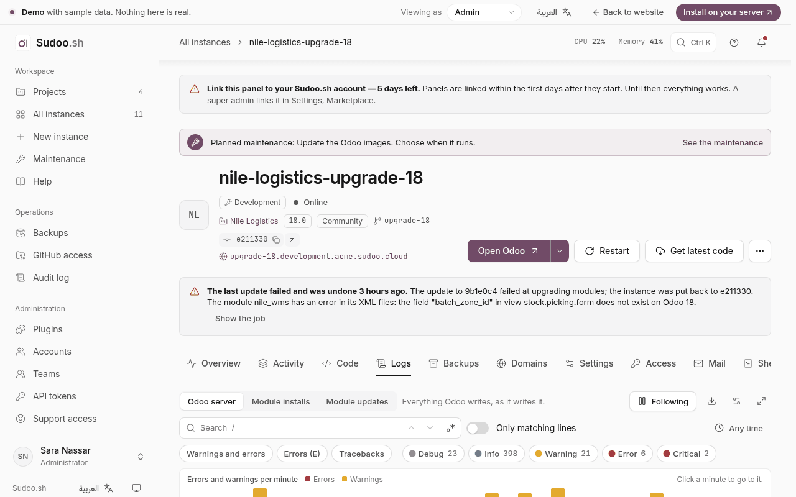

# Workflow: Troubleshooting builds

[العربية](13-troubleshooting-builds.ar.md) · [All workflows](README.md)

**Goal:** find out why a build, update or job failed and what to do, without making things worse.

**Who can do it:** anyone who can open the instance or project sees the **Activity** tab and the **Builds** tab. Some fixes need a role ([Team members and roles](07-team-members-and-roles.md)). Server commands (marked below) are for the administrator of the server.

> **Do not retry blindly on production.** A failed update on a safe-updates instance has already been put back by the panel (see "Updating Odoo and your code"). Read the message first. Restoring or rolling back replaces current data.

## Steps
1. Read the message. The panel explains failures in plain words. (Figure 1)
2. Open the project's **Builds** tab. Each branch shows its last builds side by side: commit subject, author, age, duration and a coloured band (green passed, amber warning, red failed, grey replaced, moving stripes while building). Press a build to open its commit on GitHub.
3. Open the job in the instance's **Activity** tab and read **Why it failed**: the step that failed, the reason and the error details.
4. Look at the instance's **Logs** tab if Odoo does not start. Try **Restart** if Odoo behaves strangely. (Figure 1)
5. If a button is missing or refused, your role may not include it. The panel says which permission is missing.
6. If it is still unsolved, contact the administrator named on the sign-in page. Say which instance, what you did and what the message said.

## Common failures
| What you see | Likely cause | What to do |
| :--- | :--- | :--- |
| Update fails: the branch no longer exists on GitHub (or no such ref was fetched) | The branch was deleted, usually after its pull request was merged | In the menu choose **Switch branch** and pick the branch to follow now. |
| Update fails: "went in different directions" | Something was changed directly in the instance's addons folder | A developer resets that folder to the GitHub branch. |
| Changes are not visible in Odoo | The module was not upgraded | **Upgrade modules**, or turn on **Upgrade changed modules**. |
| Instance "Stopped" | Odoo crashed, often out of memory | **Start**, pause other instances, check the server's memory (administrator). |
| A restore failed | The backup file is damaged, or the database did not start | The Activity tab shows the step. Use **Rollback to before the restore** if it is offered. |
| An update was rolled back and is not retried | A commit that failed is not retried by automatic updates | Push a fix, or click **Get latest code** to try the same commit again. |
| "Starting up" for several minutes | Odoo fails to start | Read the **Logs** tab. |
| "Why it failed" is not enough | It shows only the lines that explain the failure | The administrator reads the full job log on the server (the job's id is in the address after `?job=`). |
| Pushes do not start updates at once | The GitHub trigger is off, or GitHub cannot reach the panel | Administrator: check the update triggers in Settings and the app's recent deliveries on GitHub. |

## Screenshots
From the demo with invented sample data. Nothing shown is a real account.

*Figure 1. An instance's Logs tab, with the failed-update message above it. Shown in step 1, 4.*

## What you see when it worked
The job in **Activity** turns green and the build band on the Builds tab is green.

## Review limits
This page's table is taken from the Administrator guide's troubleshooting table and the User Manual (sections 2 and 14). The update and rollback behaviour was checked in code (operations.update_code, safe updates). The other rows, and their causes, were not reproduced, and the Builds tab colours and the job log lookup are from the manual only. Server commands are deliberately left out of this page.
