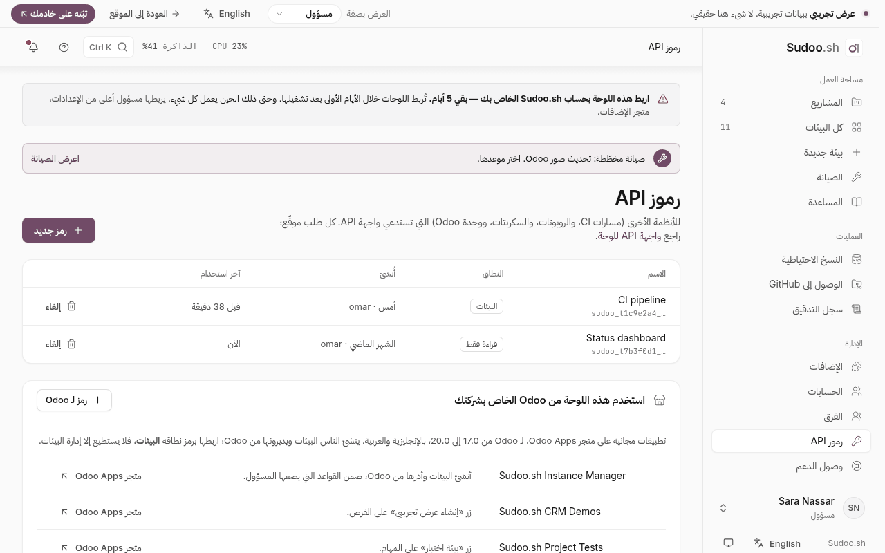
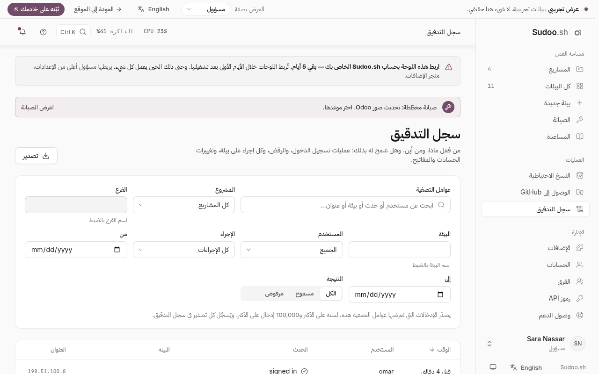

# سير العمل: قائمة الأمان للمسؤولين

[English](14-security-checklist.md) · [كل سير العمل](README.md)

**الهدف:** فحص الإعدادات والعادات التي تحمي اللوحة وبيانات بيئاتك.

**من يستطيع:** المسؤولون الأعلى (الإعدادات وإعادة تشغيل اللوحة) والمسؤولون (الحسابات وسجل التدقيق والنسخ الاحتياطية). الإعدادات المعلَّمة «المشغّل» في إعدادات اللوحة أو `.env`.

> **غيّر شيئًا واحدًا كل مرة، ودوّن ما غيّرته.** بعض الإعدادات تحتاج إلى إعادة تشغيل اللوحة. لا تُطفئ حماية لتزول مشكلة دون أن تعرف سبب عملها.

## القائمة
في كل سطر: ما تفحصه، وأين، وكيف تبدو القيمة الآمنة. القيم الافتراضية هي المشحونة في الشيفرة عند 3.5.0. اقرأ قيمة لوحتك أنت.

1. **العامل الثاني.** الإعداد REQUIRE_SECOND_FACTOR: «none» أو «admins» أو «everyone». المشحون: **admins** (على المسؤولين الأعلى والمسؤولين إعداد عامل). فكّر في «everyone» إن رأى العملاء أو المطوّرون بيانات حساسة. العوامل المعروضة: SECOND_FACTORS (المشحون «email,totp»). ورموز البريد تحتاج إلى إعداد البريد أولًا. *(الشيفرة: config.py.)* تحقق في **الحسابات** أن لكل مسؤول عاملًا ثانيًا.
2. **الحسابات.** افتح **الحسابات** وراجع دور كل شخص وآخر دخول له. أزل حسابات من غادروا. استخدم أدنى دور يكفي ([أعضاء الفريق والأدوار](07-team-members-and-roles.ar.md)). أبقِ شخصين على الأقل قادرين على استرداد الوصول، لأن آخر مسؤول أعلى لا يُزال.
3. **فقدان العامل الثاني.** استخدم **أزل عوامل التحقق الثانية** بعد أن تتأكد أن الطلب من صاحب الحساب.
4. **سطر الأوامر.** الإعداد SHELL_PRODUCTION: «off» أو «super_admins» أو «allowed». المشحون: **super_admins**. وسطر الأوامر بصلاحية root (SHELL_ROOT) المشحون **مطفأ**. كل جلسة تُؤكَّد عند فتحها. أبقِ جلسات الإنتاج ضيقة. *(الشيفرة: config.py.)*
5. **وصول الدعم.** الإعداد SUPPORT_ACCESS (المشحون **مفعّل**، ميزة مدفوعة) يتيح لك منح دعم Sudoo.sh وصولًا **مؤقتًا**: عرض، أو مسؤول اللوحة، أو مسؤول اللوحة مع سطر أوامر، لمدة ساعة أو يوم أو 3 أيام (حتى SUPPORT_ACCESS_MAX_HOURS، المشحون 72). تبقى الفروع المقفلة مقفلة. يمكنك السحب أو **إنهاء الآن** في أي وقت. أطفئ الإعداد إن لم ترد ذلك أبدًا. امنح أقل مستوى وأقصر مدة. *(الشيفرة: config.py، والباقي من دليل المسؤول.)*
6. **رموز API.** راجعها في **رموز API**. رمز الكتابة يعمل كمسؤول ورمز القراءة كمشاهد. احذف رموزًا لا يستخدمها أحد. ولا يفتح أي رمز سطر أوامر. (الشكل 1)
7. **سجل التدقيق.** اقرأه من وقت لآخر (**سجل التدقيق**). يسجل الدخول والتغييرات والمحاولات المرفوضة وتجاوزات مثل «الترقية على أي حال». (الشكل 2)
8. **النسخ الاحتياطية.** تأكد أن النسخ اليومية تعمل وأن لديك نسخة خارج الخادم (دليل المسؤول، القسم 20). جرّب الاستعادة على نسخة، لا على الإنتاج. انظر [النسخ الاحتياطية والاستعادة](04-backups-and-restores.ar.md).
9. **عنوان اللوحة والشهادة.** ينبغي أن يكون للوحة اسمها الخاص وشهادة صالحة (الإعدادات، العناوين والنطاقات). تحذير شهادة في المتصفح يعني أنها تستخدم شهادتها الخاصة دون اسم.
10. **البريد.** أعدّ البريد ليصل الناس الدعوات وتحذيرات الانتهاء ورموز الدخول. استخدم **إرسال تجربة**. ولـ Gmail استخدم كلمة مرور تطبيق.
11. **GitHub.** فضّل تطبيق GitHub على مفاتيح النشر. امنح التطبيق الصلاحيات التي تحتاجها فقط. ولا تمنح صلاحية إنشاء المستودعات (الإدارة: كتابة) إلا إن أردت إنشاء مشاريع من اللوحة.
12. **المشاريع والأقفال.** استخدم وصول المشروع وأقفال الفروع لئلا يصل إلى الإنتاج إلا من ينبغي (الفرق والوصول لكل مشروع ميزتان مدفوعتان). اقفل فروع الإنتاج التي يجب ألا تتغير.
13. **مشاريع العملاء.** تذكّر أن العميل يستطيع إغلاق مشروعه على فريقك. ومن يملك root على الخادم يصل إلى البيانات رغم ذلك، فالعميل الذي يحتاج عزلًا قويًا يلزمه خادم خاص.
14. **التحديثات.** حدّث اللوحة (دليل المسؤول، القسم 4) واقرأ ملاحظات الإصدار. وجرّب الإضافة أو التحديث على بيئة التجهيز أولًا.

## ما تراه عند الانتهاء
لكل مسؤول عامل ثانٍ، وإعدادات سطر الأوامر والدعم تطابق سياستك، والرموز والحسابات مراجَعة، ونجحت تجربة استعادة على نسخة.

## مشكلات شائعة
- شخص مقفل خارج حسابه: يستخدم مسؤول آخر **أزل عوامل التحقق الثانية**، أو يعيد مسؤول الخادم تعيين كلمة المرور من سطر الأوامر (دليل المسؤول، القسم 11).
- لا تُعرض رموز البريد: البريد غير معدّ أو «email» ليست في SECOND_FACTORS.

## حدود المراجعة
القيم الافتراضية لـ REQUIRE_SECOND_FACTOR وSECOND_FACTORS وSHELL_PRODUCTION وSHELL_ROOT وSUPPORT_ACCESS وSUPPORT_ACCESS_MAX_HOURS قُرئت من config.py عند 3.5.0. وكل ما عداها من دليل المسؤول ودليل المستخدم ولم يُجرَّب. هذه قائمة فحص، وليست تدقيقًا أمنيًا ولا ضمانًا. أسماء الأقسام والأزرار من ملفات الترجمة العربية للوحة؛ وعبارة «الترقية على أي حال» من ملف ترجمة الترقية (promotion.ts).

## لقطات الشاشة
من العرض التجريبي ببيانات مخترعة. لا شيء مما يظهر حساب حقيقي.

*الشكل 1. رموز API. يظهر في البند 6.*

*الشكل 2. سجل التدقيق. يظهر في البند 7.*
