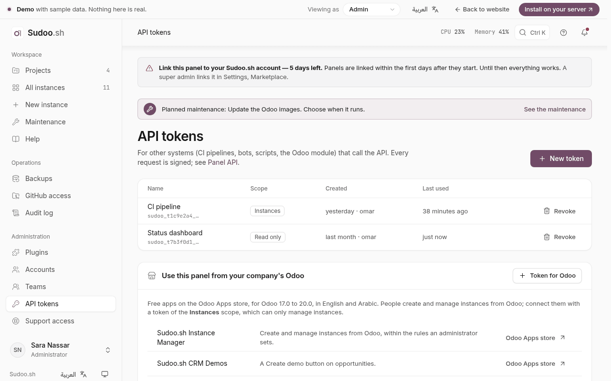
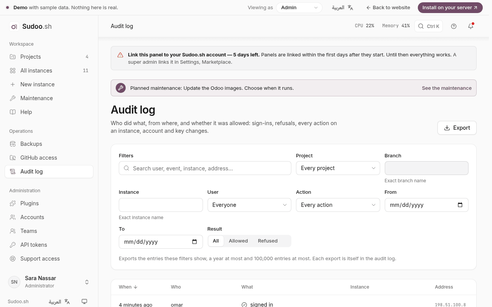

# Workflow: Security checklist for admins

[العربية](14-security-checklist.ar.md) · [All workflows](README.md)

**Goal:** check the settings and habits that protect the panel and the data of your instances.

**Who can do it:** super admins (Settings, restart the panel) and administrators (Accounts, audit log, backups). Settings marked "operator" are in the panel's Settings or `.env`.

> **Change one thing at a time, and write down what you changed.** Some settings need a panel restart. Do not turn a protection off to make a problem go away without knowing why it fired.

## The checklist
Each line: what to check, where, and what a safe value looks like. Defaults are the shipped ones in code at 3.5.0. Read your own panel's value.

1. **Second factor.** Setting REQUIRE_SECOND_FACTOR: "none", "admins" or "everyone". Shipped: **admins** (super admins and administrators must set one up). Consider "everyone" if clients or developers see sensitive data. Factors offered: SECOND_FACTORS (shipped "email,totp"). E-mail codes need e-mail to be set up first. *(Code: config.py.)* Check on **Accounts** that each admin has a second factor.
2. **Accounts.** Open **Accounts** and review each person's role and last sign-in. Remove accounts that left. Use the lowest role that works ([Team members and roles](07-team-members-and-roles.md)). Keep at least two people who can recover access, because the last super admin cannot be removed.
3. **Lost second factor.** Use **Remove second factors** only after you are sure the request is from that person.
4. **Shells.** Setting SHELL_PRODUCTION: "off", "super_admins" or "allowed". Shipped: **super_admins**. Root shells (SHELL_ROOT) are shipped **off**. Every shell is confirmed when it is opened. Keep production shells narrow. *(Code: config.py.)*
5. **Support access.** Setting SUPPORT_ACCESS (shipped **on**, a premium feature) lets you grant Sudoo.sh support a **temporary** access: View, Panel admin, or Panel admin + shell, for 1 hour, 1 day or 3 days (up to SUPPORT_ACCESS_MAX_HOURS, shipped 72). Locked branches stay locked. Withdraw or **End now** at any time. Turn the setting off if you never want it. Grant the least level and the shortest time. *(Code: config.py; the rest is from the Admin guide.)*
6. **API tokens.** Review them on **Accounts, API tokens**. A write token acts as an Administrator and a read token as a Viewer. Delete tokens nobody uses. No token can open a shell. (Figure 1)
7. **Audit log.** Read it from time to time (**Audit log**). It records sign-ins, changes, refused attempts and overrides such as "promote anyway". (Figure 2)
8. **Backups.** Check that daily backups run and that you have an off-site copy (Admin guide, section 20). Test a restore on a copy, not on production. See [Backups and restores](04-backups-and-restores.md).
9. **Panel address and certificate.** The panel should have its own name and a valid certificate (Settings, Addresses and domains). A browser certificate warning means it is using its own certificate without a name.
10. **E-mail.** Set up e-mail so people get invitations, expiry warnings and sign-in codes. Use **Send a test**. For Gmail use an app password.
11. **GitHub.** Prefer the GitHub App over deploy keys. Give the app only the permissions you need. Create new-repository access (Administration: write) only if you want projects created from the panel.
12. **Projects and locks.** Use project access and branch locks so only the right people reach production (teams and per-project access are premium). Lock production branches that must not change.
13. **Client projects.** Remember that a client can close their project to your team. Root on the server can still reach the data, so a client needing strong isolation should have a server of their own.
14. **Updates.** Keep the panel updated (Admin guide, section 4) and read release notes. A plugin or update should be tested on staging first.

## What you see when it is done
Each admin has a second factor, shell and support settings match your policy, tokens and accounts are reviewed, and a restore test succeeded on a copy.

## Common problems
- Someone is locked out: another administrator uses **Remove second factors**, or the server administrator resets the password from the command line (Admin guide, section 11).
- E-mail codes are not offered: e-mail is not set up or "email" is not in SECOND_FACTORS.

## Review limits
Defaults of REQUIRE_SECOND_FACTOR, SECOND_FACTORS, SHELL_PRODUCTION, SHELL_ROOT, SUPPORT_ACCESS and SUPPORT_ACCESS_MAX_HOURS are read from config.py at 3.5.0. Everything else is from the Admin guide and User Manual and was not tested. This is a checklist, not a security audit and not a guarantee.

## Screenshots
From the demo with invented sample data. Nothing shown is a real account.

*Figure 1. API tokens. Shown in item 6.*

*Figure 2. The audit log. Shown in item 7.*
